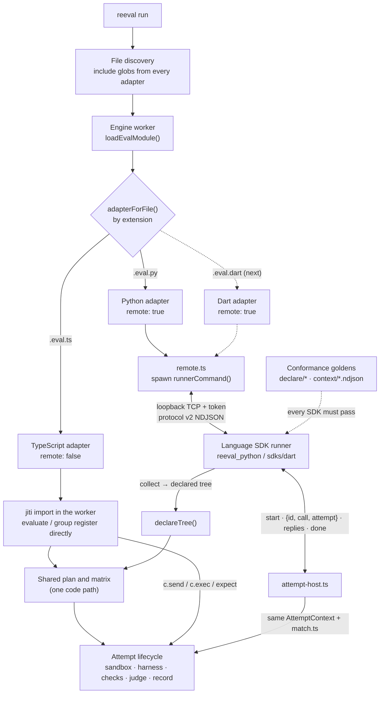

# Add a language runtime to reeval

reeval routes every eval file through a **`LanguageAdapter`**. TypeScript is adapter #1
(in-process jiti). Python is adapter #2 (out-of-process runner on loopback TCP). The next
language registers another adapter and ships an SDK package; the engine, plan and attempt
lifecycle stay shared.

**Rules (non-negotiable):**

- **SDKs are language-native; the wire format is never the public API.** Python evals import
  `evaluate` and `expect` from `reeval_python`, use snake_case (`c.read_file`, `assert result.ok`,
  typed `ExecResult` / `Turn` / `Verdict`), and snake_case options mapped to camelCase on the wire
  internally. Plain `assert` in an eval body is recorded as a failed hard check (mapped to protocol
  `expect` records). Use `expect(…).to_succeed()` and the other matchers for reeval-specific checks.
  Plain `def` bodies run on a worker thread with a sync context; `async def` uses the same asyncio
  implementation.
- **TypeScript stays in-process.** Never send `.eval.ts` through the runner transport; records,
  stacks and matcher behaviour must stay unchanged.
- **No per-language branches in the engine.** The worker calls `loadEvalModule()` only; do not
  fork plan/matrix logic or special-case languages in `engine/worker.ts`.
- **Update goldens in the same PR** when declaration or attempt-protocol shapes change
  (`test/conformance/`, plan snapshots, SDK mirrors).

## How languages plug together



## The adapter interface

Defined in `packages/reeval/src/language-runner/adapter.ts`:

| Field | Purpose |
|---|---|
| `id` | Stable name (`typescript`, `python`, …) |
| `extensions` | Eval file suffixes (e.g. `.eval.ts`, `.eval.py`) |
| `includeGlobs` | Default discovery patterns merged into config `include` |
| `remote` | `false`: body runs in the worker with jiti; `true`: out-of-process runner |
| `load(file, root)` | Worker **collect**: register evals via `evaluate` / `group` (TS) or remote `declareTree` |
| `runnerCommand(root)?` | When `remote`, spawn the SDK (`resolvePythonRunnerCommand` in `python-runner.ts`: `uv run … python -m reeval_python`, `.venv/bin/python`, or `python3`) |

Entry point: `loadEvalModule()` in `language-runner/load.ts` →
`adapterForFile(file).load(...)`.

Register new adapters in `LANGUAGE_ADAPTERS`. Merge their `includeGlobs` via
`defaultIncludeGlobs()` (config default `include`). For Python-only env helpers today, see
`runnerEnv()` in the same file; add analogous SDK path overrides when the next language needs them.

## Out-of-process transport (remote adapters only)

Generic code lives under `packages/reeval/src/language-runner/` (ported from the Dart spike;
see [Prior art](#prior-art-dart-spike) below):

| Module | Role |
|---|---|
| `protocol.ts` | `RUNNER_PROTOCOL = 2`. Session messages use `t` (`hello`, `collect`, `declared`, `log`). Attempt traffic uses shapes from `src/contract/attempt.ts` (`start`, `abort`, `done`, `{id, call, attempt}`, replies with `attempt`) — no `t` on attempt lines. |
| `transport.ts` | Loopback TCP, one-time token (`REEVAL_RUNNER`, `REEVAL_RUNNER_TOKEN`) |
| `attempt-host.ts` | Maps protocol ops to real `AttemptContext` (`expect` → `match.ts`) |
| `remote.ts` | `collectLanguageFile`: collect tree, `declareTree`, run remote bodies |

SDK runner responsibilities:

1. Connect; send `{ t: 'hello', protocol: 2, token, sdk, version, runtime }`.
2. On `{ t: 'collect', file }`, import the eval file; reply with `{ t: 'declared', file, tree }`
   (tree must match `schema/plan/declaration.schema.json`).
3. On `start`, run the body async; each `c.*` becomes `{ id, call, attempt }`; read replies
   (including `expect` assertion records); send `{ type: 'done', attempt, error? }`.
4. Optionally route stdout/stderr as `{ t: 'log', stream, text }`.

Declaration tree JSON is validated by the same contract TypeScript uses (`declareTree` in the worker).

## Conformance contract (every SDK)

Goldens live in `packages/reeval/test/conformance/` ([README](../../../packages/reeval/test/conformance/README.md)).
TypeScript holds them to the real code in `conformance.test.ts`. Each SDK mirrors the suite in its
own test runner.

1. **`test/conformance/declare/<case>/`** — `expected.json` equals the tree the SDK records
   (Python: `packages/reeval-python/tests/test_conformance_declare.py`).
2. **`test/conformance/context/<case>.ndjson`** — port of `conformance/runner.ts`: replay each
   `reeval` line, run a tiny eval body that emits the golden `runner` lines, match the `record` line.
3. **Repo gate** — `packages/reeval/test/python-sdk.test.ts` runs `uv sync` + `uv run pytest` when
   `uv` is present; add a sibling gate per language.

When TypeScript changes declaration or protocol behaviour, run
`REEVAL_UPDATE_SNAPSHOTS=1` on `conformance.test.ts`, review the diff, and update every SDK mirror
in the **same PR**. Do not duplicate the full `test/features/` corpus per language — one **smoke
fixture** per adapter plus declare/context conformance is enough.

## Checklist: add a new language

Use **Python** as the worked reference (`packages/reeval-python/`, feature fixture
`packages/reeval/test/features/python-sdk/hello/`).

| Step | Work |
|---|---|
| 1 | SDK under `packages/reeval-<lang>/` or `sdks/<lang>/`: declare API, attempt context, runner entrypoint |
| 2 | Register adapter in `language-runner/adapter.ts` (`extensions`, `includeGlobs`, `remote: true`, `runnerCommand`) |
| 3 | Declare conformance: mirror each `test/conformance/declare/<case>/` |
| 4 | Context conformance: NDJSON scripts through the SDK runner |
| 5 | One feature fixture (`<lang>-sdk/hello`: `lands` + `canary`) on **fake**; add **docker** / **real** when sandbox or Cursor checks apply ([feature contract](../../../packages/reeval/test/features/README.md)) |
| 6 | Plan case under `test/plan/<lang>/` + snapshot |
| 7 | Row in `test/features/inventory.ts`, row in `features.test.ts`, then `pnpm features:matrix --write` |
| 8 | CI: install the SDK toolchain; run conformance (and a gate test like `python-sdk.test.ts`) |
| 9 | User docs on [docs.page](https://use.docs.page) when the language is product-ready (optional for adapter-only PRs) |

### Python reference map

| Piece | Location |
|---|---|
| Declare API | `packages/reeval-python/src/reeval_python/declare.py` |
| Runner + collect | `packages/reeval-python/src/reeval_python/runner.py` |
| Attempt `c.*` over the socket | `packages/reeval-python/src/reeval_python/context.py` |
| uv project + project dep | `packages/reeval/test/features/python-sdk/hello/pyproject.toml` (`tomli` import in `lands.eval.py`) |
| Declare goldens | `packages/reeval-python/tests/test_conformance_declare.py` |
| Smoke fixture | `packages/reeval/test/features/python-sdk/hello/` (`lands.eval.py`, `canary.eval.py`) |
| Plan snapshot | `packages/reeval/test/plan/python/hello/` |

Real-tier smoke uses `REEVAL_FIXTURE_HARNESS=cursor`, one short `c.send` turn, and checks that
survive a real agent (see `lands.eval.py` in that fixture).

## Verify on fake, Docker and real tiers

From the repo root after `pnpm build`:

```bash
cd packages/reeval
pnpm test:features    # fake sandbox; Docker legs run when Docker is available
pnpm test:docker      # Docker only; fails if Docker is missing (REEVAL_TEST_REQUIRE_DOCKER=1 in CI)
pnpm test:real        # real Cursor fixtures; needs REEVAL_TEST_REAL=1 and CURSOR_API_KEY
pnpm test:plan        # plan snapshots for new include globs / eval files
node --test test/python-sdk.test.ts   # Python declare conformance (uv required)
```

Debug one fixture by hand: `REEVAL_TEST_KEEP=1` on the feature test, then in the temp project
`reeval run --ui plain`. For Docker: `REEVAL_FIXTURE_SANDBOX=docker`.

Filter to your fixture while iterating:

```bash
pnpm build
cd packages/reeval
node --test --test-name-pattern 'python-sdk/hello' test/features.test.ts
```

## Environment variables

Documented for users in `docs/reference/env-vars.mdx`. Remote runners receive:

| Variable | Purpose |
|---|---|
| `REEVAL_RUNNER` / `REEVAL_RUNNER_TOKEN` | Set by the engine when spawning the SDK (`127.0.0.1:<port>` and secret) |
| `REEVAL_PROJECT_ROOT` | Project root for eval imports |
| `REEVAL_PYTHON` / `REEVAL_PYTHON_SDK` | Override Python binary or monorepo SDK path (Python today) |

Add language-specific overrides in the adapter or `runnerEnv()` when the next SDK needs them.

## Prior art: Dart spike

Before the generic `language-runner` layer, branch **`ehesp/experiment-dart-evals-ca15`**
(`origin/ehesp/experiment-dart-evals-ca15`) proved Dart evals with engine-local hooks and an
earlier RPC shape. Round 2 notes live on **`ehesp/experiment-dart-evals-r2-ca15`**. A Dart adapter
on main should:

- Reuse `remote.ts` / `protocol.ts` (attempt protocol **v2**, not legacy `t.*` attempt RPC).
- Move SDK code to `sdks/dart` (or `packages/reeval-dart`) and delete Dart-only engine forks.
- Re-run declare + context goldens; update expect traffic for v2.
- Copy the `python-sdk/hello` fixture pattern for smoke + plan.

Rough size versus greenfield: **medium** epic — much smaller than the original spike if transport
stays generic (register adapter + SDK port + conformance + one fixture).
