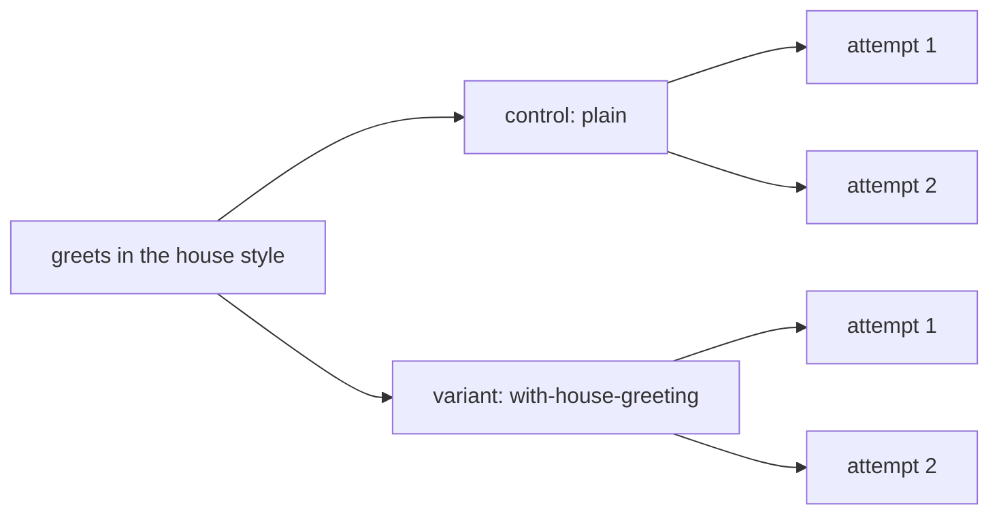

A skill is only worth shipping if agents do better with it. `compare` runs the same eval with and without it, on the same agent, and reports the difference as [lift](/concepts/lift).

```ts title="evals/environments.ts"
import { defineEnvironment } from '{{ pkg }}'

export const plain = defineEnvironment('plain', {})

export const withHouseGreeting = plain.extendEnvironment(
  'with-house-greeting',
  ({ skill }) => ({
    skills: [skill.local('../skills/house-greeting')],
  }),
)
```

```ts title="evals/skill.eval.ts"
import { evaluate, expect, group } from '{{ pkg }}'
import { plain, withHouseGreeting } from './environments.ts'

const greetAda = `node -e "import('./greet.js').then((m) => {
  const greet = m.greet ?? m.default?.greet ?? m.default
  const out = greet('Ada')
  console.log(out)
  process.exit(out === 'Ahoy, Ada!' ? 0 : 1)
})"`

group(
  'house greeting',
  {
    compare: { baseline: plain, variants: [withHouseGreeting] },
    pin: ['compare'],
  },
  () => {
    evaluate('greets in the house style', async (c) => {
      await c.send(
        'Create greet.js exporting greet(name) that greets the person ' +
          'in our house greeting style. ' +
          'Add a package.json with "type": "module". No dependencies.',
      )
      await expect(c.exec(greetAda)).toSucceed()
    })
  },
)
```

The skill says the house greeting is `Ahoy, <name>!`. An agent can't guess that, so only the run with the skill should pass. `pin: ['compare']` keeps the compare on even in a [profile](/guide/profiles) that turns variants off.

```md title="skills/house-greeting/SKILL.md"
---
name: house-greeting
description: The house style for greetings in this organisation. Use when writing any greeting function, message or text.
---
…
- The greeting word is always "Ahoy", never "Hello" or "Hi".
- Format: `Ahoy, <name>!` (comma after Ahoy, exclamation mark at the end).
…
```

## Run it

```bash
npx reeval run skill --runs 2 --log-order grouped --output-logs full
```

```text
plan  run … · 1 eval · 2 cells · 4 attempts · ~52s serial (~13s at concurrency 4)
hint: 1 eval runs more than once with the default gate, so every attempt must pass (pass^k); set gate: { passRate: 0.8 } to gate on pass@1 instead
…
[greets#1 with-house-greeting] ▶ evals/skill.eval.ts › house greeting › greets in the house style
[greets#1 with-house-greeting]  +0:00 sandbox ready 2s
[greets#1 with-house-greeting]  +0:02 turn 1 done 6s · 3 tool calls, 2 file edits
[greets#1 with-house-greeting]  +0:08 $ node -e "import('./greet.js').then((m) => {…  exit 0 117ms
…
[greets#1 control] ▶ evals/skill.eval.ts › house greeting › greets in the house style
[greets#1 control]  +0:00 sandbox ready 2s
[greets#1 control]  +0:02 turn 1 done 1m 26s · 55 tool calls, 2 file edits
[greets#1 control]  +1:29 $ node -e "import('./greet.js').then((m) => {…  exit 1 107ms
[greets#1 control]  Error: house greeting: expected command to succeed, exit code 1

pass             house greeting › greets in the house style
  arm                  pass
  plain                0 of 2
  with-house-greeting  2 of 2  can't tell yet
  check                plain   with-house-greeting
  house greeting       0 of 2  2 of 2
    expected command to succeed, exit code 1
  +2 more passed
…
1m 31s · 5,383k in (2,593k cached) · 12k out · results .reeval/runs/…/summary.md
1 pass
```

Without the skill, Cursor searched for the house style for 55 tool calls and still failed the check, both times. With it, it passed both times in 3. The eval passes and the run exits 0: only the variant gates, and the control's misses never fail it.

Each arm reads `N of M`, and the variant's effect is `can't tell yet`: two tries a side is too few to call, whatever the difference. With `--runs 4` it reads `helped`, and an effort table compares the arms' tool calls and time when they differ.

## Control and variant



`baseline` is the control. Each variant runs as that environment on its own, with the same prompt and checks: `compare` doesn't layer, inherit or extend. Each arm is a [cell](/concepts/matrix), and `--runs 2` runs each cell twice.

Share setup with `extendEnvironment` before the compare. The child keeps the parent's layers and wins on shared keys, so the house-greeting variant is `plain` plus the skill.

With a `baseline`, the compare names every arm. Don't set `environment` on the same object; reeval doesn't apply one inherited from a parent either.

## Leave out the baseline

```ts
group(
  'house greeting',
  { environment: plain, compare: { variants: [withHouseGreeting] } },
  () => {
    /* same prompt and checks */
  },
)
```

Without `baseline`, the control is the environment the eval would run in anyway: its own `environment`, or one it inherits from a group or the config. Here that's `plain`, so this plans the same cells as the eval above.

With no environment anywhere in the cascade, the control is an empty environment named `baseline`: the sandbox and the agent as they are. The run record keeps the control's name in `evals[].compare.baseline`, and `from` says where it came from.

## Two stacks, not a layer

Name both arms yourself when neither should inherit the other:

```ts
const firebaseAuth = defineEnvironment('firebase-auth', {
  files: { 'AGENTS.md': 'Use the Firebase Auth SDK.\n' },
})
const firebaseUi = defineEnvironment('firebase-ui', {
  files: { 'AGENTS.md': 'Use the FirebaseUI library.\n' },
})

group(
  'email sign-in',
  {
    compare: {
      baseline: firebaseAuth,
      variants: [firebaseUi],
      minLift: 0,
    },
    runs: 5,
  },
  () => {
    /* same prompt and checks */
  },
)
```

Lift and effort pair each variant with the control, whether you named it or not. They do not pair variants with each other.

## Choose which cells gate

```ts
{
  compare: {
    baseline: plain,
    variants: [withHouseGreeting],
    gate: 'all',
  },
}
```

By default only variant cells decide pass or fail. The control is expected to do worse, so its misses print in its arm row and the check matrix, dim, and never break CI. `gate: 'all'` gates the control too, and `'none'` only reports: the eval reads `not gated`, the tally counts it as `1 not gated` rather than a pass, and only a pooled `minLift` can fail the run.

## Gate on pass@1

```ts
{
  compare: { baseline: plain, variants: [withHouseGreeting] },
  gate: { passRate: 0.8 },
}
```

By default a cell passes only when every counted attempt passes: pass^k. That gets harder as `runs` grows, even for an agent that's no worse, which is what the plan's hint says.

`gate: { passRate: 0.8 }` passes a cell when its pass@1, the share of its attempts that pass, is at least 80%. Infra errors don't count either way; a cell is `infra_error` only when nothing counted.

## Require a minimum lift

```ts
{
  compare: {
    baseline: plain,
    variants: [withHouseGreeting],
    minLift: 0,
  },
}
```

`minLift` is in points from -1 to 1. It fails a variant cell when the lower bound of its interval is below it, so `minLift: 0` means "confidently no worse than the control". On an `evaluate.each`, it gates the lift pooled across the cases instead of each case's; see [Suites of cases](/recipes/eval-each).

## Read the lift

```text
  with-house-greeting  2 of 2  can't tell yet
    difference +100 points, 95% interval +7…+100
```

Lift is the variant's pass@1 minus the control's, on the same harness, and `-v` prints it under the arm with its 95% interval. The effect word reads the interval: `helped` above 0, `made it worse` below, `can't tell yet` across it or below four counted tries a side. At two runs a cell, +100 points can still be luck.

<Warning>
  Few runs give a wide interval. Here, `+7…+100` is barely clear of 0. Raise `runs`, or pool several cases with `evaluate.each`, before you trust a small lift.
</Warning>

The studio shows the same cells, roles, lift and effort for every run (here with two agents):

<Image src="/assets/studio/run-cells-lift.png" alt="reeval studio run page with a cells table: each agent's control at 0% and its variant at 100%, with +100 pts lift and fewer tool calls" width={800} />

## Read the effort

```text
  effort           tools  time
  plain            1      <0.1s
  with-skill       1      <0.1s
  with-doc         1      <0.1s
```

From four counted tries a side, a measure-a-change block ends with each arm's median tool calls and agent time, then tokens when every arm reported usage. It shows when the eval failed or an arm's effort differs from its baseline's by a rank test, so a skill that passes like the control but in a third of the tool calls still stands out. Below four a side the test can't reach significance, and the table stays out; in the run above, the control's 55 tool calls against the skill's 3 are in the logs and in `reeval query effort`. [Effort](/concepts/lift#effort-next-to-lift) has the details.

## Which checks made the difference

```ts
evaluate('greets in the house style', async (c) => {
  await c.send('Create greet.js exporting greet(name) …')
  await expect.soft(c, 'exports greet').toHaveFile('greet.js', /export/)
  await expect.soft(c, 'adds package.json')
    .toHaveFile('package.json', /"module"/)
  await expect(c.exec(greetAda), 'house greeting').toSucceed()
})
```

The check matrix under the arms has a column per arm and a row per [labelled](/reference/matchers#labels) check that failed or didn't run in some arm; the checks that pass everywhere are counted in `+N more passed`. On the fake agent at `--runs 2`:

```text
pass             house greeting › greets in the house style
  arm                  pass
  plain                0 of 2
  with-house-greeting  2 of 2  can't tell yet
  check                plain   with-house-greeting
  house greeting       0 of 2  2 of 2
    expected command to succeed, exit code 1
  +2 more passed
```

`exports greet` and `adds package.json` pass on both sides, so they measure nothing about the variant: rework such a check, or drop it. `reeval query` names them.

A labelled judge (`expect.soft(await c.judge(q), 'Social OAuth').toPass()`) is one of these checks, and its label replaces the question everywhere it's shown.

Use `expect.soft` for independent requirements. A hard failure ends the attempt, so on a control that misses early the later checks never run: they read `not run` in the control's column, never `0 of 2`, and have no verdict, since the control never answered them. The same verdicts are in `reeval query`'s `check_discrimination` view:

```bash
npx reeval query "SELECT label, variant_pass, control_pass, verdict
  FROM check_discrimination"
```

```text
label              variant_pass  control_pass  verdict
exports greet      2             2             both-pass
adds package.json  2             2             both-pass
house greeting     2             0             discriminates
```

`verdict` is `discriminates` when every counted attempt passes on one side and none on the other, else `both-pass`, `both-fail` or `mixed`.

## Two variants against each other

```text
fail             adds sign-in
  arm              pass
  no-skill         0 of 3
  current-skill    0 of 3  can't tell yet
  new-skill        0 of 3  can't tell yet
  check            no-skill  current-skill  new-skill
  Social OAuth     0 of 3    0 of 3         3 of 3
    expected file AUTH.md to exist
  Passkeys         0 of 3    0 of 3         0 of 3
    expected file AUTH.md to exist
```

With two variants or more, the check matrix sets every arm side by side, in the run output, `reeval show` and `summary.md`. Here every attempt misses `Passkeys`, a requirement no arm meets, so the pass rates say nothing and `Social OAuth` carries the difference. Gating stays each variant against its control.

`reeval query contrasts` has the same pairs as rows, and `reeval analyze` gets one `contrast` fact per pair. To ask a model which arm did better, add a pairwise [question](/guide/questions).

## Next

<CardGroup cols={2}>
  <Card title="Environments and skills" icon="box" href="/guide/environments">
    Give the agent skills, MCP servers, rules and setup steps.
  </Card>
  <Card title="Gates and lift" icon="chart-line" href="/concepts/lift">
    How the interval and the effect word work.
  </Card>
</CardGroup>
