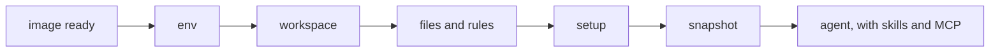

The sandbox is where the agent runs: put a specific machine on the environment (`defineEnvironment('python', { sandbox: docker({ from: 'python:3.12-slim' }) })`), or set `sandbox` on `defineConfig` as the default when the resolved environment omits one. An environment is also what the agent runs with: a starting codebase, skills, MCP servers, rules, files, variables and setup steps, applied fresh to every attempt. The house-greeting compare used the smallest one:

```ts title="evals/environments.ts"
import { defineEnvironment } from '{{ pkg }}'

export const plain = defineEnvironment('plain', {})

export const withHouseGreeting = plain.extendEnvironment(
  'with-house-greeting',
  ({ skill }) => ({ skills: [skill.local('../skills/house-greeting')] }),
)
```

`defineEnvironment(name, spec)` takes a plain object, or a callback that picks the helpers it needs: `skill`, `plugin`, `mcp`, `file`, `git` and `secret`. The callback runs once, when the file loads, and must return synchronously.

## Use an environment

```ts title="evals/guide-env.eval.ts"
group('greet with context', { environment: base }, () => {
  // …
})

group(
  'greet with skills',
  { compare: { baseline: plain, variants: [withSkills, withDocsMcp] } },
  () => {
    // …
  },
)
```

`environment` sets what every eval in the group runs in. An eval that sets `compare: { baseline, variants }` names every arm itself: don't put `environment` on that same object.

A named arm that omits `sandbox` uses the root `sandbox` option (a fake config puts `sandbox: fakeSandbox()` there), not the config environment's sandbox. `.extend()` keeps the parent environment's sandbox when the child omits it. Leave `baseline` out and the group's environment is the control.

## Add skills

```ts title="evals/guide-environments.ts"
export const withSkills = base.extendEnvironment(
  'with-skills',
  ({ skill }) => ({
  skills: [
    skill.local('../skills/house-greeting'),
    skill.git('github:acme/skills', { ref: 'v2.4.0', only: ['greet'] }),
    skill.npm('@acme/skills@1.2.3'),
    skill.registry('acme/skills@greet', { version: 'v1' }),
    skill.inline({
      name: 'no-deps',
      description: 'Use when adding code to this repo.',
      content: 'Never add dependencies. Use the standard library.',
    }),
  ],
}))
```

| Helper | Source |
|---|---|
| `skill.local(path)` | A directory with a `SKILL.md`, or a directory of them, relative to this file |
| `skill.git(repo, { ref, path, only })` | A git repo: `github:owner/repo`, `https://…` or `git@…` |
| `skill.npm(spec, { path })` | A pinned npm package, reading `skills/` inside it by default |
| `skill.registry(id, { version })` | A skills.sh id, `owner/repo@skill` |
| `skill.inline({ name, description, content })` | A skill written in the eval |

The harness adapter puts skills where its agent reads them. `placement: 'workspace'` writes them into the repo's skill directory instead, such as `.cursor/skills`. Pin git skills to a tag or commit: the plan warns on a moving ref like `main`, and the record keeps the commit either way.

<Info>
  Eval material stays out of the sandbox. A skill directory leaves out `.git` and `DEFAULT_SKILL_EXCLUDE`: a root `/evals/`, any `.history/` and any `*.eval.ts`. Pass `exclude` to change the list.
</Info>

## Connect MCP servers

```ts title="evals/guide-environments.ts"
export const withDocsMcp = base.extendEnvironment(
  'with-docs-mcp',
  ({ mcp }) => ({
  mcp: {
    docs: mcp.stdio('npx', ['-y', '@acme/docs-mcp@1.0.0']),
    search: mcp.http('https://mcp.acme.dev/mcp'),
  },
}))
```

Each server has a name, and the agent's calls to it show in the transcript as `mcp__<server>__<tool>`, such as `mcp__docs__search`. `mcp.stdio` starts a command in the sandbox; `mcp.http` and `mcp.sse` connect to a URL. Headers can carry secrets, which [Secrets and egress](/guide/secrets-and-egress) covers.

## Add plugins

```ts title="evals/env.ts"
export const withReview = base.extendEnvironment(
  'with-review',
  ({ plugin }) => ({
    plugins: [plugin.local('../plugins/review', { only: ['skills', 'mcp'] })],
  }),
)
```

<Warning>
Plugins are experimental. Which parts each harness loads, and how, may change in any release.
</Warning>

A plugin bundles skills, subagents, commands, hooks, MCP servers and rules in Claude Code's layout. `only` picks the parts to place. `plugin.git` and `plugin.npm` fetch one pinned, and `plugin.marketplace` takes an entry from a Claude Code marketplace. Its servers join `mcp` as `review:docs`, and the record lists the plugin with what it placed.

Cursor and Antigravity load every part, Claude Code and Grok Build every part but `rules`, OpenCode every part but `hooks` and `rules`, pi its `skills`, `commands` and `mcp`, and Codex, Goose and fx their `skills` and `mcp`; the plan refuses a part the harness doesn't load, and the fake harness takes every part. See [Helpers](/reference/helpers#plugin).

## Start from a repository

```ts title="evals/env.ts"
export const reactTs = defineEnvironment('react-ts', ({ git }) => ({
  workspace: git('https://github.com/vitejs/vite', {
    ref: 'v6.0.0',
    path: 'packages/create-vite/template-react-ts',
  }),
}))
```

`workspace` starts every attempt's workspace as a git repository, or one directory of it. reeval fetches it on the host once per run, before any attempt, so the sandbox never sees your git credentials. The record keeps the commit; [Start from an existing codebase](/recipes/existing-codebase) covers private repositories, caching and errors.

## Write rules and files

```ts title="evals/guide-environments.ts"
export const base = defineEnvironment('base', ({ file }) => ({
  rules: file('../rules/house.md'),
  files: {
    'package.json': '{ "type": "module" }\n',
    'docs/api.md': file('../docs/api.md'),
    '~/.npmrc': 'fund=false\n',
  },
  env: { NODE_ENV: 'test' },
  setup: [{ run: 'npm install --no-audit', timeout: '5m' }],
}))
```

`rules` lands where the harness's agent reads project rules: `CLAUDE.md` for Claude Code, `AGENTS.md` for every other agent. `files` maps workspace paths (or `~/` paths) to a string or a host `file()`, copied byte for byte. `env` sets variables in the sandbox.

## Seed a fixture directory

```ts title="evals/notes-env.ts"
export const notes = defineEnvironment('acme-notes', ({ directory }) => ({
  files: { ...directory('../fixture'), 'README.md': 'something' },
  setup: [{ run: 'npm ci --no-audit --no-fund', timeout: '5m' }],
}))
```

`directory()` maps every file in a host directory to its `file()`, so a later key overrides it. It skips `.git`, dependencies, build output and caches, such as `node_modules/`, `dist/` and `.cache/`.

`into` places the files under a subdirectory, and `glob` picks them with ordered patterns, `!` excluding: `glob: ['src/**', 'package.json', '!**/*.test.ts']`. [Helpers](/reference/helpers#directory) lists the default ignores and how symlinks and modes are handled.

## Run setup steps



`setup` runs commands in order in every attempt, before the agent starts. Steps get the environment's secrets, run outside the eval's timeout, and write their output to the attempt's `setup.log`. Each step can set its own `timeout` and `cwd`.

reeval snapshots the workspace after setup, so the repository, files, rules and setup output never show in the agent's diff. Anything baked into the image instead belongs to the [sandbox](/guide/sandboxes).

## Layer environments with extendEnvironment

```ts
const withSkills = base.extendEnvironment('with-skills', ({ skill }) => ({
  /* … */
}))
```

`extendEnvironment` is how two environments share setup. The child's spec layers on the parent's: where both set the same key (a variable, a file path, a skill or server name, `rules`, `workspace`), the child wins, and the record lists it under `overrides`. `setup` steps concatenate, parent first, and `compare` doesn't layer for you.

## Check what the environment set up

```ts title="evals/guide-env.eval.ts"
evaluate('sees the house rules', async (c) => {
  expect(await c.readFile('AGENTS.md')).toContain('House rules')
  await expect(c.exec('test -f docs/api.md')).toSucceed()
})
```

```text
[sees#1 fake]  +0:00 $ test -f docs/api.md  exit 0 6ms
…
pass             sees the house rules
```

The `$ test -f` line is the attempt's detail, which a pass prints with `--output-logs full`. The first `c.readFile` starts the sandbox and the agent session without a turn. Check an environment this way before you spend a turn on it.

## Next

<CardGroup cols={2}>
  <Card title="Harnesses" icon="terminal" href="/guide/harnesses">
    Cursor, Claude Code and Antigravity, one at a time or side by side.
  </Card>
  <Card title="defineEnvironment" icon="book" href="/reference/environment">
    Every field, the phase order and what's refused.
  </Card>
</CardGroup>
