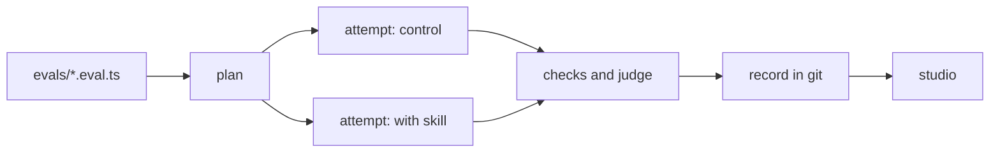

Does a coding agent actually use your SDK, your skills and your docs correctly? reeval answers that with evals you write like tests.

```ts title="evals/skill.eval.ts"
group(
  'house greeting',
  { compare: { baseline: plain, variants: [withHouseGreeting] } },
  () => {
    evaluate('greets in the house style', async (c) => {
      await c.send(
        'Create greet.js exporting greet(name) that greets in our house style.',
      )
      await expect(c.exec(greetAda)).toSucceed()
    })
  },
)
```

An agent does the task in a fresh sandbox, here four times without the skill and four times with it (`--runs 4`). reeval checks each try and reports what the skill changed:

```text
pass             house greeting › greets in the house style
  arm                  pass
  plain                0 of 4
  with-house-greeting  4 of 4  helped
  check                plain   with-house-greeting
  house greeting       0 of 4  4 of 4
    expected command to succeed, exit code 1
  +2 more passed
…
1 pass
```

Without the skill the agent never wrote the house greeting; with it, it did every time, so reeval calls the skill's effect `helped`. When the tries differ in tool calls or time, an effort table follows.

## How it works



| Step | What reeval does |
|---|---|
| Agent | Runs Cursor, Claude Code, Antigravity, OpenCode, Goose, pi, Codex, fx or Grok Build on your prompt, in its own sandbox |
| Checks | Runs your commands in the sandbox and asks an LLM judge yes/no questions |
| Compare | Runs the same eval with and without a skill, MCP server or docs, and reports lift and effort |
| History | Saves every run as a file you commit, diff and browse |

## See every attempt

The studio shows each run's cells, pass rates and lift, and each attempt's transcript, diff, checks and judge input.

<Image src="/assets/studio/run-cells-lift.png" alt="reeval studio run page with a cells table showing 0% for the control and 100% with the skill" width={800} />

## Next

<CardGroup cols={2}>
  <Card title="Quickstart" icon="rocket" href="/quickstart">
    Scaffold a project and run your first eval on a real agent.
  </Card>
  <Card title="Compare and lift" icon="chart-line" href="/guide/compare">
    Prove a skill, MCP server or doc makes agents better.
  </Card>
</CardGroup>
