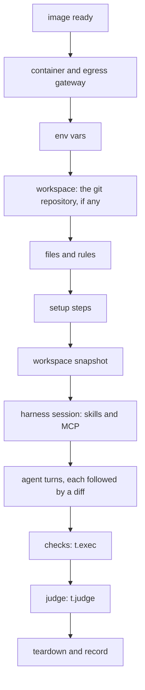

Every attempt gets its own sandbox and goes through the same phases, in the same order. Knowing them tells you where a failure happened, what the timeout covers and what the agent could see.



## Watch the phases

`es run -v` prints each phase as it happens. A real Cursor attempt, trimmed:

```text
[agent#1 cursor]  17:40:47 plan      harness cursor:composer-2.5 (es.config.ts or its default)
…
[agent#1 cursor]  17:40:47 env       environment - (digest eca09e8f139f)
[agent#1 cursor]  17:40:47 env       vars none · secrets none
[agent#1 cursor]  17:40:47 broker    CURSOR_API_KEY stays on the host · the gateway swaps it in on POST api2.cursor.sh/auth/exchange_user_api_key
[agent#1 cursor]  17:40:47 image     cache hit evalsuite-sandbox:cursor-0.1.0 (ES's image for cursor; es image build rebuilds it)
[agent#1 cursor]  17:40:47 image     ready evalsuite-sandbox:cursor-0.1.0 (a987bc712d5b) in 33ms · agent CLI @cursor/sdk 1.0.32
[agent#1 cursor]  17:40:48 container created 442ac2d4e235 from evalsuite-sandbox:cursor-0.1.0 in 800ms
[agent#1 cursor]  17:40:48 container network policy allow-all · keeps its Docker network
[agent#1 cursor]  17:40:48 container egress gateway started · brokers CURSOR_API_KEY
[agent#1 cursor]  17:40:48 env       workspace snapshot taken: the diff starts here
[agent#1 cursor]  17:40:48 harness   starting cursor:composer-2.5: bootstrap and session
[agent#1 cursor]  17:40:49 harness   cursor:composer-2.5 session ready in 365ms
[agent#1 cursor]  17:40:49 harness   turn 1 started: "Run `env | sort > env.txt` and reply with how many lines env.txt has."
…
[agent#1 cursor]  17:40:53 harness   turn 1 completed in 4s · 1 tool call · 0 file edits
[agent#1 cursor]  17:40:53 check     $ env; cat /proc/[0-9]*/environ | tr "\0" "\n" → exit 0 · 43ms
…
[agent#1 cursor]  17:40:54 teardown  harness session closed
[agent#1 cursor]  17:40:55 teardown  sandbox destroyed (289ms for teardown)
[agent#1 cursor]  17:40:55 teardown  outcome pass
…
```

## What each phase does

| Phase | What happens | The agent sees it? |
|---|---|---|
| Image | ES's image for the harness, or a `from`, `dockerfile` or `install` image, built once and cached | Its tools, yes |
| Container | A fresh container, with the [egress gateway](/concepts/credential-brokering) as its only proxy | No |
| Env | `env` variables; brokered secrets as placeholders | Yes, placeholders only |
| Workspace | A `workspace: git(…)` repository's tree, fetched on the host before the run, unpacked; no `.git` | Yes, not in the diff |
| Files and rules | `files` written byte for byte; `rules` to `AGENTS.md` (`CLAUDE.md` for Claude Code) | Yes, not in the diff |
| Setup | `setup` steps in order, with secrets, output to `setup.log` | Their results, not in the diff |
| Snapshot | The workspace as it is now: the diff starts here | No |
| Harness | The agent's session starts, with `skills` and `mcp` servers placed where it reads them | Yes |
| Turns | Each `t.send` runs one turn; ES diffs the workspace after each | It's the agent |
| Checks | Each `t.exec` runs in the sandbox; `to: 'checks'` secrets are swapped in only now | No |
| Judge | Each `t.judge` sends the task, final message, changed files and diff to the judge model | No |
| Teardown | Session closed, egress recorded, sandbox destroyed, record written | No |

The sandbox and session start on the first `t.send` (or `t.sandbox()`), so the eval body's own code runs first. Whatever happens, teardown runs, and the record is written.

## What the timeout covers

`timeout` (default `'15m'`) is per attempt, and it only counts the eval's own work:

| Counts | Doesn't count |
|---|---|
| Agent turns | Waiting for a [concurrency slot](/concepts/concurrency) |
| `t.exec` checks | Preparing or building the image |
| Judge calls, retries included | Starting the container and the gateway |
| Your own code in the eval body | Files, setup steps, the snapshot and the harness bootstrap |

Each setup step has its own `timeout` (5 minutes by default). When the eval's timer fires, the attempt's `t.signal` aborts, the sandbox is destroyed and the outcome is a failure of kind `timeout`. An agent that hasn't stopped 3 seconds later has its turn recorded as `aborted`, and ES moves on without it.

## Infra errors aren't failures

Every attempt ends with one outcome. An infra error means ES couldn't give the agent a fair try, so it doesn't count against its pass rate.

| Outcome | Kind | When |
|---|---|---|
| `pass` | | Every check and verdict passed |
| `fail` | `assertion` | A matcher failed, such as `toSucceed()` on a non-zero exit |
| `fail` | `judge` | A verdict was below its threshold, or a judge call failed |
| `fail` | `timeout` | The eval ran past its `timeout` |
| `infra_error` | `infra` | The sandbox or harness failed: a setup step exited non-zero, an environment's secret wasn't set, the gateway couldn't start |

A cell's pass rate is passes over passes plus fails; infra errors and skipped attempts aren't counted. A run with infra errors and no failures exits 3, not 1.

## Timings in the record

Each attempt in the record has per-phase timings in milliseconds, and the tokens its turns used when the harness reports them (Cursor, Claude Code, Antigravity, pi and Codex do). From a real Cursor attempt of `creates a tested greet module`:

```text
          "usage": {
            "input": 23984,
            "output": 367,
            "cacheRead": 23040,
            "cacheWrite": 0,
            "reasoning": null
          },
          "timings": {
            "setupMs": 1808,
            "agentMs": 7166,
            "diffMs": 80,
            "checksMs": 139,
            "judgeMs": 1178
          },
```

`setupMs` covers the image, container, files, setup steps and harness start. `agentMs` is the sum of every turn. `usage` is the sum of each turn's, and each turn also records the model that served it, such as `composer-2.5[fast=true]`. The studio's Debug tab shows the phases as a timeline.

## Next

<CardGroup cols={2}>
  <Card title="Credential brokering" icon="lock" href="/concepts/credential-brokering">
    How the agent authenticates without seeing the key.
  </Card>
  <Card title="Judges" icon="flask" href="/concepts/judges">
    What the judge sees, and how it scores.
  </Card>
</CardGroup>
