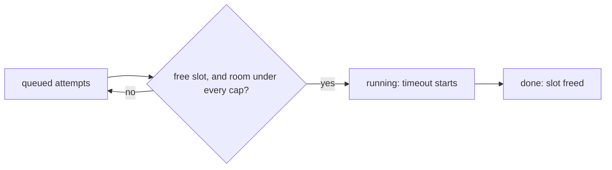

Every attempt has its own sandbox, so attempts run in parallel: up to `concurrency` of them at once, across every eval, cell and file in the run. Tighter caps can sit on top for resources several attempts share.

```ts title="reeval.config.ts"
const limited = defineEnvironment('limited', {
  sandbox: docker({ maxConcurrent: 4 }),
})

export default defineConfig({
  concurrency: 8,
  environment: limited,
  // Cursor attempts at once, across every Cursor model
  harness: cursor({ model: 'composer-2.5', maxConcurrent: 3 }),
  // judge calls at once, per provider
  judge: { model: 'google/gemini-3.8-flash', maxConcurrent: 2 },
})
```



## The default and how to set it

The default is 8, but no more than one per CPU or per GB of memory where the sandboxes run: the Docker VM under Docker Desktop, else the host. So a 4 GB Docker VM gets 4. A value you set above the CPU count is honoured, since attempts mostly wait on a model.

| Precedence | Set with |
|---|---|
| 1 | `--concurrency <n>` |
| 2 | `REEVAL_CONCURRENCY` |
| 3 | `concurrency` in `reeval.config.ts` |
| 4 | The default, `min(8, CPUs, GB)` |

The plan line and the run header show the value. With the config above, `REEVAL_CONCURRENCY` beats the config's 8 and the flag beats both:

```text
plan  1 eval · 2 cells · 4 attempts · ~12m 00s serial (~3m 00s at concurrency 8)
plan  1 eval · 2 cells · 4 attempts · ~12m 00s serial (~6m 00s at concurrency 2)
plan  1 eval · 2 cells · 4 attempts · ~12m 00s serial (~3m 00s at concurrency 6)
```

Those are `reeval run --dry-run`, then with `REEVAL_CONCURRENCY=2`, then with `--concurrency 6`. A dry run measures the Docker VM too when Docker is running, so its default matches the real run's; without Docker it measures the host.

## Caps per kind

A cap limits one kind of resource across the whole run. An attempt starts only when it has a slot and every cap it falls under has room.

| Cap | Limits | Use it for |
|---|---|---|
| `docker({ maxConcurrent })` | Docker containers at once, whatever their image | Memory on a small Docker VM |
| `cursor({ maxConcurrent })`, `claudeCode(…)`, `antigravity(…)` | Attempts of that harness kind at once, across all its models | An account's rate limits |
| `judge: { maxConcurrent }` | Judge calls at once per provider | A judge provider's rate limits |

Caps change how fast a run goes, not what it measures, so they're left out of the harness's [fingerprint](/concepts/fingerprints).

## Which attempt goes next

Among the attempts that could start, reeval picks in this order:

| Order | Picks | So that |
|---|---|---|
| 1 | The other cells of a run already started | A control and its variants run side by side |
| 2 | The eval with the fewest runs started | Every eval gets a first result early |
| 3 | Lower run number, then file, declaration order and cell | Ties break predictably |

At `--concurrency 1` that's `a control#1, a skill#1, b control#1, b skill#1, a control#2 …`. The result blocks stay in declaration order, whatever finished first.

## Waiting doesn't count

An attempt's [timeout](/concepts/attempt-lifecycle) starts when it gets a slot, not while it waits, and its duration leaves out the wait too.

| Shared work | Happens |
|---|---|
| Image builds (`from`, `dockerfile`, `install`) | Once, one at a time; attempts needing an image another is building wait and reuse it |
| Ctrl-C | Running attempts are cancelled, queued ones skipped, every sandbox destroyed |

Two `reeval run`s at once don't share caps: each has its own scheduler.

## Measured

A real benchmark: 16 Cursor `composer-2.5` attempts (a 2-environment matrix × `runs: 2` over four evals, one with a Python sandbox) with a Gemini Flash judge, on a Mac whose Docker VM had 20 CPUs and 8.2 GB, and on a 4-CPU Linux VM.

| Where | Concurrency | Wall time | Notes |
|---|---|---|---|
| Mac | 1 | 434 s | Peak 1 container, about 290 MB |
| Mac | 4 | 93 s | 4.7× faster |
| Mac | 8 | 142 s | 15 of 16 done by about 50 s; one attempt took 113 s. Peak 2.4 GB of Docker memory |
| Linux VM, first run | 4 | 108 s | Includes building the Python layer |
| Linux VM, warm | 4 | 80 s | At most 4 containers at once, none left afterwards |

Per-attempt agent time was 12 to 28 s at every level, so there was no sign of rate limiting. At 8, one slow attempt set the wall time.

<Info>
  This benchmark ran on an earlier reeval, with a bench config that crossed every eval with two environments.
</Info>

## Choose a value

Memory runs out first: an idle agent container takes about 300 MB, and installs, builds and test runs inside it take more.

| Situation | Do |
|---|---|
| More attempts than slots | Expect wall time of about total agent time ÷ concurrency |
| Every attempt has a slot | The slowest attempt sets the wall time; going above about 8 rarely helps |
| Short evals, a roomy Docker VM | Raise `concurrency` |
| Heavy repos, small CI runners | Lower it, or cap `docker({ maxConcurrent })` |
| Provider rate limits | Cap the harness or the judge |

## Next

<CardGroup cols={2}>
  <Card title="Sizing runs" icon="gear" href="/guide/profiles">
    Profiles, budgets and `--dry-run`.
  </Card>
  <Card title="Output modes" icon="terminal" href="/concepts/output">
    What the heartbeat and grouped logs show while attempts run.
  </Card>
</CardGroup>
