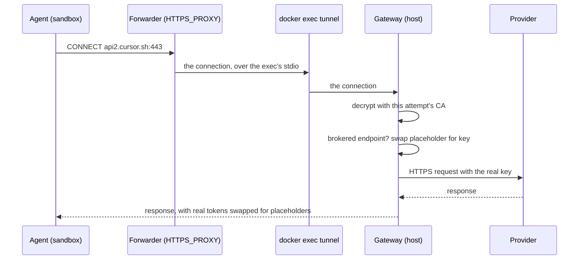

The agent needs a key to talk to its model, and an eval often needs keys for the APIs the agent's code calls. On Docker, none of those keys enter the sandbox. The agent gets a placeholder, and an egress gateway on your machine swaps in the real value on the way out, only for the hosts and endpoints that should get it.



## Watch a key being brokered

`reeval run -v` shows the broker and gateway lines. A real Cursor attempt, trimmed:

```text
[agent#1 cursor]  17:40:47 broker    CURSOR_API_KEY stays on the host · the gateway swaps it in on POST api2.cursor.sh/auth/exchange_user_api_key
…
[agent#1 cursor]  17:40:48 container egress gateway started · brokers CURSOR_API_KEY
…
[agent#1 cursor]  17:40:49 gateway   POST https://api2.cursor.sh/auth/exchange_user_api_key → 200 · allowed · ↑2 B ↓956 B · 76ms · substituted CURSOR_API_KEY (authorization)
[agent#1 cursor]  17:40:49 broker    substituted CURSOR_API_KEY (authorization) for api2.cursor.sh (POST https://api2.cursor.sh/auth/exchange_user_api_key)
…
[agent#1 cursor]  17:40:50 gateway   POST https://api2.cursor.sh/aiserver.v1.ServerConfigService/GetServerConfig → 200 · allowed · ↑0 B ↓4.1 KB · 109ms · substituted CURSOR_API_KEY accessToken
…
[agent#1 cursor]  17:40:51 gateway   POST https://api2.cursor.sh/aiserver.v1.BidiService/BidiAppend → 200 · allowed · ↑437 B ↓0 B · 57ms · substituted CURSOR_API_KEY accessToken
…
```

The key goes up only on the exchange, which the Cursor SDK repeats a few times in an attempt. Every other request carries a placeholder access token, which the gateway swaps for the real one, including the agent's `BidiService/BidiAppend` stream.

## How the pieces fit

| Piece | Where | What it does |
|---|---|---|
| Placeholder | The sandbox's environment | `aisdkhc_…` for the harness's key, `reeval_secret_` and 32 characters for your secrets |
| Forwarder | In the container, on `127.0.0.1:43128` | Every process's `HTTPS_PROXY`; sends each connection over `docker exec` to the host |
| Per-attempt CA | Certificate in the container, key in the host's memory | Lets the gateway decrypt only the hosts it brokers |
| Gateway | On the host, in reeval | Checks the egress policy, swaps placeholders on matching requests, records traffic |

reeval sets `HTTPS_PROXY`, `NODE_USE_ENV_PROXY=1`, `NODE_EXTRA_CA_CERTS`, and `SSL_CERT_FILE`, `REQUESTS_CA_BUNDLE`, `CURL_CA_BUNDLE` and `GIT_SSL_CAINFO` for every process. Hosts that aren't brokered pass through end to end, undecrypted.

## Brokered endpoints per harness

The harness's key goes only to the requests its agent needs it for:

| Harness | Endpoints that get the key |
|---|---|
| Cursor | `POST api2.cursor.sh/auth/exchange_user_api_key` |
| Claude Code | `POST /v1/messages`, `POST /v1/messages/count_tokens`, `GET /api/claude_code/settings`, `GET /api/claude_code/policy_limits` on `api.anthropic.com` |
| Antigravity | `POST generativelanguage.googleapis.com/v1beta/models/<model>:streamGenerateContent` |
| OpenCode, pi | `POST generativelanguage.googleapis.com/v1beta/models/<model>:streamGenerateContent` |
| Codex | `POST /v1/responses` on `api.openai.com` |
| fx | `POST /v1/chat/completions` on `api.openai.com`, or AI Gateway's model list and language-model calls on `ai-gateway.vercel.sh`, by the model |
| Goose | The same, and `GET generativelanguage.googleapis.com/v1beta/models` |
| Grok Build | `GET /v1/models`, `GET /v1/api-key`, `POST /v1/responses` and `POST /v1/chat/completions` on `api.x.ai` |

Cursor's agent runs through the Cursor TypeScript SDK, which exchanges its key for session tokens. The gateway hands the SDK placeholder `accessToken` and `refreshToken` values that keep the real JWT's header and claims (so the SDK sees the real expiry), and swaps the real tokens back in, in headers only, on requests to `cursor.sh` and its subdomains.

reeval's runner sends the SDK's agent stream over HTTP/1.1, because over HTTP/2 the SDK ignores the proxy and connects directly.

## It fails closed

Every path where the key could leak stops the attempt or the request instead.

| When | What happens |
|---|---|
| A request carries the placeholder to any other endpoint | `403` from the gateway and `warning: the egress gateway refused POST https://…` |
| The gateway can't start (an image without `node`) | The attempt is an infra error that names the key |
| Cursor's exchange response can't be read (compressed, over 1 MB, not JSON) | `502`, so the real tokens never pass |
| The harness's key isn't set on the host | `reeval run` names it and stops before anything starts (exit 2) |

An agent update that needs a new endpoint fails loudly rather than hanging or leaking. There's no option to pass the real key in.

## Broker your own secrets

Give a secret the `hosts` it's sent to, and it's brokered the same way:

```ts title="evals/environments.ts"
export const genkit = defineEnvironment('genkit', ({ secret }) => ({
  env: {
    GEMINI_API_KEY: secret.fromEnv('GOOGLE_GENERATIVE_AI_API_KEY', {
      hosts: secret.hosts.gemini,
    }),
  },
}))
```

The plan lists it: `brokered: GEMINI_API_KEY → generativelanguage.googleapis.com`.

| Rule | Detail |
|---|---|
| Only HTTPS | Plain HTTP is never substituted. A plain-HTTP request inside a CONNECT to a brokered host goes upstream as it is, and the gateway trace lists it |
| Only its `hosts` | `*.example.com` matches subdomains; the `Host` must be the host it connected to |
| Headers by default | `in: ['query']` or `in: ['body']` opt in to the query string and uncompressed bodies |
| Responses scrubbed | The real value in a response's headers and body comes back as the placeholder, so an echo can't reveal it. WebSocket messages after the upgrade pass through as they are |
| `to: 'checks'` | Substituted only while `c.exec` or a setup step runs, never on the agent's requests |
| MCP headers | Brokered to the server's own host, or the secret's `hosts`, when its URL is `https://`; never on an `http://` server |

`secret.hosts` has presets for `gemini`, `openai`, `anthropic` and `github`. A secret without `hosts` enters the sandbox as its real value, and the plan warns; `secrets: { unbrokered: 'error' }` in `reeval.config.ts` makes that an error.

## What the agent can still see

Brokering keeps the value out of the sandbox, not the ability to use it. reeval's nightly real-agent run checks the first part in `brokering.eval.ts`:

```ts title="evals/brokering.eval.ts"
const seen = (await c.readFile('env.txt')) ?? ''
const environ = await c.exec(
  'env; cat /proc/[0-9]*/environ | tr "\\0" "\\n"',
)
const dumped = `${seen}\n${environ.stdout}`
const keyLines = dumped
  .split('\n')
  .filter((line) => /^\w+_API_KEY=/.test(line))
for (const line of keyLines) {
  expect(line).toMatch(
    /^\w+_API_KEY=(?:aisdkhc_[\w-]{43}|reeval_secret_[0-9A-Za-z]{32})?$/,
  )
}
expect(holdsAKey(dumped)).toBe(false)

const scan = await c.exec(`node ~/.reeval-scan/scan.mjs '${targets}'`)
expect(JSON.parse(scan.stdout).hits).toEqual([])
```

`holdsAKey` compares whole keys on the host and returns a boolean, so a failure can't print a key. The file scan gets only each key's length and hashes, never any of its characters. After a refused turn Claude Code may unset `ANTHROPIC_API_KEY`; the check then sees reeval's `reeval_secret_…` placeholder or no key line.

| The agent can | The agent can't |
|---|---|
| Read the placeholders | Read a brokered key, in env, `/proc` or files |
| Call a brokered host, on your key, through the gateway | Send the key to any other host |
| Read unbrokered secrets and every file you give it | Read the gateway's CA key |

A client that ignores the proxy variables sends the placeholder direct, and authentication fails. SDKs that check a key's shape (`AIza…`, `sk-…`) may reject the placeholder, and signed requests (SigV4) can't be brokered.

<Info>
  The fake sandbox hands out placeholders too, but nothing substitutes them. Brokering needs `docker()`.
</Info>

## Next

<CardGroup cols={2}>
  <Card title="Egress policies" icon="globe" href="/concepts/egress">
    Control where the sandbox may connect at all.
  </Card>
  <Card title="Secrets and egress" icon="shield" href="/guide/secrets-and-egress">
    Set up brokered secrets and an allowlist, step by step.
  </Card>
</CardGroup>
