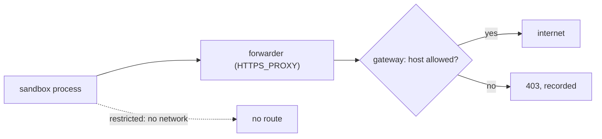

`egress` says where an attempt's sandbox may connect. Every request goes through the attempt's egress gateway, which enforces the policy and records each host contacted or refused.

```ts title="evals/offline.eval.ts"
evaluate('installs from npm only', {
  harness: (inherited) => inherited.slice(0, 1),
  egress: { allow: [...DEFAULT_EGRESS_ALLOW] },
}, async (c) => {
  await c.send('Add left-pad to package.json and install it.')
  await expect(c.exec('npm ls left-pad')).toSucceed()
})

evaluate('works offline', { egress: 'deny-all' }, async (c) => {
  await c.send('Create add.js exporting add(a, b).')
  await expect(c.exec('node -e "import(\'./add.js\')"')).toSucceed()
})
```

The plan shows each restricted policy and the hosts reeval adds to it:

```text
plan  2 evals · 3 cells · 3 attempts · ~9m 00s serial (~3m 00s at concurrency 4)
eval                                          harnesses  variants  runs  attempts  notes
evals/offline.eval.ts › installs from npm only  1          —         1     1         egress: allow registry.npmjs.org, registry.yarnpkg.com, github.com, *.github.com, *.githubusercontent.com, pypi.org, files.pythonhosted.org + auto: api2.cursor.sh, *.cursor.sh
evals/offline.eval.ts › works offline           2          —         1     2         egress: deny-all + auto: api2.cursor.sh, *.cursor.sh; deny-all + auto: api.anthropic.com, *.anthropic.com
```

## Three policies

| Policy | The sandbox may reach |
|---|---|
| `'allow-all'` (default) | Anywhere |
| `'deny-all'` | Only the automatic hosts below |
| `{ allow: [hosts] }` | The listed hosts and the automatic hosts |

Hosts are names or IPv4 addresses, without a scheme or port. `*.example.com` matches subdomains, not `example.com` itself, and `*.com` is refused. `DEFAULT_EGRESS_ALLOW` is the package registries and GitHub, for an allowlist that still installs.

Each level replaces the one before: the config, a profile's defaults, the environment (an `extendEnvironment` child's replaces its parent's), groups, then the eval. A compare variant runs as its own environment, so its policy is the one that cell uses.

## Automatic hosts

A restricted policy always allows what the attempt itself needs, so an agent still works under `'deny-all'`.

| Added for | Hosts |
|---|---|
| Cursor | `api2.cursor.sh`, `*.cursor.sh` |
| Claude Code | `api.anthropic.com`, `*.anthropic.com` |
| Antigravity | `generativelanguage.googleapis.com` |
| OpenCode | The model's provider's API hosts, such as `api.anthropic.com`, and `mcp.exa.ai` (its web search) |
| Goose, pi | `generativelanguage.googleapis.com` |
| Codex | `api.openai.com` |
| fx | `ai-gateway.vercel.sh` or `api.openai.com`, by the model |
| Grok Build | `api.x.ai` |
| Brokered secrets | Each secret's `hosts` |
| MCP servers | Each `http` or `sse` server's host |

Only the attempt's own harness's hosts are added: a Cursor attempt under `'deny-all'` can't reach Anthropic. Cursor needs only its agent backend: reeval's Cursor adapter fetches the model catalogue from `api.cursor.com` on the host, not in the sandbox.

## Expected telemetry hosts

Some CLIs contact hosts that nothing needs and no setting turns off. reeval lists them per harness, still refuses them under a restricted policy, and records them apart from real blocks.

| Harness | Expected blocks | Why |
|---|---|---|
| Antigravity | `play.googleapis.com`, `antigravity-unleash.goog` | Telemetry and feature flags, sent even with telemetry off |
| Claude Code | None | reeval runs it with `CLAUDE_CODE_DISABLE_NONESSENTIAL_TRAFFIC=1` |
| Cursor | None | Its analytics go to `api2.cursor.sh`, an automatic host |
| OpenCode | None | It calls only its provider's API and, for web search, Exa |
| Goose | `models.dev` | Its model catalogue refresh, which no setting turns off |
| pi | None | It calls only the Gemini API |
| Codex | `github.com`, `api.github.com`, `chatgpt.com` | Its plugin sync, on in a session with plugins; without them it calls only the OpenAI API |
| fx | None | Self-upgrade is off; its model calls go through a relay to the gateway, and its own web tools bypass it, so a restricted policy blocks them |
| Grok Build | None | Its telemetry, summaries and updates are off, so it calls only the xAI API |

These go to the record's `expectedBlocked` instead of `blocked`, and `-v` prints one `expected blocks, not logged per request: …` line at teardown instead of a line per request.

## Blocked requests don't fail the attempt

A request to any other host gets a `403` from the gateway and the attempt carries on; your checks decide whether it passed. With `-v`, each refusal is a `gateway` line. This one is from an Antigravity run, before reeval listed that host as expected:

```text
[scaffolds#1 antigravity:gemini-3.8-flash-low · control] 13:57:41 gateway   CONNECT antigravity-unleash.goog:443 → 403 · blocked: antigravity-unleash.goog isn't in the allowlist · ↑0 B ↓0 B · 1ms · no key substituted
```

A name that doesn't resolve gets a `502` and is recorded too.

## How Docker enforces it



| Under | The container |
|---|---|
| A restricted policy | Is detached from every Docker network before anything but `sleep` runs, so the gateway is its only way out; a client that ignores the proxy gets no connection |
| `'allow-all'` | Keeps its network; only proxy-aware clients (curl, npm, pip, git, Node, the agents) show up in the record |
| Any policy | Can't reach the host's loopback or link-local addresses (cloud metadata) |

The allowlist is checked by name at `CONNECT`, before any DNS lookup. A client that sends `GET https://host/…` to the proxy instead (Puppeteer's browser download does) gets the same check, and the gateway opens the TLS connection to the host for it.

A name a `*.` pattern matches that resolves to a private address is refused. An HTTPS tunnel to an allowed host isn't inspected, so the TLS inside could name another host on the same CDN.

## What's recorded

Each attempt's record has an `egress` block. From a real Cursor attempt under `'allow-all'`:

```text
          "egress": {
            "policy": "allow-all",
            "allowed": null,
            "recorded": true,
            "contacted": [
              {
                "host": "api2.cursor.sh",
                "port": 443,
                "connections": 12,
                "sent": 99152,
                "received": 213426
              }
            ],
            "blocked": [],
            "expectedBlocked": []
          },
```

`allowed` is every host a restricted policy let through (null under `'allow-all'`), and `blocked` each refused `host:port` with its connections and reason. A restricted policy is also part of the environment's [fingerprint](/concepts/fingerprints). The studio shows it on the attempt's State tab.

<Image src="/assets/studio/attempt-state-egress.png" alt="reeval studio attempt State tab with the egress panel: the policy, hosts contacted with bytes, and hosts refused" width={800} />

## The fake sandbox can't enforce

The fake sandbox runs commands on the host, so it enforces nothing and records nothing. A restricted policy on it stops the run before anything starts:

```text
reeval: evals/offline.eval.ts: evaluate("works offline") runs under egress 'deny-all', which needs turning egress off, but the fake sandbox enforces no egress policy (its commands run on the host). Run it in docker(), or set egress: 'allow-all'.
```

That's exit 2, for `--dry-run` too.

## Next

<CardGroup cols={2}>
  <Card title="Credential brokering" icon="lock" href="/concepts/credential-brokering">
    How the same gateway keeps keys out of the sandbox.
  </Card>
  <Card title="Offline evals" icon="shield" href="/recipes/offline">
    A complete `deny-all` eval, and what the agent can still reach.
  </Card>
</CardGroup>
