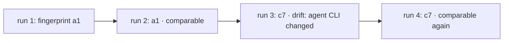

A pass that turns into a fail is only a regression if nothing else changed. reeval fingerprints each cell from everything that shapes its result, so `reeval compare` can tell a regression from a changed eval, agent, image or judge.

```text
          "fingerprintParts": {
            "sources": "5a4c60ca74d466023eeb8deeab1c7a01848de928c706c06fdf311165f578c35b",
            "harness": "7baac3ecdf9f6500e04c0d9d5b985386cb74ef20c0ccfd6d6e0e7f176b4a65e7",
            "environment": "sha256:eca09e8f139fb2456ce711a4f177ce81d9a5fdef6f8cdc80e9746ba8c5a9aae9",
            "image": "sha256:a987bc712d5b50ae09401d8a770a15601b0c415cc91e8ac43313662410ab7deb",
            "agentCli": "@cursor/sdk 1.0.32",
            "judge": "420360e9c618ea1c84382cde06139351bd6c1fb95d4192ed693a2189795ba33d",
            "context": "6bfc554ca370e2415c8bfc407b507bb0f3141eba7f8bf65e48bc458efe8a5d7b"
          },
```

That's one cell of a real Cursor run. The cell's `fingerprint` is the hash of these parts, and two runs of a cell are comparable only when it matches.

## What each part covers

| Part | Hashes | Changes when |
|---|---|---|
| `sources` | The eval file and every local file it imports, directly or not | You edit the eval or a helper it imports |
| `harness` | The harness's options, less `maxConcurrent` | You change the model or another harness option |
| `environment` | The environment's digest: skills, MCP servers, files, rules, setup, variable and secret names, a restricted egress policy | You change what the agent is given |
| `image` | The sandbox image's content-addressed id | The image is rebuilt with different contents |
| `agentCli` | The agent's version baked into the image: a CLI's, or the Cursor SDK's (`@cursor/sdk 1.0.32`) | The agent updates |
| `judge` | The judge's model, threshold and version | You change the judge or its threshold |
| `context` | The skills, rules and MCP config the agent could see in its sandbox | Anything new lands where the agent reads it |
| `gateway` | The gateway the model calls went through; unset on `direct` | You add, change or drop a gateway |

Only local imports are traced; packages are covered by the lockfile hashes the run records. Records from before `cursor()` moved to the Cursor SDK list files its old CLI rewrote every session, such as `~/.cursor/cli-config.json`; reeval treats changes to those as noise, not drift.

## Read a compare

`reeval compare` diffs the latest run against its nearest recorded ancestor and gives each eval one status. An eval whose fingerprint changed gets a `can't compare` block naming the part:

```text
can't compare    bills in minor units with the billing doc
  changed          environment
  base             20261020T231407Z_ea2a649_ada-lovelace_8h1n  pass
  head             20261020T231408Z_b2c98b4_ada-lovelace_fypq  fail
  amount in minor units  failed
    expected command to succeed, exit code 1
…
1 regressed · 1 fixed · 1 can't compare · 1 new · 1 removed · 4 same
```

The environment's doc changed between the runs, so the flip from pass to fail isn't called a regression.

| Status | Means |
|---|---|
| `regressed` | Same fingerprint, passed before, fails now |
| `fixed` | Same fingerprint, failed before, passes now |
| `same` | Same fingerprint, same outcome; collapsed to `+N same` |
| `can't compare` | The fingerprint changed; reeval names what, e.g. `evals/helpers.ts` or `agent CLI` |
| `infra error` | Either side had an infra error |
| `new`, `removed` | The eval is in only one of the runs |

When two runs ran different cells of an eval (one was filtered to a harness, say), reeval compares the cells both ran and lists the rest as `cells added` or `cells removed`. With no cell in common, it can't compare them. A pooled family with a `minLift` gets a row of its own for its pooled gate, comparable when all its cases are. `--fail-on-regression` exits 1 on any `regressed`, and on a `new` or `can't compare` row that fails.

## Drift

Drift is a cell whose fingerprint changed since the last run that had it. The studio's runs list shows a drift badge, `reeval history` marks the run with `¦`, and `reeval query drift` lists which parts changed.



A run filtered to fewer cells isn't drift, and neither is the full run after it: each cell is compared with the last run that had it.

Some changes sit outside the fingerprint but still move results, such as the model id the judge provider says it served. When one of those changes between two runs, an outcome that flipped across it is `can't compare`, its `changed` row naming the part (`judge model served`), rather than a regression. `reeval compare -v` lists every stack change.

<Image src="/assets/studio/compare.png" alt="reeval studio compare page: evals marked regressed, fixed and not comparable, with the reason" width={800} />

## Renaming an eval starts a new history

```text
evals/hello.eval.ts › greet module › creates a tested greet module
└ file               └ group         └ name
```

An eval's id is its file, its groups and its name. History, compare and the studio follow evals by that id.

<Warning>
  Renaming an eval, one of its groups or its file gives it a new id. `reeval compare` shows the old one as `removed` and the new one as `new`, and its history starts again.
</Warning>

## What a fingerprint can't pin

A matching fingerprint means the inputs reeval controls are the same. Some inputs aren't under its control:

| Can't pin | What to do |
|---|---|
| Sampled agent output: the same prompt gives different runs | Run cells more than once and read the [interval](/concepts/lift) |
| Provider-side model updates behind a model id | Pin versioned model ids; reeval records the judge model the provider reported |
| Network results: web search, package registries | Pin dependencies in the workspace, or restrict [egress](/concepts/egress) |
| Locally built images | `reeval show` warns when an image isn't pushed, so a rerun needs that machine's image |

## Next

<CardGroup cols={2}>
  <Card title="History" icon="database" href="/guide/history">
    Record runs in git, then read `reeval history` and `reeval compare`.
  </Card>
  <Card title="Judges" icon="flask" href="/concepts/judges">
    Why a pinned judge model keeps runs comparable.
  </Card>
</CardGroup>
