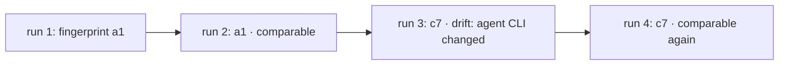

A pass that turns into a fail is only a regression if nothing else changed. ES fingerprints each cell from everything that shapes its result, so `es compare` can tell a regression from a changed eval, agent, image or judge.

```text
          "fingerprintParts": {
            "sources": "5a4c60ca74d466023eeb8deeab1c7a01848de928c706c06fdf311165f578c35b",
            "harness": "84f8a02aabf8cc5f94e282a5b85d7148d3089b2f44fd550dcea1d89cbe80870b",
            "environment": "sha256:eca09e8f139fb2456ce711a4f177ce81d9a5fdef6f8cdc80e9746ba8c5a9aae9",
            "image": "sha256:e034063c0c8d994f6c8ebdf71ea15d8cd5309449f3430c1c509e5edeadf2f1c6",
            "agentCli": "2026.09.26-dd393fe",
            "judge": "420360e9c618ea1c84382cde06139351bd6c1fb95d4192ed693a2189795ba33d",
            "context": "aa8009e365dbef880c63cd2dbe715017bc29cbf7acb75b03f2c8dce5d6fe970b"
          },
```

That's one cell of a real Cursor run. The cell's `fingerprint` is the hash of these parts, and two runs of a cell are comparable only when it matches.

## What each part covers

| Part | Hashes | Changes when |
|---|---|---|
| `sources` | The eval file and every local file it imports, directly or not | You edit the eval or a helper it imports |
| `harness` | The harness's options, less `maxConcurrent` | You change the model or another harness option |
| `environment` | The environment's digest: skills, MCP servers, files, rules, setup, variable and secret names, a restricted egress policy | You change what the agent is given |
| `image` | The sandbox image's content-addressed id | The image is rebuilt with different contents |
| `agentCli` | The agent CLI version baked into the image | The harness CLI updates |
| `judge` | The judge's model, threshold and version | You change the judge or its threshold |
| `context` | The skills, rules and MCP config the agent could see in its sandbox | Anything new lands where the agent reads it |

Only local imports are traced; packages are covered by the lockfile hashes the run records. Files the agent's CLI rewrites every session, such as Cursor's `~/.cursor/cli-config.json`, are recorded but left out of `context`.

## Read a compare

`es compare` diffs the latest run against its nearest recorded ancestor and gives each eval one status:

```text
base 20260926T170851Z_bd6205e_ada-lovelace_pq8p (bd6205e) → head 20260926T170907Z_bd6205e_ada-lovelace_nfvg (bd6205e)
0 regressed · 0 fixed · 0 not comparable · 0 same

  · → ✗  new                       evals/hello.es.ts › greet module › creates a tested greet module
  · → ✗  new                       evals/hello.es.ts › greet module › adds a default name in a follow-up turn
  ✓ → ·  removed                   evals/jq.es.ts › summarises a JSON file with jq
…
```

| Status | Means |
|---|---|
| `regressed` | Same fingerprint, passed before, fails now |
| `fixed` | Same fingerprint, failed before, passes now |
| `same` | Same fingerprint, same outcome |
| `changed (not comparable)` | The fingerprint changed; ES names what, e.g. `evals/helpers.ts changed` or `agent CLI changed` |
| `infra error` | Either side had an infra error |
| `new`, `removed` | The eval is in only one of the runs |

When two runs ran different cells of an eval (one was filtered to a harness, say), ES compares the cells both ran and lists the rest, as in `same · cells removed: cursor:composer-2.5/-/fake`. With no cell in common, it's not comparable. `--fail-on-regression` exits 1 on any `regressed`.

## Drift

Drift is a cell whose fingerprint changed since the last run that had it. The studio's runs list shows a drift badge, `es history` marks the run with `¦`, and `es query drift` lists which parts changed.



A run filtered to fewer cells isn't drift, and neither is the full run after it: each cell is compared with the last run that had it.

Some changes sit outside the fingerprint but still move results, such as the model id the judge provider says it served. When one of those changes between two runs, `es compare` prints a `stack changed:` line, and an outcome that flipped across it counts as not comparable rather than as a regression.

<Image src="/assets/studio/compare.png" alt="ES studio compare page: evals marked regressed, fixed and not comparable, with the reason" width={800} />

## Renaming an eval starts a new history

An eval's id is its file, its groups and its name: `evals/hello.es.ts › greet module › creates a tested greet module`. History, compare and the studio follow evals by that id.

<Warning>
  Renaming an eval, one of its groups or its file gives it a new id. `es compare` shows the old one as `removed` and the new one as `new`, and its history starts again.
</Warning>

## What a fingerprint can't pin

A matching fingerprint means the inputs ES controls are the same. Some inputs aren't under its control:

| Can't pin | What to do |
|---|---|
| Sampled agent output: the same prompt gives different runs | Run cells more than once and read the [interval](/concepts/lift) |
| Provider-side model updates behind a model id | Pin versioned model ids; ES records the judge model the provider reported |
| Network results: web search, package registries | Pin dependencies in the workspace, or restrict [egress](/concepts/egress) |
| Locally built images | `es show` warns when an image isn't pushed, so a rerun needs that machine's image |

## Next

<CardGroup cols={2}>
  <Card title="History" icon="database" href="/guide/history">
    Record runs in git, then read `es history` and `es compare`.
  </Card>
  <Card title="Judges" icon="flask" href="/concepts/judges">
    Why a pinned judge model keeps runs comparable.
  </Card>
</CardGroup>
