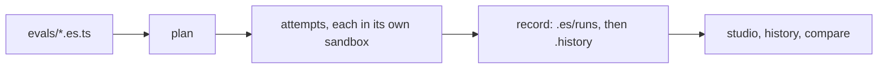

ES reads your eval files, plans every attempt they ask for, runs each one in a fresh sandbox, and writes what happened to a record you can commit and browse. These pages explain each step and why it works the way it does.



## From eval file to studio

Every `es run` goes through the same five steps. `--dry-run` stops after the plan.

| Step | What ES does | Read more |
|---|---|---|
| Eval file | Loads `group` and `evaluate` calls and resolves their options | [Options and inheritance](/concepts/options) |
| Plan | Expands each eval into cells and attempts, and prints the plan line | [The matrix](/concepts/matrix) |
| Attempts | Runs each attempt in its own sandbox: agent turns, then checks and the judge | [Attempt lifecycle](/concepts/attempt-lifecycle) |
| Record | Writes each attempt's outcome, transcript, diff and timings, and each cell's pass rate and lift | [Gates and lift](/concepts/lift) |
| Studio | Shows runs, cells and attempts; `es compare` diffs two runs | [Fingerprints and drift](/concepts/fingerprints) |

## The vocabulary

The code, the CLI and these docs use the same words.

| Term | Meaning |
|---|---|
| eval | One `evaluate(name, fn)`: a task for the agent and the checks on its result |
| harness | The agent that does the task, such as `cursor({ model: 'composer-2.5' })` |
| sandbox | Where the agent runs and what's baked into its image, such as `docker()` |
| environment | What the agent gets per attempt: skills, MCP servers, rules, files, setup |
| control | The eval with its inherited environment (or none) |
| variant | The eval with one `compare` environment layered on the control |
| cell | One harness × environment × sandbox of an eval, e.g. `cursor:composer-2.5/-/docker` |
| attempt | One run of a cell in a fresh sandbox, e.g. `cursor:composer-2.5/-/docker#1` |
| run | One `es run`: every attempt it started, saved as one record |
| lift | A variant's pass rate minus its control's, with a 95% interval |

A cell passes or fails by its [gate](/concepts/lift); an eval fails when any of its gated cells fails.

## Where results go

```text
.es/runs/<runId>.json          every run, scratch (gitignore .es/)
evals/.history/<runId>.json    recorded runs, which you commit
.es/debug/<runId>/…            local debug traces, never recorded
```

`es record` (or `record: 'ci'` in CI) copies a scratch run into the history folder. `es history`, `es compare`, `es query` and the studio read both.

## Next

<CardGroup cols={2}>
  <Card title="The matrix" icon="layer-group" href="/concepts/matrix">
    How harnesses, variants and runs multiply into attempts.
  </Card>
  <Card title="Attempt lifecycle" icon="play" href="/concepts/attempt-lifecycle">
    What happens inside one attempt, phase by phase.
  </Card>
  <Card title="Gates and lift" icon="chart-line" href="/concepts/lift">
    How a cell passes and how sure a lift is.
  </Card>
</CardGroup>
