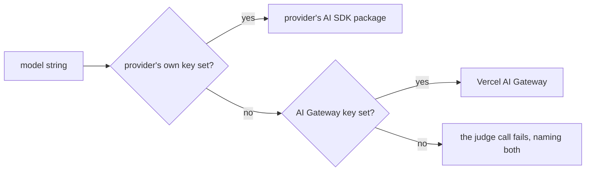

`c.judge(question)` asks an evaluation model a yes/no question about the agent's latest turn. The model returns the probability of "yes", and the verdict passes when that score is at or above the threshold.

```ts title="evals/hello.eval.ts"
evaluate('adds a default name in a follow-up turn', async (c) => {
  await c.send(
    'Create greet.js exporting greet(name) that returns "Hello, <name>!". ' +
      'No dependencies.',
  )
  await c.send(
    'Make name default to "world" when greet() is called without arguments.',
  )

  await expect(c.exec(callGreetWithNoArgs)).toSucceed()
  expect(
    await c.judge(
      'Did the agent add the default without breaking greet(name)?',
    ),
  ).toPass()
})
```

```text
[adds#1 cursor]  +0:10 judge  pass 1.00 (≥ 0.8)  Did the agent add the default without breaking greet(name)?
```

## Score and threshold

The score is P(yes), from 0 to 1. The threshold defaults to 0.8, and a verdict is `{ verdict, score, threshold, question, model }`. With `-v`, the judge line says why:

```text
[adds#3 fake]  17:15:24 judge     fake · 4ms · score 0.90 ≥ 0.7 · pass · reason: P(yes) 0.90 is at or above the 0.7 threshold
```

`judge` merges field by field, innermost first: the call, then the eval, then each group, then the config. So an eval or a single call can change the threshold and keep the config's model:

```ts title="evals/strict.eval.ts"
evaluate('strict', { judge: { threshold: 0.9 } }, async (c) => {
  await c.send('Rename add.js to sum.js and update its imports.')
  const minimal = await c.judge('Is the change minimal?', { threshold: 0.7 })
  expect(minimal).toPass()
})
```

## Which model it calls

There's no default model. Set `judge.model` in the config, a group, an eval or the call, or `c.judge()` fails with `c.judge() has no model. Set judge: { model: 'typesafe-ai/jev-1.13.0' } in reeval.config.ts, on the group or eval, or pass { model } to this call.`



| `model` | With its own key | Otherwise |
|---|---|---|
| `'typesafe-ai/jev-1.13.0'` (recommended) | `TYPESAFE_AI_API_KEY` | The AI Gateway |
| `'google/gemini-3.8-flash'` | `GOOGLE_GENERATIVE_AI_API_KEY` | The AI Gateway |
| Any other `provider/model` | — | The AI Gateway, with `AI_GATEWAY_API_KEY` or `VERCEL_OIDC_TOKEN` |
| An evaluation model object | Used as is, per group, eval or call only | — |
| `fakeJudge({ score })` | A fixed score, no model call | — |

<Warning>
  Pin model versions: `jev-1.13.0`, not `jev-latest`. A moving alias changes scores between runs, and the judge's model is part of every [fingerprint](/concepts/fingerprints).
</Warning>

## Retries

A judge call that hits a transient error (a 429, a 5xx, "high demand", a dropped connection) is retried with exponential backoff, up to six tries over about a minute, honouring `retry-after`. A bad request or a bad key fails straight away.

| Where | What's recorded |
|---|---|
| The verdict | `retries`: each error and the delay before the next try |
| The attempt | A judge call that fails for good returns `verdict: 'error'`; the judges and checks after it still run, then the attempt is a `judge` failure |
| The timeout | Retries count toward the eval's `timeout` |

`judge: { maxConcurrent: 2 }` caps calls at once per provider, for rate limits. See [Concurrency](/concepts/concurrency).

## What the judge sees

The judge sees four things: the latest turn's prompt as `task`, the agent's final message as `output`, the changed files and the diff since the eval started. Each call is saved in the attempt's `judge-input.json`. From a real Cursor attempt of the multi-turn eval above:

```text
[
  {
    "question": "Did the agent add the default without breaking greet(name)?",
    "model": "google/gemini-3.8-flash",
    "state": {
      "task": "Make name default to \"world\" when greet() is called without arguments.",
      "output": "Updated `greet` to use a default parameter: `name = \"world\"`. Calling `greet()` returns `\"Hello, world!\"`; passing a name still works as before.",
      "files": [
        "added greet.js"
      ],
      "diff": {
        "$ref": "diff.patch",
        "sha256": "2d8d95c242d9ea1246dd52368f13f5220d8992713885b2be946af5c939915fdc"
      }
    }
  }
]
```

| Sees | Doesn't see |
|---|---|
| The latest turn's prompt | Earlier prompts |
| The agent's final message | Its reasoning and intermediate messages |
| Changed files, dependency and build folders collapsed | The transcript: commands it ran, tool calls, web fetches |
| The diff since the eval started, without build output, lockfiles, source maps and minified files | Your checks and their output |

So the judge can't tell whether the agent ran the tests; check that with `c.exec`. `{ on: turn }` grades an earlier turn, and `{ on: value }` grades any value in place of the final message. `{ artifacts: [image] }` adds a `c.capture()` PNG as a file part; ask about facts in the picture, not whether it "looks great".

## Judge what the code prints

```ts title="evals/hygiene.eval.ts"
const run = await c.exec('node summary.js')
const verdict = await c.judge('Does it say 3 orders totalling 50?', {
  on: run.stdout,
})
```

```text
    "question": "Does it say 3 orders totalling 50?",
    …
      "task": "Write summary.js. It prints the order count and total of orders.csv.",
      "output": "3 orders, total 50.00\n",
      "files": [
        "added greet.js",
        "added summary.js"
      ],
…
```

The diff shows the code, not what it does. When the behaviour is the outcome, run the code and pass its output with `on`. In `judge-input.json` it replaces the final message as `output`, and the task, files and diff stay. [Make the eval trustworthy](/guide/writing-evals#make-the-eval-trustworthy) has the whole eval.

## Narrow what the judge sees

```ts title="evals/sign-in.eval.ts"
const flow = await c.judge('Does this change implement email sign-in?', {
  include: ['src/', '!**/*.test.ts'],
  files: ['src/firebase.ts'],
})
expect.soft(flow, 'Email sign-in').toPass()
```

`include` keeps the diff to the files a question is about, and `files` shows files whole, changed or not. Set either on `judge` in the config, a group or an eval as a default; a call's own replaces it. A smaller state fits the model's context, and the judge grades better without the noise.

<Warning>
  The diff is what changed in the workspace, so give the workspace its own `.gitignore`: an agent that runs `npm run build` leaves its output there. A Vite bundle once filled 97% of a 310k-token state and failed every call on Jev's 32k limit.
</Warning>

A provider error on a judge call says how big the input was and names its biggest files. See [Provider errors](/reference/judges#provider-errors).

## Write questions the judge can grade

Ask one thing, about what the judge sees, in words that don't assume one solution. The reeval dogfood run found the failure mode: a question that named specific matchers failed a correct scaffold at 0.05, because the agent used `c.readFile` and `toEqual` instead.

| Brittle | Better |
|---|---|
| Pass only if the eval uses `toHaveFile` or `c.exec` to check the file. | Does the eval check that the file was created with the right content? |
| Pass only if the final message names all three mistakes correctly: … | Does the final message explain why `compare` can't go in `reeval.config.ts`? |
| Did the agent run the tests? | Use `c.exec('npm test')` and `toSucceed()` instead |

"Pass only if …" questions with several conditions are the most brittle: every extra clause is another way to score near 0. Split them into several `c.judge` calls, and move anything a command can check into a check.

<Image src="/assets/studio/attempt-judge.png" alt="reeval studio attempt page, Judge tab: the question, the score against the threshold and the judge input" width={800} />

## Next

<CardGroup cols={2}>
  <Card title="Fingerprints and drift" icon="code-compare" href="/concepts/fingerprints">
    Why a judge change makes two runs not comparable.
  </Card>
  <Card title="Judges reference" icon="book" href="/reference/judges">
    Every judge option, model string and helper.
  </Card>
</CardGroup>
