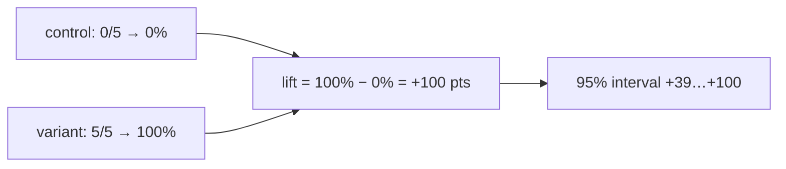

A `compare` eval answers "does this environment help?". Two settings decide what fails the run, and lift, with its interval, says how big the difference is and whether the attempts can tell.

```ts title="evals/skill.eval.ts"
group('house greeting', {
  compare: { baseline: plain, variants: [withHouseGreeting], minLift: 0 },
  gate: { passRate: 0.8 },
  runs: 5,
}, () => {
  evaluate('greets in the house style', async (c) => {
    await c.send('Create greet.js exporting greet(name) in our house style.')
    await expect(c.exec(greetAda)).toSucceed()
  })
})
```

Run under the fake agent, which writes the house greeting only when it has the skill:

```text
Summary
 evals/skill.eval.ts
   house greeting
     ✓ greets in the house style     5/10 · pass@1 100% gated  10 attempts
         fake/plain/fake                control    0/5  pass@1   0%   not gated
         fake/with-house-greeting/fake  variant    5/5  pass@1 100%   lift +100 pts (95% +39…+100, 5/5 vs 0/5) (minLift 0)   gate passRate 0.8
…
```

## Choose which cells gate

`compare.gate` picks which cells can fail the run. The control usually runs without the thing you're testing, so it's expected to do worse.

| `compare.gate` | Variant cells | Control cell |
|---|---|---|
| `'variants'` (default) | Gate | Report only: misses print under `Expected misses, not gated` |
| `'all'` | Gate | Gate |
| `'none'` | Report only | Report only |

A cell that doesn't gate has `gate: 'none'` in the plan and the record. Without `compare`, the one cell always gates.

## Choose how a cell passes

The `gate` option (on the config, a profile's `defaults`, a group or an eval) decides when a gating cell passes.

| `gate` | A cell passes when | Elsewhere called |
|---|---|---|
| `'all'` (default) | Every counted attempt passes | pass^k |
| `{ passRate: 0.8 }` | Its pass@1 is at least 0.8 | a pass@1 threshold |

A cell's pass@1 is its passes over its passes and fails: the chance that one attempt passes. Infra errors and skipped attempts don't count either way.

`'all'` gets harder to meet as `runs` grows, even for an agent that's no worse: at a pass@1 of 0.85, all five of `runs: 5` pass only 0.85⁵ = 44% of the time. The plan prints a hint when an eval runs more than once with it.

## Lift and its interval

Lift is the variant's pass@1 minus the control's on the same harness, in points. reeval stores it on the variant cell with a 95% interval on the difference, computed with Newcombe's method from each side's Wilson score interval.



When the interval spans 0, the summary adds `within noise`: at this many attempts, the variant and the control can't be told apart. The Wilson interval stays sensible at 0/n and n/n, which is where small evals usually land.

Lift gates; the win rates of a [compare question](/guide/questions) only annotate, and never change a cell's outcome.

Each judge key also has its own pass rate on the cell (`login 4/5 · checkout 0/5`). A key's lift prints only when both sides have at least two counted attempts, the floor at which an all-or-nothing split can exclude 0.

## Why two runs is usually noise

The interval is wide when attempts are few. These are reeval's own intervals for common results:

| Variant | Control | Lift | 95% interval | Within noise |
|---|---|---|---|---|
| 1/1 | 0/1 | +100 | −12…+100 | yes |
| 2/2 | 2/2 | +0 | −66…+66 | yes |
| 2/2 | 1/2 | +50 | −27…+91 | yes |
| 2/2 | 0/2 | +100 | +7…+100 | no |
| 5/5 | 3/5 | +40 | −12…+77 | yes |
| 5/5 | 0/5 | +100 | +39…+100 | no |
| 10/10 | 5/10 | +50 | +12…+76 | no |
| 20/20 | 10/20 | +50 | +24…+70 | no |

At two runs per cell only an all-or-nothing difference clears noise. reeval's own dogfood suite, run on Cursor with a good skill, a weak skill and no skill at `runs: 2`, is a real example:

```text
     ✓ fixes a broken config and explains it      5/6 · pass@1 100% gated  6 attempts
         cursor:composer-2.5/broken-project/reeval-tarball  control    1/2  pass@1  50%   not gated
         cursor:composer-2.5/reeval-weak/reeval-tarball         variant    2/2  pass@1 100%   lift +50 pts (95% −27…+91, 2/2 vs 1/2), within noise   gate passRate 0.5
         cursor:composer-2.5/reeval-good/reeval-tarball         variant    2/2  pass@1 100%   lift +50 pts (95% −27…+91, 2/2 vs 1/2), within noise   gate passRate 0.5
```

One control attempt failed, so both skills show +50 pts, and neither is distinguishable from +0. The good skill's real effect showed up elsewhere: a median of 10 tool calls against the control's 40. Lift only measures pass@1.

<Info>
  Use `reeval query lift` to see every variant cell's lift across runs, with `lo`, `hi` and `within_noise` columns.
</Info>

## Lift across cases

An [`evaluate.each`](/recipes/eval-each) family with `compare` gets one lift per variant, paired by case: each case ran the control and the variant, so only the cases where they disagree (discordant) move it.

```text
   ✓ greets %s in the house style  6 cases · paired
       ✓ Ada  ✓ Grace  ✓ Linus  ✓ Margaret  ✓ Dennis  ✓ Barbara
       fake/with-house-greeting/fake  pass@1 100% vs 0%  lift +100 pts (95% +45…+100, paired, 6 vs 0 discordant, p 0.031) (minLift 20)
```

| Runs per cell | Interval | p | `insufficient` below |
|---|---|---|---|
| 1 | Newcombe's paired score interval (his method 10) | McNemar's exact test | 6 discordant cases |
| More | A t interval over each case's pass-rate difference | Wilcoxon signed-rank | 6 cases |

Six discordant cases are the fewest whose exact p can fall below 0.05 (2 · 0.5⁶ = 0.031). The verdict is `lift` or `drop` when the interval excludes 0, else `noise`, and a family's effort uses the same per-case pairing with a signed-rank verdict.

## Effort next to lift

Pass rate can't tell a skill that makes the agent four times cheaper from no skill at all when both pass. So under each variant the summary prints its effort: the median tool calls and agent time against its control's, the ratio, and a verdict. From a real run of Cursor and Antigravity at `--runs 2`:

```text
     ✓ greets in the house style                    4/8 · pass@1 100% gated  8 attempts
         cursor:composer-2.5/plain/docker                                control    0/2  pass@1   0%   not gated
         cursor:composer-2.5/with-house-greeting/docker                  variant    2/2  pass@1 100%   lift +100 pts (95% +7…+100, 2/2 vs 0/2)   gate passRate 0.5
           effort: tools 3 vs 11.5 (×0.26), agent 9s vs 22s (×0.39): too few attempts to test
         antigravity:gemini-3.8-flash-medium/plain/docker                control    0/2  pass@1   0%   not gated
         antigravity:gemini-3.8-flash-medium/with-house-greeting/docker  variant    2/2  pass@1 100%   lift +100 pts (95% +7…+100, 2/2 vs 0/2)   gate passRate 0.5
           effort: tools 3.5 vs 24.5 (×0.14), agent 17s vs 1m 00s (×0.28): too few attempts to test
```

The medians cover passes and fails; infra errors and skips don't count. The verdict comes from an exact, two-sided Mann–Whitney rank test on tool calls, the steadier measure; agent time and tokens get their own verdicts in `reeval query effort`. Effort never fails a run.

Tokens join the line when both sides reported usage. An attempt with no usage (Goose's, say) drops out of the token sample only, and when either side has none left the token metric is omitted, not `insufficient`.

**Effort** always means this measure, an output read from the attempt. A harness factory's `effort` option, as in `codex({ effort: 'high' })`, is **reasoning effort**, an input to the model, which `reeval query` has as `reasoning_effort`.

| Verdict | Printed | When |
|---|---|---|
| `fewer`, `more` | `fewer tool calls (p = 0.029)` | p is below 0.05 |
| `noise` | `within noise` | p is 0.05 or more |
| `insufficient` | `too few attempts to test` | Even complete separation couldn't reach p below 0.05 |

The smallest p a rank test can give depends only on the attempt counts, so a verdict needs at least four attempts on each side:

| Variant vs control | Smallest possible p | Can reach a verdict |
|---|---|---|
| 2 vs 2 | 0.333 | no |
| 3 vs 3 | 0.100 | no |
| 3 vs 4 | 0.057 | no |
| 4 vs 4 | 0.029 | yes |
| 5 vs 5 | 0.008 | yes |

So `reeval run` hints when a compare runs 2 or 3 times a cell: `hint: 1 compare runs 3 times per cell; effort can't reach p < 0.05 below 4 vs 4 (runs: 4)`.

### No overlap at small n

```text
effort: tools 26 vs 38 (×0.68, no overlap), agent 1m 03s vs 1m 38s (×0.64, no overlap), tokens 430k vs 1,094k (×0.39, no overlap): too few attempts to test (n = 3 vs 3)
```

At three or more attempts a side, a metric whose two ranges don't overlap says `no overlap` even when its test is `insufficient`. It's a direction, not an effect: one ordering in ten separates by chance at 3 vs 3. `reeval query effort` has it as `separated`, `time_separated` and `tokens_separated`.

## Effects across runs

```text
eval_key                                                    factor       tier        points  lo      hi     pass_verdict  effort_verdict
evals/skill.eval.ts › house greeting › greets in the house…   environment  controlled  1       0.07    1      effect        insufficient
…
evals/skill.eval.ts › house greeting › greets in the house…   environment  pooled      1       0.307   1      effect        fewer
·                                                           harness      pooled      0       -0.436  0.436  noise         insufficient
```

`reeval query factor_effects` contrasts one factor at a time (`environment`, `harness` or `model`), with a pass-rate verdict from the Newcombe interval and an effort verdict from the rank test. Pooling is how two runs at a time add up to a verdict: each run's skill contrast is `insufficient` on effort, and the pooled one isn't.

| `tier` | The contrast |
|---|---|
| `controlled` | Two cells in one run and eval |
| `pooled` | The same contrast over comparable runs: attempts summed per eval, then across evals, where an effort effect needs the same verdict in at least 2/3 of them. Two source fingerprints of the same eval are not pooled |
| `paired` | A variant against its control over a pooled `evaluate.each` family's cases in one run; `strata` is the paired cases |
| `observed` | A cell between two runs whose fingerprint changed in one part; `confounded` when several did |
| `not_measured` | The factor has one level |

[`reeval analyze`](/guide/analyze) reads these facts and explains a run in plain words.

## Gate on the lower bound with minLift

`minLift` (points from -1 to 1) fails a variant cell whose interval's **lower bound** is below it, so it asks for confidence, not a lucky point estimate. `minLift: 0` means "confidently no worse than the control". With `minLift: 0.5` at `runs: 2`, a perfect +100 still fails:

```text
         fake/with-house-greeting/fake  variant    2/2  pass@1 100%   lift +100 pts (95% +7…+100, 2/2 vs 0/2) (minLift 50) ✗   gate passRate 0.8
…
Lift below minLift (1)
 ✗ evals/skill.eval.ts › house greeting › greets in the house style  fake/with-house-greeting/fake lift +100 pts (95% +7…+100, 2/2 vs 0/2): its lower bound is below minLift 50
```

A variant below its `minLift` fails the run with exit 1: add runs until the interval narrows. On an `evaluate.each` family, `minLift` gates the pooled lift's lower bound, not each case's, so more cases narrow it too.

## Methods

reeval uses standard methods for small samples, so its numbers can be checked against any statistics package.

| Method | Used for | Source |
|---|---|---|
| Wilson score interval | Each side's pass@1 | Wilson, E. B. (1927). *Probable inference, the law of succession, and statistical inference.* JASA 22(158) |
| Newcombe's hybrid score interval | The 95% interval on lift | Newcombe, R. G. (1998). *Interval estimation for the difference between independent proportions.* Statistics in Medicine 17(8) |
| Exact two-sided Mann–Whitney U test | The effort verdict | Mann, H. B. and Whitney, D. R. (1947). *On a test of whether one of two random variables is stochastically larger than the other.* Annals of Mathematical Statistics 18(1) |

## See it in the studio

The run page shows each cell's role, pass rate and lift with its interval.

<Image src="/assets/studio/run-cells-lift.png" alt="reeval studio run page with a cells table: the control at 0%, the variant at 100% and its lift" width={800} />

## Next

<CardGroup cols={2}>
  <Card title="Judges" icon="flask" href="/concepts/judges">
    How a judge verdict becomes a pass or a fail.
  </Card>
  <Card title="Prove a skill helps" icon="chart-line" href="/recipes/skill-lift">
    A complete compare eval with a pass-rate gate and `minLift`.
  </Card>
</CardGroup>
