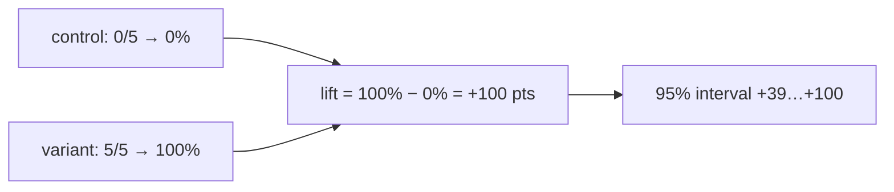

A `compare` eval answers "does this environment help?". Two settings decide what fails the run, and lift, with its interval, says how big the difference is and whether the attempts can tell.

```ts title="evals/skill.eval.ts"
group('house greeting', {
  compare: { baseline: plain, variants: [withHouseGreeting], minLift: 0 },
  gate: { passRate: 0.8 },
  runs: 5,
}, () => {
  evaluate('greets in the house style', async (c) => {
    await c.send('Create greet.js exporting greet(name) in our house style.')
    await expect(c.exec(greetAda)).toSucceed()
  })
})
```

Run under the fake agent, which writes the house greeting only when it has the skill:

```text
Summary
 evals/skill.eval.ts
   house greeting
     ✓ greets in the house style     5/10 · 100% gated  10 attempts
         fake/plain/fake                control    0/5    0%   not gated
         fake/with-house-greeting/fake  variant    5/5  100%   lift +100 pts (95% +39…+100, 5/5 vs 0/5) (minLift 0)   gate passRate 0.8
…
```

## Choose which cells gate

`compare.gate` picks which cells can fail the run. The control usually runs without the thing you're testing, so it's expected to do worse.

| `compare.gate` | Variant cells | Control cell |
|---|---|---|
| `'variants'` (default) | Gate | Report only: misses print under `Expected misses, not gated` |
| `'all'` | Gate | Gate |
| `'none'` | Report only | Report only |

A cell that doesn't gate has `gate: 'none'` in the plan and the record. Without `compare`, the one cell always gates.

## Choose how a cell passes

The `gate` option (on the config, a profile's `defaults`, a group or an eval) decides when a gating cell passes.

| `gate` | A cell passes when |
|---|---|
| `'all'` (default) | Every attempt passes |
| `{ passRate: 0.8 }` | At least 80% of its passes and fails are passes |

Infra errors and skipped attempts don't count either way. `'all'` gets harder to meet as `runs` grows, even for an agent that's no worse, so the plan prints a hint when an eval runs more than once with it.

## Lift and its interval

Lift is the variant's pass rate minus the control's on the same harness, in points. reeval stores it on the variant cell with a 95% interval on the difference, computed with Newcombe's method from each side's Wilson score interval.



When the interval spans 0, the summary adds `within noise`: at this many attempts, the variant and the control can't be told apart. The Wilson interval stays sensible at 0/n and n/n, which is where small evals usually land.

Lift gates; the win rates of a [compare question](/guide/compare#ask-questions) only annotate. They judge the attempts that passed their checks against each other, and never change a cell's outcome.

Each judge key also has its own pass rate on the cell
(`login 4/5 · checkout 0/5`). A key's lift prints only when both sides have at
least two counted attempts — the same floor at which an all-or-nothing split
can exclude 0. An attempt still fails if any judge fails.

## Why two runs is usually noise

The interval is wide when attempts are few. These are reeval's own intervals for common results:

| Variant | Control | Lift | 95% interval | Within noise |
|---|---|---|---|---|
| 1/1 | 0/1 | +100 | −12…+100 | yes |
| 2/2 | 2/2 | +0 | −66…+66 | yes |
| 2/2 | 1/2 | +50 | −27…+91 | yes |
| 2/2 | 0/2 | +100 | +7…+100 | no |
| 5/5 | 3/5 | +40 | −12…+77 | yes |
| 5/5 | 0/5 | +100 | +39…+100 | no |
| 10/10 | 5/10 | +50 | +12…+76 | no |
| 20/20 | 10/20 | +50 | +24…+70 | no |

At two runs per cell only an all-or-nothing difference clears noise. `reeval analyze` treats fewer than two counted attempts a side as `insufficient` (not measured), not as a results line; the run summary still prints the interval. reeval's own dogfood suite, run on Cursor with a good skill, a weak skill and no skill at `runs: 2`, is a real example:

```text
     ✓ fixes a broken config and explains it      5/6 · 100% gated  6 attempts
         cursor:composer-2.5/broken-project/reeval-tarball  control    1/2   50%   not gated
         cursor:composer-2.5/reeval-weak/reeval-tarball         variant    2/2  100%   lift +50 pts (95% −27…+91, 2/2 vs 1/2), within noise   gate passRate 0.5
         cursor:composer-2.5/reeval-good/reeval-tarball         variant    2/2  100%   lift +50 pts (95% −27…+91, 2/2 vs 1/2), within noise   gate passRate 0.5
```

One control attempt failed, so both skills show +50 pts, and neither is distinguishable from +0. The good skill's real effect showed up elsewhere: a median of 10 tool calls against the control's 40. Pass-rate lift only measures pass rate.

<Info>
  Use `reeval query lift` to see every variant cell's lift across runs, with `lo`, `hi` and `within_noise` columns.
</Info>

## Effort next to lift

Pass rate can't tell a skill that makes the agent four times cheaper from no skill at all when both pass. So under each variant the summary prints its effort: the median tool calls and agent time against its control's, the ratio, and a verdict. From a real run of Cursor and Antigravity at `--runs 2`:

```text
     ✓ greets in the house style                    4/8 · 100% gated  8 attempts
         cursor:composer-2.5/plain/docker                                control    0/2    0%   not gated
         cursor:composer-2.5/with-house-greeting/docker                  variant    2/2  100%   lift +100 pts (95% +7…+100, 2/2 vs 0/2)   gate passRate 0.5
           effort: tools 3 vs 11.5 (×0.26), agent 9s vs 22s (×0.39): too few attempts to test
         antigravity:gemini-3.8-flash-medium/plain/docker                control    0/2    0%   not gated
         antigravity:gemini-3.8-flash-medium/with-house-greeting/docker  variant    2/2  100%   lift +100 pts (95% +7…+100, 2/2 vs 0/2)   gate passRate 0.5
           effort: tools 3.5 vs 24.5 (×0.14), agent 17s vs 1m 00s (×0.28): too few attempts to test
```

The medians cover passes and fails; infra errors and skips don't count. The verdict comes from an exact, two-sided Mann–Whitney rank test on tool calls, the steadier measure (agent time gets its own verdict in `reeval query effort`). Effort never fails a run.

| Verdict | Printed | When |
|---|---|---|
| `fewer`, `more` | `fewer tool calls (p = 0.029)` | p is below 0.05 |
| `noise` | `within noise` | p is 0.05 or more |
| `insufficient` | `too few attempts to test` | Even complete separation couldn't reach p below 0.05 |

The smallest p a rank test can give depends only on the attempt counts, so a verdict needs at least four attempts on each side:

| Variant vs control | Smallest possible p | Can reach a verdict |
|---|---|---|
| 2 vs 2 | 0.333 | no |
| 3 vs 3 | 0.100 | no |
| 3 vs 4 | 0.057 | no |
| 4 vs 4 | 0.029 | yes |
| 5 vs 5 | 0.008 | yes |

## Effects across runs

`reeval query factor_effects` contrasts one factor at a time (`environment`, `harness`, `model`) with a pass-rate verdict from the Newcombe interval and an effort verdict from the rank test. `pass_verdict` is `insufficient` when either side has fewer than two counted attempts. Each row has an evidence tier:

| `tier` | The contrast |
|---|---|
| `controlled` | Two cells in one run and eval |
| `pooled` | The same contrast over comparable runs: attempts summed per eval, then across evals, where an effort effect needs the same verdict in at least 2/3 of them |
| `observed` | A cell between two runs whose fingerprint changed in one part; `confounded` when several did |
| `not_measured` | The factor has one level |

Pooling is how 2 runs at a time add up to a verdict. Over the same history, each run's skill contrast is `insufficient` on effort, and the pooled one isn't:

```text
eval_key                                                    factor       tier        points  lo      hi     pass_verdict  effort_verdict
evals/skill.eval.ts › house greeting › greets in the house…   environment  controlled  1       0.07    1      effect        insufficient
…
evals/skill.eval.ts › house greeting › greets in the house…   environment  pooled      1       0.307   1      effect        fewer
·                                                           harness      pooled      0       -0.436  0.436  noise         insufficient
```

`reeval analyze` reads these facts and explains a run in plain words; see [reeval analyze](/reference/cli/analyze).

## Gate on the lower bound with minLift

`minLift` (points from -1 to 1) fails a variant cell whose interval's **lower bound** is below it, so it asks for confidence, not a lucky point estimate. `minLift: 0` means "confidently no worse than the control". With `minLift: 0.5` at `runs: 2`, a perfect +100 still fails:

```text
         fake/with-house-greeting/fake  variant    2/2  100%   lift +100 pts (95% +7…+100, 2/2 vs 0/2) (minLift 50) ✗   gate passRate 0.8
…
Lift below minLift (1)
 ✗ evals/skill.eval.ts › house greeting › greets in the house style  fake/with-house-greeting/fake lift +100 pts (95% +7…+100, 2/2 vs 0/2): its lower bound is below minLift 50
```

A variant below its `minLift` fails the run with exit 1. To pass it, add runs until the interval narrows, not until the point estimate looks good.

## See it in the studio

The run page shows each cell's role, pass rate and lift with its interval.

<Image src="/assets/studio/run-cells-lift.png" alt="reeval studio run page with a cells table: the control at 0%, the variant at 100% and its lift" width={800} />

## Next

<CardGroup cols={2}>
  <Card title="Judges" icon="flask" href="/concepts/judges">
    How a judge verdict becomes a pass or a fail.
  </Card>
  <Card title="Prove a skill helps" icon="chart-line" href="/recipes/skill-lift">
    A complete compare eval with a pass-rate gate and `minLift`.
  </Card>
</CardGroup>
