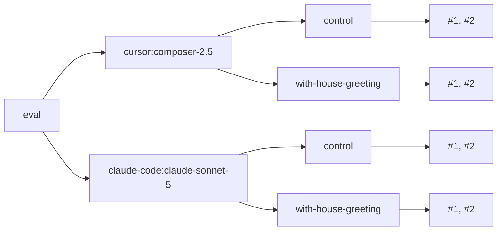

reeval never runs an eval once. It runs it once per cell, and `runs` times per cell, each time in a fresh sandbox:

```text
attempts = harnesses × (control + variants) × runs
```



## Build a matrix

Two harnesses in the config, one `compare` variant and `runs: 2` on the group:

```ts title="reeval.config.ts"
export default defineConfig({
  harness: [
    cursor({ model: 'composer-2.5' }),
    claudeCode({ model: 'claude-sonnet-5' }),
  ],
  judge: { model: 'typesafe-ai/jev-1.13.0' },
})
```

```ts title="evals/skill.eval.ts"
group(
  'house greeting',
  {
    compare: { baseline: plain, variants: [withHouseGreeting] },
    runs: 2,
  },
  () => {
    evaluate('greets in the house style', async (c) => {
      await c.send('Create greet.js exporting greet(name) in our house style.')
      await expect(c.exec(greetAda)).toSucceed()
    })
  },
)
```

That's 2 harnesses × (1 control + 1 variant) × 2 runs = 8 attempts in 4 cells. `--dry-run` shows it without keys or Docker:

```text
plan  1 eval · 4 cells · 8 attempts · ~24m 00s serial (~6m 00s at concurrency 4)
eval                                                            harnesses  variants  runs  attempts  notes
evals/skill.eval.ts › house greeting › greets in the house style  2          1         2     8
hint: 1 eval runs more than once with the default gate, so every attempt must pass (pass^k); set gate: { passRate: 0.8 } to gate on pass@1 instead
```

The hint is about [gates](/concepts/lift): with more than one run, the default gate needs every attempt to pass.

## Cell keys and attempt ids

A cell key is `<harness>/<environment>/<sandbox>`, and an attempt id adds `#<n>`:

| Part | Where it comes from | Examples |
|---|---|---|
| harness | `<kind>:<model>`, or the harness's `id` | `cursor:composer-2.5`, `fake` |
| environment | The environment's name, `-` for none | `-`, `with-house-greeting` |
| sandbox | `docker`, or `docker:<image or Dockerfile>` | `docker`, `docker:python:3.12-slim`, `fake` |
| run | `#1` to `#runs` | `#2` |

So `cursor:composer-2.5/with-house-greeting/docker#2` is the second run of the skill variant on Cursor. Two harnesses that resolve to the same id are an error; give one an `id`, as in `cursor({ model: 'composer-2', id: 'fast' })`.

In plain output, each attempt's lines carry a shorter tag: the eval's distinctive word, the run number, and what tells its cells apart.

```text
[greets#1 control] ▶ evals/skill.eval.ts › house greeting › greets in the house style
[greets#2 control] ▶ evals/skill.eval.ts › house greeting › greets in the house style
[greets#1 with-house-greeting] ▶ evals/skill.eval.ts › house greeting › greets in the house style
```

## Filter by cell

Filters that aren't eval file paths match eval names and cell keys, so a harness id picks its cells. Here `skill` picks the file and `claude-code` the cells:

```bash
reeval run --dry-run skill claude-code
```

```text
plan  1 eval · 2 cells · 4 attempts · ~12m 00s serial (~3m 00s at concurrency 4)
eval                                                            harnesses  variants  runs  attempts  notes
evals/skill.eval.ts › house greeting › greets in the house style  1          1         2     4
…
```

## Read the plan as JSON

`--dry-run --json` prints every cell with its role and gate. From `examples/hello` under the fake config:

```bash
reeval run --dry-run --json --config reeval.fake.config.ts skill
```

```text
{
  "profile": null,
  "totals": {
    "evals": 1,
    "skipped": 0,
    "cells": 2,
    "attempts": 2
  },
…
  "evals": [
    {
      "id": "evals/skill.eval.ts › house greeting › greets in the house style",
…
      "cells": [
        {
          "key": "fake/plain/fake",
          "harness": "fake",
          "environment": "plain",
          "sandbox": "fake",
          "role": "control",
          "gate": "none",
          "runs": 1,
          "brokered": [],
          "egress": {
            "policy": "allow-all",
            "auto": []
          }
        },
        {
          "key": "fake/with-house-greeting/fake",
          "harness": "fake",
          "environment": "with-house-greeting",
          "sandbox": "fake",
          "role": "variant",
          "variant": "with-house-greeting",
          "gate": "all",
…
  "excluded": [],
  "images": []
}
```

The control's `gate` is `"none"`: under the default `compare.gate: 'variants'`, only variant cells can fail the run.

## A real suite

`examples/hello` with its real config: 18 evals, one with a variant, so 19 cells.

```text
plan  18 evals · 19 cells · 19 attempts · ~57m 00s serial (~14m 15s at concurrency 4)
eval                                                              harnesses  variants  runs  attempts  notes
evals/brokering.eval.ts › the agent authenticates without seeing…   1          —         1     1
…
evals/gemini.eval.ts › the agent calls Gemini with a brokered key   1          —         1     1         brokered: GOOGLE_GENAI_API_KEY → generativelanguage.googleapis.com; GEMINI_API_KEY → generativelanguage.googleapis.com
…
evals/skill.eval.ts › house greeting › greets in the house style    1          1         1     2
evals/sqlite.eval.ts › queries a seeded SQLite database             1          —         1     1
```

With `--profile nightly` (`defaults: { runs: 3 }`) the same suite is 57 attempts. The estimate is the median of each eval's recent attempts on that harness, else 3 minutes each.

<Info>
  An eval has one sandbox. Comparing toolchains needs different checks, so that's a separate eval, not another axis.
</Info>

## Next

<CardGroup cols={2}>
  <Card title="Options and inheritance" icon="gear" href="/concepts/options">
    Where `harness`, `runs` and `compare` come from.
  </Card>
  <Card title="Gates and lift" icon="chart-line" href="/concepts/lift">
    How a cell passes, and what its lift means.
  </Card>
</CardGroup>
