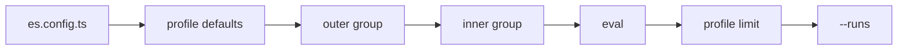

`defineConfig`, `group` and `evaluate` take the same options. Each eval's value comes from the nearest level that sets it, and a profile can then narrow a few of them.



## Follow one eval

A config, a profile that sets `runs`, a group that lowers the judge threshold and an eval that sets its own timeout:

```ts title="es.config.ts"
export default defineConfig({
  harness: fakeHarness({
    files: { 'add.js': 'export const add = (a, b) => a + b\n' },
  }),
  sandbox: fakeSandbox(),
  judge: { model: fakeJudge({ score: 0.9 }) },
  timeout: '2m',
  profiles: {
    nightly: { defaults: { runs: 3 } },
  },
})
```

```ts title="evals/add.es.ts"
group('maths', { judge: { threshold: 0.7 }, tags: ['maths'] }, () => {
  evaluate('adds two numbers', { timeout: '5m' }, async (t) => {
    await t.send('Create add.js exporting add(a, b).')
    await expect(t.exec('test -f add.js')).toSucceed()
    expect(await t.judge('Does add.js export add?')).toPass()
  })
})
```

`es run --profile nightly -v` prints where each option came from:

```text
[adds#3 fake]  17:15:24 plan      config es.config.ts · profile nightly (--profile) · run 20260926T171524Z_nogit_cursor-agent_vhan · attempt fake/-/fake#3
[adds#3 fake]  17:15:24 plan      harness fake (es.config.ts or its default)
[adds#3 fake]  17:15:24 plan      sandbox fake (es.config.ts or its default)
[adds#3 fake]  17:15:24 plan      environment - (none set)
[adds#3 fake]  17:15:24 plan      egress allow-all (es.config.ts or its default)
[adds#3 fake]  17:15:24 plan      run 3 · runs (profiles.nightly.defaults) · gate all · timeout 5m 00s (evaluate("maths › adds two numbers"))
[adds#3 fake]  17:15:24 plan      judge fake judge · threshold 0.7 (group("maths"))
```

The profile's `defaults` sit under the groups and evals: they fill in what the eval files don't set, and anything the files set wins.

## The levels, in order

| Level | Set in | Role |
|---|---|---|
| Config | `es.config.ts` | The base for every eval |
| Profile `defaults` | `profiles.<name>.defaults` | Fills in what groups and evals don't set |
| Groups | `group(name, options, fn)`, outer then inner | Applies to every eval inside |
| Eval | `evaluate(name, options, fn)` | The eval's own values |
| Profile `limit` | `profiles.<name>.limit` | Narrows `runs`, `harness` and `compare` |
| `--runs` | The CLI | Sets `runs` everywhere, pins included |

An environment's `egress` sits between the profile defaults and the groups: groups and evals override it, and it overrides the config.

## How each option merges

Most options replace: the nearest level wins outright. Four merge instead.

| Option | Rule | Example |
|---|---|---|
| `harness`, `sandbox`, `environment`, `compare`, `runs`, `gate`, `timeout`, `egress` | Replace | An eval's `runs: 5` beats the group's `runs: 2` |
| `env` | Merge by variable name | The group adds `DEBUG`, the eval overrides `NODE_ENV`, the config's `API_URL` stays |
| `judge` | Merge field by field | The group sets `threshold: 0.7`, the model still comes from the config |
| `tags`, `pin` | Union | A group's `['slow']` and an eval's `['maths']` give `['slow', 'maths']` |

`compare` can't be set in `es.config.ts`, since it would multiply every eval. Unknown keys are errors with a hint, such as `Unknown option "repeat" … Did you mean "runs"?`.

## Edit the inherited harness list

`harness` is the one option that's a list: each harness is its own [cell](/concepts/matrix). A list replaces the inherited one, and a function receives it and returns a new one:

```ts title="evals/offline.es.ts"
evaluate('installs from npm only', {
  harness: (inherited) => inherited.slice(0, 1),
  egress: { allow: [...DEFAULT_EGRESS_ALLOW] },
}, async (t) => {
  await t.send('Add left-pad to package.json and install it.')
  await expect(t.exec('npm ls left-pad')).toSucceed()
})
```

Under a config with Cursor and Claude Code, this eval runs on Cursor only. A function can also add one: `(inherited) => [...inherited, cursor({ model: 'composer-2', id: 'fast' })]`.

## Narrow with a limit, and pin what can't narrow

A profile's `limit` sits over every eval and only narrows: `runs` becomes at most the limit, `harness` keeps the listed ids, and `compare: false` runs the control only. `pin` on a group or eval exempts a key.

```ts title="evals/skill.es.ts"
group(
  'house greeting',
  { compare: [withHouseGreeting], pin: ['compare'] },
  () => { /* … */ },
)
```

With `examples/hello`'s `pr` profile (`limit: { runs: 1, compare: false }`), every other eval drops its variants, and this one keeps its variant and says why:

```text
plan  profile pr (auto: CI is set) · 18 evals · 19 cells · 19 attempts · ~57m 00s serial (~14m 15s at concurrency 4) · budget 20 attempts ✓
…
evals/skill.es.ts › house greeting › greets in the house style    1          1         1     2         pinned: compare
```

`pin` accepts `harness`, `runs` and `compare`, the keys a limit can touch. `--runs` beats pins too, since you typed it.

<Warning>
  A limit's `harness` list takes harness ids (`'cursor:composer-2.5'`), not harness objects. An eval left with no harness is skipped, and the plan says why.
</Warning>

## Next

<CardGroup cols={2}>
  <Card title="The matrix" icon="layer-group" href="/concepts/matrix">
    How the resolved options become cells and attempts.
  </Card>
  <Card title="Options reference" icon="book" href="/reference/options">
    Every option, where it's accepted and its default.
  </Card>
</CardGroup>
