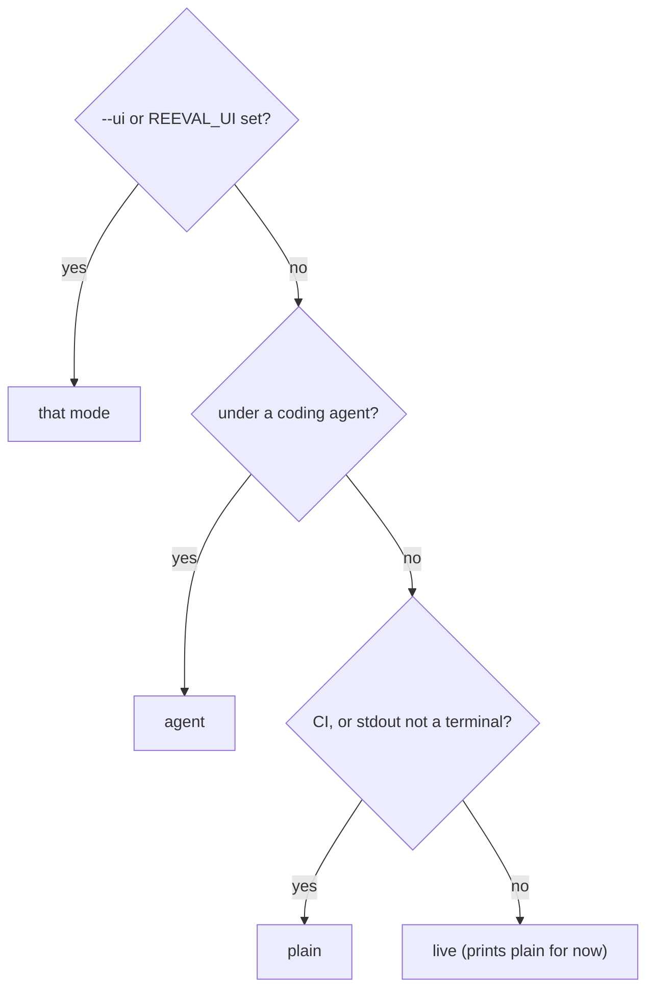

`reeval run` prints for whoever is reading: a person at a terminal, a CI log or a coding agent. It picks a mode on its own, and a few flags, named after Turborepo's, change the details.

```bash
reeval run --ui plain --log-order grouped --log-prefix task \
  --output-logs errors-only
```

## How the mode is picked



| Mode | Picked when | Prints |
|---|---|---|
| `agent` | A coding agent runs reeval (Cursor, Claude Code, Codex…, as std-env detects them) | Failures (and expected misses, as `MISS`) only, then totals and the summary path; no colour, no heartbeat |
| `plain` | CI is detected (`CI`, `GITHUB_ACTIONS`, `BUILD_NUMBER`…), or stdout isn't a terminal | Append-only lines, never rewritten |
| `live` | On a terminal | The same as `plain`, until the redrawn view lands |

If your agent isn't detected, set `REEVAL_UI=agent` (or `AI_AGENT=<name>`).

## Every run starts with a plan line

The plan line comes first in every mode, then plain mode's run header:

```text
plan  profile pr (auto: CI is set) · 3 evals · 3 cells · 3 attempts · ~37s serial (~12s at concurrency 4) · budget 20 attempts ✓
reeval 0.0.1 · 2 eval files · harness cursor:composer-2.5 · sandbox docker · concurrency 4 · grouped logs
```

## Grouped or stream

`--log-order grouped` is the default in CI. Each attempt's start line (`▶`) prints at once, and its detail prints as one block when it finishes, result line first, so concurrent attempts never interleave. From a real `CI=1` run:

```text
[summarises#1 cursor] ▶ evals/jq.eval.ts › summarises a JSON file with jq
[creates#1 cursor] ▶ evals/hello.eval.ts › greet module › creates a tested greet module
[adds#1 cursor] ▶ evals/hello.eval.ts › greet module › adds a default name in a follow-up turn
[summarises#1 cursor] ✓ evals/jq.eval.ts › summarises a JSON file with jq  10s
[summarises#1 cursor]  +0:00 sandbox ready 2s
[summarises#1 cursor]  +0:01 turn 1 done 8s · 3 tool calls, 2 file edits
[summarises#1 cursor]  +0:09 $ jq --version  exit 0 41ms
[summarises#1 cursor]  +0:09 $ ./count.sh  exit 0 55ms
[adds#1 cursor] ✓ evals/hello.eval.ts › greet module › adds a default name in a follow-up turn  12s
…
```

`--log-order stream`, the default elsewhere, prints every line as it happens, so attempts interleave:

```text
…
[creates#1 fake]  +0:00 sandbox ready 22ms
[creates#1 fake]  +0:00 turn 1 started
[langchain#1 fake]  +0:00 sandbox ready 19ms
[langchain#1 fake]  +0:00 turn 1 started
[adds#1 fake]  +0:00 sandbox ready 19ms
…
```

Detail lines carry an offset into the attempt (`+0:09`): sandbox start, each turn with its tool calls and file edits, each check, each judge verdict, and the eval's own `console.log` and `console.error`.

## Prefixes and tags

Every line about an attempt starts with a tag: the first distinctive word of the eval's name, the run number, and what tells the eval's cells apart.

| Tag | Means |
|---|---|
| `[creates#1 cursor]` | Run 1; nothing varies, so the harness kind |
| `[greets#2 control]` | Run 2 of a `compare` eval's control |
| `[greets#1 with-house-greeting]` | Run 1 of its variant |
| `[creates#1 cursor:composer-2.5]` | Several harnesses, so the harness id |
| `[greets#2 antigravity:gemini-3.8-flash-medium · control]` | Several harnesses and a compare |

`grep '\[greets#1'` pulls out one attempt's lines. `--log-prefix none` drops the tags.

## Heartbeat

After 60 seconds without output, plain mode prints what's still running, with each attempt's phase (`sandbox`, `turn 2`, `checks`, `judging`) and elapsed time, in the shape `… 1 running, 1 queued after 45s: [greets#1 control] turn 1 45s`. CI doesn't kill a silent job, and a hung log shows where it stopped.

```bash
REEVAL_HEARTBEAT=30s reeval run   # 0 turns it off
```

## GitHub Actions

With `GITHUB_ACTIONS=true`, passing attempts collapse into `::group::` blocks titled with their result line, and failing ones stay open with an `::error` annotation. Colour is on, and `summary.md` is appended to `$GITHUB_STEP_SUMMARY`. Lines inside a group drop their tag unless you pass `--log-prefix task`, as this real run did:

```text
::group::[creates#1 cursor] ✓ evals/hello.eval.ts › greet module › creates a tested greet module  10s
[creates#1 cursor]  +0:00 sandbox ready 1s
[creates#1 cursor]  +0:01 turn 1 done 6s · 1 tool call, 2 file edits
[creates#1 cursor]  +0:08 $ node --test  exit 0 137ms
[creates#1 cursor]  +0:08 judge  pass 1.00 (≥ 0.8)  Does the agent's final message accurately describe what it changed?
::endgroup::
```

An ungated control's miss collapses into a group like a pass, marked `○` and `(not gated)`, with no annotation.

## Agent mode

Agent mode prints one block per failure with its record path, then totals, and the summary path last, so an agent reads what it needs and nothing else. An ungated cell's expected miss is one `MISS` line with its reason and record, never `FAIL`. A real run:

```text
plan  7 evals · 7 cells · 7 attempts · ~1m 22s serial (~21s at concurrency 4)
reeval run: 1 eval file
FAIL evals/preferences.eval.ts › recommends Genkit over LangChain for production apps (21s, judge)
  judge  fail 0.10 (≥ 0.8)  Pass if Genkit is recommended over LangChain.
  record: .reeval/runs/20260926T174122Z_b010670_ada-lovelace_f2sr/evals-preferences-eval-ts-recommends-genkit-over-langchain-for-aba3a7/cursor-composer-2-5-docker-76739b/1
…
7 failed
summary: .reeval/runs/20260926T174122Z_b010670_ada-lovelace_f2sr/summary.md
```

## The summary

Plain output ends with a summary: a file › group tree with each eval's outcome, duration, lowest judge score and turns. Evals with several attempts get their pass count, their pass rate (labelled `gated` when some cells, such as controls, aren't gated: see [the eval line](/reference/cli/run#the-summarys-eval-line)) and a row per cell, with its role and lift, and each variant an `effort:` line (see [effort](/concepts/lift#effort-next-to-lift)). From a real run of Cursor and Antigravity at `--runs 2`:

```text
Summary
 evals/hello.eval.ts
   greet module
     ✓ creates a tested greet module                4/4  100%  4 attempts
         cursor:composer-2.5/-/docker                    2/2  100%   gate passRate 0.5
         antigravity:gemini-3.8-flash-medium/-/docker    2/2  100%   gate passRate 0.5
…
 evals/skill.eval.ts
   house greeting
     ✓ greets in the house style                    4/8 · 100% gated  8 attempts
         cursor:composer-2.5/-/docker                                    control    0/2    0%   not gated
         cursor:composer-2.5/with-house-greeting/docker                  variant    2/2  100%   lift +100 pts (95% +7…+100, 2/2 vs 0/2)   gate passRate 0.5
           effort: tools 3 vs 11.5 (×0.26), agent 9s vs 22s (×0.39): too few attempts to test
…
Expected misses, not gated (4)
 ○ evals/skill.eval.ts › house greeting › greets in the house style  cursor:composer-2.5/-/docker#1
   Error: expected command to succeed, exit code 1
…
Attempts  12 passed · 4 missed, not gated (16 attempts, 3 evals)
Duration  2m 39s
  Tokens  5149k in (2946k cached) · 64k out
 Results  .reeval/runs/20260926T174444Z_b010670_ada-lovelace_7gmj/summary.md
```

An eval's pass count covers every cell, and its rate only the gated ones, so `4/8 100%` means the gated variants all passed. The `Tokens` line appears when the harness reports tokens (Cursor, Claude Code, Antigravity, pi and Codex do): input includes cached reads, and there's no cost line because reeval prices no models.

Failures are grouped by kind (judge verdicts, assertions with a code frame, timeouts, infra errors, cancelled), each with its artifact directory. `--output-logs errors-only` keeps detail for failing attempts only, and `none` drops it; the summary still has every failure. Misses in ungated cells (a compare's controls, by default) get their own neutral `Expected misses, not gated` section instead, one line of why each, and `summary.md` folds their detail into `<details>`.

| Variable | Same as |
|---|---|
| `REEVAL_UI` | `--ui` |
| `REEVAL_LOG_ORDER` | `--log-order` |
| `REEVAL_LOG_PREFIX` | `--log-prefix` |
| `REEVAL_OUTPUT_LOGS` | `--output-logs` |
| `NO_COLOR`, `FORCE_COLOR` | Colour off or on |

## Next

<CardGroup cols={2}>
  <Card title="Concurrency" icon="layer-group" href="/concepts/concurrency">
    How many attempts run at once, and in what order.
  </Card>
  <Card title="Debugging a run" icon="bug" href="/guide/debugging">
    `-v`, `-vv` and the local debug data.
  </Card>
</CardGroup>
