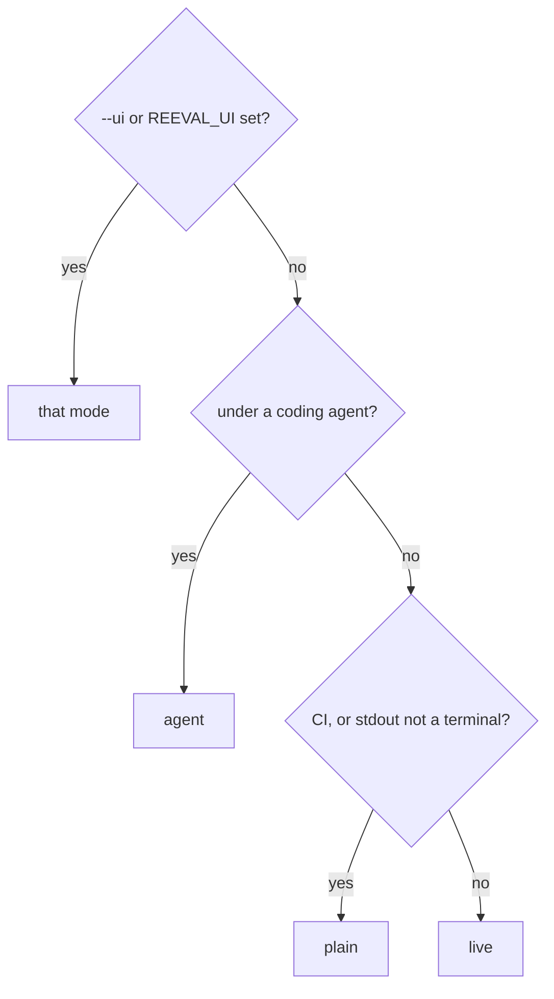

`reeval run` prints for whoever is reading: a person at a terminal, a CI log or a coding agent. It picks a mode on its own, and a few flags, named after Turborepo's, change the details. Every mode ends the same way: a result block per eval and the tally.

```bash
reeval run --ui plain --log-order grouped --log-prefix task \
  --output-logs errors-only
```

## How the mode is picked



| Mode | Picked when | Prints |
|---|---|---|
| `agent` | A coding agent runs reeval (Cursor, Claude Code, Codex, GitHub Copilot…, as std-env detects them) | The plan, then the result blocks and the tally; no attempt logs, colour or heartbeat |
| `plain` | CI is detected (`CI`, `GITHUB_ACTIONS`, `BUILD_NUMBER`…), or stdout isn't a terminal | Append-only attempt logs, never rewritten, then the result blocks |
| `live` | On a terminal | The same logs under one redrawn line (`7 evals · 12/28 tries`), then the result blocks |

If your agent isn't detected, set `REEVAL_UI=agent` (or `AI_AGENT=<name>`).

## Every run starts with a plan line

The plan line comes first in every mode, then the run header. From `reeval run hello` in `examples/hello`:

```text
plan  run 20261020T212103Z_a3fbded_cursor-agent_zjv6 · 2 evals · 2 cells · 2 attempts · ~6m 00s serial (~3m 00s at concurrency 4)
reeval 0.10.0 · run 20261020T212103Z_a3fbded_cursor-agent_zjv6 · 1 eval file · harness cursor:composer-2.5 · sandbox docker · concurrency 4 · grouped logs
```

## Result blocks

When the attempts finish, each eval gets a block, in file-path order and then source order: its verdict, its name, and only what explains the verdict. A pass prints its name alone; a fail prints its failed checks with their assertion, a check that never ran as `not run`, and how many more passed. A file of seven evals on the fake harness:

```text
pass             writes greet.js

fail             greets in French
  french greeting  failed
    expected command to succeed, exit code 1
  +1 more passed

fail             explains why greet.js fails
  2 tries               1 of 2
  names the root cause  1 of 2
    expected 'Docker is down' to contain 'null'
  +1 more passed

fail             reads the fixture repo
  error            the fixture repo is missing

infra error      starts its sandbox
  infra error      the fake sandbox fell over

skipped          greets in Welsh
todo             greets in Klingon

3 fail · 1 pass · 1 infra error · 2 skipped
Set analysis.model in reeval.config.ts for answers to what each eval asks.
```

The tally counts each eval (and each case of a family) once, fails first, and leaves zeros out. An infra error isn't a fail, and a row's count names infra errors and cancelled and skipped tries apart (`0 of 1 · 2 skipped`). The [exit code](/reference/cli#exit-codes) says which happened. `not gated` marks an eval whose cells are all ungated, a study, so it never reads `pass` beside `0 of 2`.

The last line, `Set analysis.model…`, prints while `analysis.model` is unset; the judge's model never stands in for it. With `analysis.model` set, the tally ends the run.

## The layout follows what the eval varies

| The eval varies | Layout |
|---|---|
| Nothing | Results, as above: the failed checks of each try |
| An environment (`compare`) | Measure a change: a row per arm with `N of M` and the effect, the checks that failed in some arm, then effort |
| The harness (`harness: [a, b]`) | Compare harnesses: a row per harness; a failing one indents its checks |
| Both | The harness outer, its arms inner |
| Its cases (`evaluate.each`) | A family: the template as the heading, a row per case; with a change, each case's arms and the pooled `all cases` row |

A measure-a-change block for a baseline and two variants, four tries each:

```text
fail             greets in the house style
  arm              pass
  plain            0 of 4
  with-skill       4 of 4  helped
  with-doc         0 of 4
  check            plain    with-skill  with-doc
  house greeting   0 of 4   4 of 4      0 of 4
    expected command to succeed, exit code 1
  exclaims         not run  4 of 4      not run
  +1 more passed
  effort           tools  time
  plain            1      0s
  with-skill       1      0s
  with-doc         1      0s
```

The effect reads `helped`, `made it worse` or `can't tell yet`, from the same [interval as lift](/concepts/lift), and is blank when nothing changed. With fewer than four counted tries a side it's always `can't tell yet`. The effort table needs four tries a side too, and shows when the eval failed or its effort differs. Counts are `N of M`, never percentages; `-v` adds each arm's difference and 95% interval:

```text
  with-skill       4 of 4  helped
    difference +100 points, 95% interval +31…+100
```

`summary.md` and `reeval show` print the same blocks. `reeval compare` keeps its own view of two runs.

## Grouped or stream

`--log-order grouped` is the default in CI. Each attempt's log prints as one block when it finishes, under its start line (`▶`), so concurrent attempts never interleave. From `CI=1 reeval run --config reeval.fake.config.ts` in `examples/hello`:

```text
[grace#1 with-house-greeting] ▶ evals/greetings.eval.ts › greets Grace in the house style
[grace#1 with-house-greeting]  +0:00 sandbox ready 61ms
[grace#1 with-house-greeting]  +0:00 turn 1 done 17ms · 0 tool calls, 2 file edits
[grace#1 with-house-greeting]  +0:00 $ node -e "import('./greet.js').then((m) => process.exit(m.greet('Grace') ===…  exit 0 21ms
[grace#1 control] ▶ evals/greetings.eval.ts › greets Grace in the house style
[grace#1 control]  +0:00 sandbox ready 54ms
[grace#1 control]  +0:00 turn 1 done 12ms · 0 tool calls, 3 file edits
[grace#1 control]  +0:00 $ node -e "import('./greet.js').then((m) => process.exit(m.greet('Grace') ===…  exit 1 34ms
[grace#1 control]  Error: expected command to succeed, exit code 1
…
```

`--log-order stream`, the default elsewhere, prints every line as it happens, so attempts interleave:

```text
[ada#1 control] ▶ evals/greetings.eval.ts › greets Ada in the house style
[ada#1 control]  +0:00 sandbox starting
[ada#1 with-house-greeting] ▶ evals/greetings.eval.ts › greets Ada in the house style
[ada#1 with-house-greeting]  +0:00 sandbox starting
[grace#1 control] ▶ evals/greetings.eval.ts › greets Grace in the house style
…
```

Detail lines carry an offset into the attempt (`+0:09`): sandbox start, each turn with its tool calls and file edits, each check, each judge verdict, and the eval's own `console.log` and `console.error`. `--output-logs errors-only` keeps the logs of failing attempts only, and `none` drops them; the result blocks still have every failure.

## Prefixes and tags

Every line about an attempt starts with a tag: the first distinctive word of the eval's name, the run number, and what tells the eval's cells apart.

| Tag | Means |
|---|---|
| `[creates#1 cursor]` | Run 1; nothing varies, so the harness kind |
| `[greets#2 control]` | Run 2 of a `compare` eval's control |
| `[greets#1 with-house-greeting]` | Run 1 of its variant |
| `[creates#1 cursor:composer-2.5]` | Several harnesses, so the harness id |
| `[greets#2 antigravity:gemini-3.8-flash-medium · control]` | Several harnesses and a compare |

`grep '\[greets#1'` pulls out one attempt's lines. `--log-prefix none` drops the tags.

## Heartbeat

After 60 seconds without output, plain mode prints what's still running, with each attempt's phase (`sandbox`, `turn 2`, `checks`, `judging`) and elapsed time, in the shape `… 1 running, 1 queued after 45s: [greets#1 control] turn 1 45s`. CI doesn't kill a silent job, and a hung log shows where it stopped. Live mode's redrawn line takes its place.

```bash
REEVAL_HEARTBEAT=30s reeval run   # 0 turns it off
```

## GitHub Actions

With `GITHUB_ACTIONS=true`, each attempt's log collapses into a `::group::` block titled with its start line, colour is on, and `summary.md` is appended to `$GITHUB_STEP_SUMMARY`. Lines inside a group drop their tag unless you pass `--log-prefix task`, as here:

```text
::group::[ada#1 control] ▶ evals/greetings.eval.ts › greets Ada in the house style
[ada#1 control]  +0:00 sandbox ready 41ms
[ada#1 control]  +0:00 turn 1 done 7ms · 0 tool calls, 3 file edits
[ada#1 control]  +0:00 $ node -e "import('./greet.js').then((m) => process.exit(m.greet('Ada') ===…  exit 1 32ms
[ada#1 control]  Error: expected command to succeed, exit code 1
::endgroup::
```

## Agent mode

Agent mode prints the plan, the result blocks and the tally, and nothing else, so an agent reads what it needs. `reeval show` and the record have the detail. The seven evals from [Result blocks](#result-blocks) with `REEVAL_UI=agent`:

```text
plan  run 20261020T211926Z_da3d797_cursor-agent_dcy5 · 5 evals · 5 cells · 6 attempts · ~1s serial (~313ms at concurrency 4)
…
reeval run: 20261020T211926Z_da3d797_cursor-agent_dcy5 · 1 eval file

pass             writes greet.js

fail             greets in French
  french greeting  failed
    expected command to succeed, exit code 1
  +1 more passed
…
770ms · results .reeval/runs/20261020T211926Z_da3d797_cursor-agent_dcy5/summary.md
3 fail · 1 pass · 1 infra error · 2 skipped
Set analysis.model in reeval.config.ts for answers to what each eval asks.
```

| Variable | Same as |
|---|---|
| `REEVAL_UI` | `--ui` |
| `REEVAL_LOG_ORDER` | `--log-order` |
| `REEVAL_LOG_PREFIX` | `--log-prefix` |
| `REEVAL_OUTPUT_LOGS` | `--output-logs` |
| `NO_COLOR`, `FORCE_COLOR` | Colour off or on |

## Next

<CardGroup cols={2}>
  <Card title="Concurrency" icon="layer-group" href="/concepts/concurrency">
    How many attempts run at once, and in what order.
  </Card>
  <Card title="Debugging a run" icon="bug" href="/guide/debugging">
    `-v`, `-vv` and the local debug data.
  </Card>
</CardGroup>
