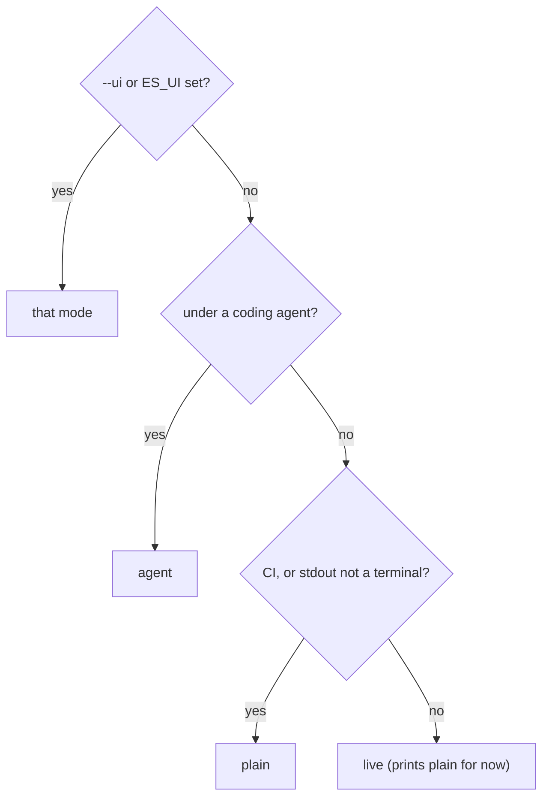

`es run` prints for whoever is reading: a person at a terminal, a CI log or a coding agent. It picks a mode on its own, and a few flags, named after Turborepo's, change the details.

```bash
es run --ui plain --log-order grouped --log-prefix task \
  --output-logs errors-only
```

## How the mode is picked



| Mode | Picked when | Prints |
|---|---|---|
| `agent` | A coding agent runs ES (Cursor, Claude Code, Codex…, as std-env detects them) | Failures only, then totals and the summary path; no colour, no heartbeat |
| `plain` | CI is detected (`CI`, `GITHUB_ACTIONS`, `BUILD_NUMBER`…), or stdout isn't a terminal | Append-only lines, never rewritten |
| `live` | On a terminal | The same as `plain`, until the redrawn view lands |

If your agent isn't detected, set `ES_UI=agent` (or `AI_AGENT=<name>`).

## Every run starts with a plan line

The plan line comes first in every mode, then plain mode's run header:

```text
plan  profile pr (auto: CI is set) · 3 evals · 3 cells · 3 attempts · ~50s serial (~17s at concurrency 4) · budget 20 attempts ✓
es 0.0.1 · 2 eval files · harness cursor:composer-2.5 · sandbox docker · concurrency 4 · grouped logs
```

## Grouped or stream

`--log-order grouped` is the default in CI. Each attempt's start line (`▶`) prints at once, and its detail prints as one block when it finishes, result line first, so concurrent attempts never interleave. From a real `CI=1` run:

```text
[summarises#1 cursor] ▶ evals/jq.es.ts › summarises a JSON file with jq
[creates#1 cursor] ▶ evals/hello.es.ts › greet module › creates a tested greet module
[adds#1 cursor] ▶ evals/hello.es.ts › greet module › adds a default name in a follow-up turn
[summarises#1 cursor] ✓ evals/jq.es.ts › summarises a JSON file with jq  14s
[summarises#1 cursor]  +0:00 sandbox ready 2s
[summarises#1 cursor]  +0:01 turn 1 done 11s · 3 tool calls, 2 file edits
[summarises#1 cursor]  +0:12 $ jq --version  exit 0 39ms
[summarises#1 cursor]  +0:12 $ ./count.sh  exit 0 52ms
[creates#1 cursor] ✓ evals/hello.es.ts › greet module › creates a tested greet module  15s
…
```

`--log-order stream`, the default elsewhere, prints every line as it happens, so attempts interleave:

```text
…
[creates#1 fake]  +0:00 sandbox ready 21ms
[creates#1 fake]  +0:00 turn 1 started
[adds#1 fake]  +0:00 sandbox ready 18ms
[adds#1 fake]  +0:00 turn 1 started
[langchain#1 fake]  +0:00 sandbox ready 18ms
…
```

Detail lines carry an offset into the attempt (`+0:12`): sandbox start, each turn with its tool calls and file edits, each check, each judge verdict, and the eval's own `console.log` and `console.error`.

## Prefixes and tags

Every line about an attempt starts with a tag: the first distinctive word of the eval's name, the run number, and what tells the eval's cells apart.

| Tag | Means |
|---|---|
| `[creates#1 cursor]` | Run 1; nothing varies, so the harness kind |
| `[greets#2 control]` | Run 2 of a `compare` eval's control |
| `[greets#1 with-house-greeting]` | Run 1 of its variant |
| `[scaffolds#1 antigravity:gemini-3.8-flash-low · control]` | Several harnesses and a compare |

`grep '\[greets#1'` pulls out one attempt's lines. `--log-prefix none` drops the tags.

## Heartbeat

After 60 seconds without output, plain mode prints what's still running, with each attempt's phase (`sandbox`, `turn 2`, `checks`, `judging`) and elapsed time, in the shape `… 1 running, 1 queued after 45s: [greets#1 control] turn 1 45s`. CI doesn't kill a silent job, and a hung log shows where it stopped.

```bash
ES_HEARTBEAT=30s es run   # 0 turns it off
```

## GitHub Actions

With `GITHUB_ACTIONS=true`, passing attempts collapse into `::group::` blocks titled with their result line, and failing ones stay open with an `::error` annotation. Colour is on, and `summary.md` is appended to `$GITHUB_STEP_SUMMARY`. Lines inside a group drop their tag unless you pass `--log-prefix task`, as this real run did:

```text
::group::[creates#1 cursor] ✓ evals/hello.es.ts › greet module › creates a tested greet module  14s
[creates#1 cursor]  +0:00 sandbox ready 2s
[creates#1 cursor]  +0:01 turn 1 done 9s · 2 tool calls, 2 file edits
[creates#1 cursor]  +0:11 $ node --test  exit 0 131ms
[creates#1 cursor]  +0:11 judge  pass 1.00 (≥ 0.8)  Does the agent's final message accurately describe what it changed?
::endgroup::
```

A failing control that isn't gated gets `(not gated)` and no annotation.

## Agent mode

Agent mode prints one block per failure with its record path, then totals, and the summary path last, so an agent reads what it needs and nothing else. A real run:

```text
plan  7 evals · 7 cells · 7 attempts · ~1m 53s serial (~28s at concurrency 4)
es run: 1 eval file
FAIL evals/preferences.es.ts › recommends Genkit over LangChain for production apps (25s, judge)
  judge  fail 0.10 (≥ 0.8)  Pass if Genkit is recommended over LangChain.
  record: .es/runs/20260926T170730Z_bd6205e_ada-lovelace_8vkb/evals-preferences-es-ts-recommends-genkit-over-langchain-for-aba3a7/cursor-composer-2-5-docker-76739b/1
…
1 passed, 6 failed
summary: .es/runs/20260926T170730Z_bd6205e_ada-lovelace_8vkb/summary.md
```

## The summary

Plain output ends with a summary: a file › group tree with each eval's outcome, duration, lowest judge score and turns. Evals with several attempts get their pass count and a row per cell, with its role and lift.

```text
Summary
 evals/hello.es.ts
   greet module
     ✓ creates a tested greet module                         136ms  judge 0.95  1 turn
     ✓ adds a default name in a follow-up turn                99ms  judge 0.95  2 turns
…
 evals/skill.es.ts
   house greeting
     ✓ greets in the house style                               1/2  100%  2 attempts
         fake/-/fake                    control    0/1    0%   not gated
         fake/with-house-greeting/fake  variant    1/1  100%   lift +100 pts (95% −12…+100, 1/1 vs 0/1), within noise

Failures (1)

Assertion failures (1)
 ✗ evals/skill.es.ts › house greeting › greets in the house style  fake/-/fake#1  (not gated)
…
Attempts  10 passed · 1 failed, not gated (11 attempts, 10 evals)
Duration  1s
 Results  .es/runs/20260926T170458Z_bd6205e_ada-lovelace_j1c4/summary.md
```

Failures are grouped by kind (judge verdicts, assertions with a code frame, timeouts, infra errors, cancelled), each with its artifact directory. `--output-logs errors-only` keeps detail for failing attempts only, and `none` drops it; the summary still has every failure.

| Variable | Same as |
|---|---|
| `ES_UI` | `--ui` |
| `ES_LOG_ORDER` | `--log-order` |
| `ES_LOG_PREFIX` | `--log-prefix` |
| `ES_OUTPUT_LOGS` | `--output-logs` |
| `NO_COLOR`, `FORCE_COLOR` | Colour off or on |

## Next

<CardGroup cols={2}>
  <Card title="Concurrency" icon="layer-group" href="/concepts/concurrency">
    How many attempts run at once, and in what order.
  </Card>
  <Card title="Debugging a run" icon="bug" href="/guide/debugging">
    `-v`, `-vv` and the local debug data.
  </Card>
</CardGroup>
