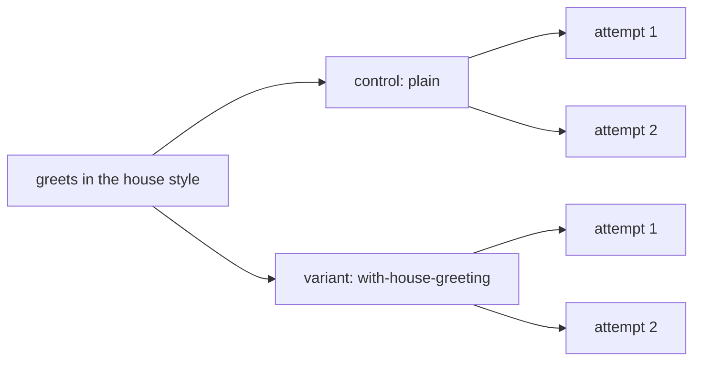

A skill is only worth shipping if agents do better with it. `compare` runs the same eval with and without it, on the same agent, and reports the difference as [lift](/concepts/lift).

```ts title="evals/environments.ts"
import { defineEnvironment } from '{{ pkg }}'

export const plain = defineEnvironment('plain', {})

export const withHouseGreeting = plain.extendEnvironment(
  'with-house-greeting',
  ({ skill }) => ({
    skills: [skill.local('../skills/house-greeting')],
  }),
)
```

```ts title="evals/skill.eval.ts"
import { evaluate, expect, group } from '{{ pkg }}'
import { plain, withHouseGreeting } from './environments.ts'

const greetAda = `node -e "import('./greet.js').then((m) => {
  const greet = m.greet ?? m.default?.greet ?? m.default
  const out = greet('Ada')
  console.log(out)
  process.exit(out === 'Ahoy, Ada!' ? 0 : 1)
})"`

group(
  'house greeting',
  {
    compare: { baseline: plain, variants: [withHouseGreeting] },
    pin: ['compare'],
  },
  () => {
    evaluate('greets in the house style', async (c) => {
      await c.send(
        'Create greet.js exporting greet(name) that greets the person ' +
          'in our house greeting style. ' +
          'Add a package.json with "type": "module". No dependencies.',
      )
      await expect(c.exec(greetAda)).toSucceed()
    })
  },
)
```

The skill says the house greeting is `Ahoy, <name>!`. An agent can't guess that, so only the run with the skill should pass. `pin: ['compare']` keeps the compare on even in a [profile](/guide/profiles) that turns variants off.

```md title="skills/house-greeting/SKILL.md"
---
name: house-greeting
description: The house style for greetings in this organisation. Use when writing any greeting function, message or text.
---
…
- The greeting word is always "Ahoy", never "Hello" or "Hi".
- Format: `Ahoy, <name>!` (comma after Ahoy, exclamation mark at the end).
…
```

## Run it

```bash
npx reeval run skill --runs 2 --log-order grouped
```

```text
plan  1 eval · 2 cells · 4 attempts · ~50s serial (~13s at concurrency 4)
hint: 1 eval runs more than once with the default gate, so every attempt must pass; set gate: { passRate: 0.8 } to gate on a pass rate instead
…
[greets#1 control] ○ evals/skill.eval.ts › house greeting › greets in the house style  24s  (not gated)
[greets#1 control]  +0:00 sandbox ready 2s
[greets#1 control]  +0:01 turn 1 done 21s · 10 tool calls, 2 file edits
[greets#1 control]  +0:23 $ node -e "import('./greet.js').then((m) => {…  exit 1 75ms
[greets#1 control]  Error: expected command to succeed, exit code 1
…
Summary
 evals/skill.eval.ts
   house greeting
     ✓ greets in the house style      2/4 · 100% gated  4 attempts
         cursor:composer-2.5/plain/docker               control    0/2    0%   not gated
         cursor:composer-2.5/with-house-greeting/docker  variant    2/2  100%   lift +100 pts (95% +7…+100, 2/2 vs 0/2)
           effort: tools 3 vs 8 (×0.38), agent 9s vs 18s (×0.50): too few attempts to test
…
Attempts  2 passed · 2 missed, not gated (4 attempts, 1 evals)
Duration  24s
  Tokens  362k in (169k cached) · 3525 out
…
```

Without the skill, Cursor guessed `Welcome home, Ada!` and `Welcome to the house, Ada!`, and failed. With it, Cursor wrote `Ahoy, Ada!` twice and passed. The lift is +100 points, and the run exits 0.

The eval line reads `2/4 100%`: two of the four attempts passed, but only the variant gates, and it passed every time.

## Control and variant



`baseline` is the control. Each variant runs as that environment on its own, with the same prompt and checks. `compare` does not layer, inherit or extend. Each is a [cell](/concepts/matrix), and `--runs 2` runs each cell twice.

Share setup before compare, with `extendEnvironment`. The child keeps the parent's layers and wins on shared keys. The house-greeting variant above is `plain` plus the skill. Do not set `environment` on the same object as a compare object. A parent `environment` is allowed when the eval only sets `compare`, and reeval does not apply that inherited environment.

## Two stacks, not a layer

Name both arms yourself when neither should inherit the other:

```ts
const firebaseAuth = defineEnvironment('firebase-auth', {
  files: { 'AGENTS.md': 'Use the Firebase Auth SDK.\n' },
})
const firebaseUi = defineEnvironment('firebase-ui', {
  files: { 'AGENTS.md': 'Use the FirebaseUI library.\n' },
})

group(
  'email sign-in',
  {
    compare: {
      baseline: firebaseAuth,
      variants: [firebaseUi],
      minLift: 0,
    },
    runs: 5,
  },
  () => {
    /* same prompt and checks */
  },
)
```

Lift and effort still pair each variant with the baseline. They do not pair variants with each other.

## Choose which cells gate

```ts
{
  compare: {
    baseline: plain,
    variants: [withHouseGreeting],
    gate: 'all',
  },
}
```

By default only variant cells decide pass or fail. The control is expected to do worse, so its misses print in their own `Expected misses, not gated` section, one line of why each, never under `Failures`, and never break CI. `gate: 'all'` gates the control too, and `'none'` only reports.

## Gate on a pass rate

```ts
{
  compare: { baseline: plain, variants: [withHouseGreeting] },
  gate: { passRate: 0.8 },
}
```

A cell passes only when every attempt passes, by default. That gets harder as `runs` grows, even for an agent that's no worse, which is what the plan's hint says. `gate: { passRate: 0.8 }` passes a cell when at least 80% of its attempts pass. Infra errors don't count either way.

## Require a minimum lift

```ts
{
  compare: {
    baseline: plain,
    variants: [withHouseGreeting],
    minLift: 0,
  },
}
```

`minLift` is in points from -1 to 1. It fails a variant cell when the lower bound of its interval is below it, so `minLift: 0` means "confidently no worse than the control".

## Read the lift

```text
lift +100 pts (95% +7…+100, 2/2 vs 0/2)
```

Lift is the variant's pass rate minus the control's, on the same harness. The range is the 95% interval on that difference. When it spans 0, the summary adds `within noise`: at two runs a cell, +100 points can still be luck.

<Warning>
  Few runs give a wide interval. Here, `+7…+100` is barely clear of 0. Raise `runs` before you trust a small lift.
</Warning>

The studio shows the same cells, roles, lift and effort for every run (here with two agents):

<Image src="/assets/studio/run-cells-lift.png" alt="reeval studio run page with a cells table: each agent's control at 0% and its variant at 100%, with +100 pts lift and fewer tool calls" width={800} />

## Read the effort

```text
effort: tools 3 vs 8 (×0.38), agent 9s vs 18s (×0.50): too few attempts to test
```

Under each variant, the effort line compares the median attempt with the control's: tool calls, then the agent's time. With the skill, Cursor made 3 tool calls instead of 8 and finished in half the time.

The verdict comes from a rank test on the tool calls. Two attempts against two can never reach significance, so it says `too few attempts to test`. With enough runs it says `fewer tool calls` or `more tool calls` with a p-value, or `within noise`. The studio's cells table shows effort next to lift, as in the screenshot above.

## Ask questions

```ts title="evals/questions.eval.ts"
evaluate('greets by name', {
  harness: [composer, pim],
  runs: 1,
  compare: {
    baseline: plain,
    variants: [withHouseGreeting],
    question: 'Which greet.js handles a missing or empty name better?',
  },
}, async (c) => { … })
```

Lift says which arm passes more often. A `question` asks which attempt did the better job, pair by pair, once every attempt of the eval has finished. Questions annotate the compare: they never change pass, fail or the exit code.

```text
plan  profile questions (--profile) · 1 eval · 4 cells · 4 attempts · …
eval                                      harnesses  variants  runs  attempts  notes
evals/questions.eval.ts › greets by name  2          1         1     4
  question 1/1  Which greet.js handles a missing or empty name better? · after the run · google/gemini-3.8-flash
```

`reeval run --dry-run` lists each question with the model that will answer it, and a profile that leaves only the baseline drops them. Pass a list for several, and `{ question, model }` to give one its own model. Without one, `analysis.model` answers, else the judge's model when it's a language model; with neither, `reeval run` exits 2 at plan time.

## Read the answers

```text
Summary
 evals/questions.eval.ts
   ✓ greets by name      4/4 · 100% gated  4 attempts
       cursor:composer-2.5/plain/docker                control    1/1  100%
       cursor:composer-2.5/with-house-greeting/docker  variant    1/1  100%   lift +0 pts (95% −79…+79, 1/1 vs 1/1), within noise
       …
       pi:gemini-3.8-flash/plain/docker                control    1/1  100%
       pi:gemini-3.8-flash/with-house-greeting/docker  variant    1/1  100%   lift +0 pts (95% −79…+79, 1/1 vs 1/1), within noise
       …
       question  "Which greet.js handles a missing or empty name better?" within: plain 0/4 (0%), with-house-greeting 4/4 (100%) · across: cursor:composer-2.5 0/2 (0%), pi:gemini-3.8-flash 2/2 (100%) · 8 votes, 2 ties · gemini-3.8-flash
```

A real run on Cursor and pi. Lift can't separate the arms, since all four attempts passed, but the question can: with the skill, both agents' `greet.js` answered a missing name with `Ahoy, crew!`, and the model picked that arm in both orders on both harnesses.

reeval pairs the attempts from their diffs in two cuts. `within` a harness, arm against arm on the same run; `across` harnesses, agent against agent on the same arm and run. Each pair goes to the model twice, the order swapped, labelled only A and B, so neither position nor a name can win it.

A side's rate is its wins over the decided votes it was in; a tie counts for neither side. Every vote is in the record under `evals[].answers`, with the rates per cut. A model error is kept on its answer as `error` and printed as a warning, and the outcomes stand.

<Warning>
  Attempts that failed their checks are left out of the pairs. A question on a compare whose baseline is expected to fail, like the house-greeting eval, has no pairs to judge: ask it where both arms can pass.
</Warning>

## Next

<CardGroup cols={2}>
  <Card title="Environments and skills" icon="box" href="/guide/environments">
    Give the agent skills, MCP servers, rules and setup steps.
  </Card>
  <Card title="Gates and lift" icon="chart-line" href="/concepts/lift">
    How the interval and "within noise" work.
  </Card>
</CardGroup>
