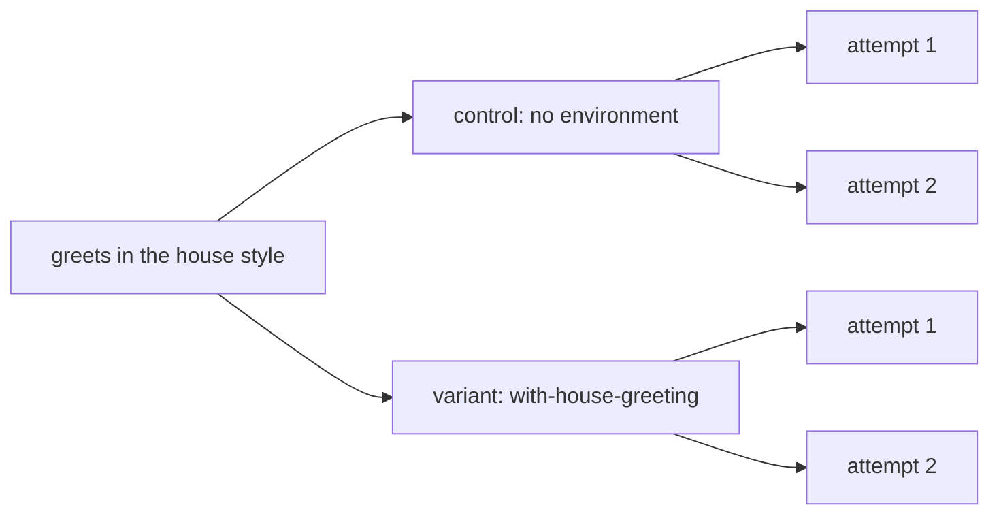

A skill is only worth shipping if agents do better with it. `compare` runs the same eval with and without it, on the same agent, and reports the difference as [lift](/concepts/lift).

```ts title="evals/environments.ts"
import { defineEnvironment } from '{{ pkg }}'

export const withHouseGreeting = defineEnvironment(
  'with-house-greeting',
  ({ skill }) => ({ skills: [skill.local('../skills/house-greeting')] }),
)
```

```ts title="evals/skill.es.ts"
import { evaluate, expect, group } from '{{ pkg }}'
import { withHouseGreeting } from './environments.ts'

const greetAda = `node -e "import('./greet.js').then((m) => {
  const greet = m.greet ?? m.default?.greet ?? m.default
  const out = greet('Ada')
  console.log(out)
  process.exit(out === 'Ahoy, Ada!' ? 0 : 1)
})"`

group(
  'house greeting',
  { compare: [withHouseGreeting], pin: ['compare'] },
  () => {
    evaluate('greets in the house style', async (t) => {
      await t.send(
        'Create greet.js exporting greet(name) that greets the person ' +
          'in our house greeting style. ' +
          'Add a package.json with "type": "module". No dependencies.',
      )
      await expect(t.exec(greetAda)).toSucceed()
    })
  },
)
```

The skill says the house greeting is `Ahoy, <name>!`. An agent can't guess that, so only the run with the skill should pass. `pin: ['compare']` keeps the compare on even in a [profile](/guide/profiles) that turns variants off.

```md title="skills/house-greeting/SKILL.md"
---
name: house-greeting
description: The house style for greetings in this organisation. Use when writing any greeting function, message or text.
---
…
- The greeting word is always "Ahoy", never "Hello" or "Hi".
- Format: `Ahoy, <name>!` (comma after Ahoy, exclamation mark at the end).
…
```

## Run it

```bash
npx es run skill --runs 2 --log-order grouped
```

```text
plan  1 eval · 2 cells · 4 attempts · ~1m 08s serial (~17s at concurrency 4)
hint: 1 eval runs more than once with the default gate, so every attempt must pass; set gate: { passRate: 0.8 } to gate on a pass rate instead
…
[greets#1 control] ✗ evals/skill.es.ts › house greeting › greets in the house style  26s  (not gated)
[greets#1 control]  +0:00 sandbox ready 2s
[greets#1 control]  +0:02 turn 1 done 22s · 15 tool calls, 2 file edits
[greets#1 control]  +0:24 $ node -e "import('./greet.js').then((m) => {…  exit 1 79ms
[greets#1 control]  Error: expected command to succeed, exit code 1
…
[greets#1 control]  --- stdout ---
[greets#1 control]  Welcome home, Ada!
…
Summary
 evals/skill.es.ts
   house greeting
     ✓ greets in the house style      2/4  100%  4 attempts
         cursor:composer-2.5/-/docker                    control    0/2    0%   not gated
         cursor:composer-2.5/with-house-greeting/docker  variant    2/2  100%   lift +100 pts (95% +7…+100, 2/2 vs 0/2)
…
Attempts  2 passed · 2 failed, not gated (4 attempts, 1 evals)
```

Without the skill, Cursor guessed `Welcome home, Ada!` twice and failed. With it, Cursor wrote `Ahoy, Ada!` twice and passed. The lift is +100 points, and the run exits 0.

## Control and variant



The control runs the eval's own environment, here none. Each variant runs the control's environment extended with its own, with the same prompt and checks. Each is a [cell](/concepts/matrix), and `--runs 2` runs each cell twice.

## Choose which cells gate

```ts
{ compare: { variants: [withHouseGreeting], gate: 'all' } }
```

By default only variant cells decide pass or fail. The control is expected to do worse, so its failures print as `(not gated)` and never break CI. `gate: 'all'` gates the control too, and `'none'` only reports.

## Gate on a pass rate

```ts
{ compare: [withHouseGreeting], gate: { passRate: 0.8 } }
```

A cell passes only when every attempt passes, by default. That gets harder as `runs` grows, even for an agent that's no worse, which is what the plan's hint says. `gate: { passRate: 0.8 }` passes a cell when at least 80% of its attempts pass. Infra errors don't count either way.

## Require a minimum lift

```ts
{ compare: { variants: [withHouseGreeting], minLift: 0 } }
```

`minLift` is in points from -1 to 1. It fails a variant cell when the lower bound of its interval is below it, so `minLift: 0` means "confidently no worse than the control".

## Read the lift

```text
lift +100 pts (95% +7…+100, 2/2 vs 0/2)
```

Lift is the variant's pass rate minus the control's, on the same harness. The range is the 95% interval on that difference. When it spans 0, the summary adds `within noise`: at two runs a cell, +100 points can still be luck.

The studio shows the same cells, roles and lift for every run:

<Image src="/assets/studio/run-cells-lift.png" alt="ES studio run page with a cells table showing the control at 0% and the variant at 100%, with its lift" width={800} />

<Warning>
  Few runs give a wide interval. Here, `+7…+100` is barely clear of 0. Raise `runs` before you trust a small lift.
</Warning>

## Next

<CardGroup cols={2}>
  <Card title="Environments and skills" icon="box" href="/guide/environments">
    Give the agent skills, MCP servers, rules and setup steps.
  </Card>
  <Card title="Gates and lift" icon="chart-line" href="/concepts/lift">
    How the interval and "within noise" work.
  </Card>
</CardGroup>
