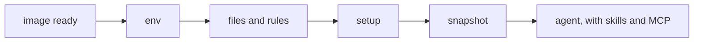

The sandbox is where the agent runs. An environment is what it runs with: skills, MCP servers, rules, files, variables and setup steps, applied fresh to every attempt. The house-greeting compare used the smallest one:

```ts title="evals/environments.ts"
import { defineEnvironment } from '{{ pkg }}'

export const withHouseGreeting = defineEnvironment(
  'with-house-greeting',
  ({ skill }) => ({ skills: [skill.local('../skills/house-greeting')] }),
)
```

`defineEnvironment(name, spec)` takes a plain object, or a callback that picks the helpers it needs: `skill`, `mcp`, `file` and `secret`. The callback runs once, when the file loads, and must return synchronously.

## Use an environment

```ts title="evals/guide-env.es.ts"
group('greet with context', { environment: base }, () => {
  // …
})

group('greet with skills', { compare: [withSkills, withDocsMcp] }, () => {
  // …
})
```

`environment` sets what every eval in the group runs in, and is the control of a compare. Each `compare` entry is another environment, run next to it as a variant.

## Add skills

```ts title="evals/guide-environments.ts"
export const withSkills = base.extend('with-skills', ({ skill }) => ({
  skills: [
    skill.local('../skills/house-greeting'),
    skill.git('github:acme/skills', { ref: 'v2.4.0', only: ['greet'] }),
    skill.npm('@acme/skills@1.2.3'),
    skill.registry('acme/skills@greet', { version: 'v1' }),
    skill.inline({
      name: 'no-deps',
      description: 'Use when adding code to this repo.',
      content: 'Never add dependencies. Use the standard library.',
    }),
  ],
}))
```

| Helper | Source |
|---|---|
| `skill.local(path)` | A directory with a `SKILL.md`, or a directory of them, relative to this file |
| `skill.git(repo, { ref, path, only })` | A git repo: `github:owner/repo`, `https://…` or `git@…` |
| `skill.npm(spec, { path })` | A pinned npm package, reading `skills/` inside it by default |
| `skill.registry(id, { version })` | A skills.sh id, `owner/repo@skill` |
| `skill.inline({ name, description, content })` | A skill written in the eval |

The harness adapter puts skills where its agent reads them. `placement: 'workspace'` writes them into the repo's skill directory instead, such as `.cursor/skills`. Pin git skills to a tag or commit: the plan warns on a moving ref like `main`, and the record keeps the commit either way.

<Info>
  Eval material stays out of the sandbox. A skill directory leaves out `.git` and `DEFAULT_SKILL_EXCLUDE`: a root `/evals/`, any `.history/` and any `*.es.ts`. Pass `exclude` to change the list.
</Info>

## Connect MCP servers

```ts title="evals/guide-environments.ts"
export const withDocsMcp = base.extend('with-docs-mcp', ({ mcp }) => ({
  mcp: {
    docs: mcp.stdio('npx', ['-y', '@acme/docs-mcp@1.0.0']),
    search: mcp.http('https://mcp.acme.dev/mcp'),
  },
}))
```

Each server has a name, and the agent's calls to it show in the transcript as `mcp__<server>__<tool>`, such as `mcp__docs__search`. `mcp.stdio` starts a command in the sandbox; `mcp.http` and `mcp.sse` connect to a URL. Headers can carry secrets, which [Secrets and egress](/guide/secrets-and-egress) covers.

## Write rules and files

```ts title="evals/guide-environments.ts"
export const base = defineEnvironment('base', ({ file }) => ({
  rules: file('../rules/house.md'),
  files: {
    'package.json': '{ "type": "module" }\n',
    'docs/api.md': file('../docs/api.md'),
    '~/.npmrc': 'fund=false\n',
  },
  env: { NODE_ENV: 'test' },
  setup: [{ run: 'npm install --no-audit', timeout: '5m' }],
}))
```

`rules` lands where the harness's agent reads project rules: `AGENTS.md` for Cursor and Antigravity, `CLAUDE.md` for Claude Code. `files` maps workspace paths (or `~/` paths) to a string or a host `file()`, copied byte for byte. `env` sets variables in the sandbox.

## Run setup steps

`setup` runs commands in order in every attempt, before the agent starts. Steps get the environment's secrets, run outside the eval's timeout, and write their output to the attempt's `setup.log`. Each step can set its own `timeout` and `cwd`.



ES snapshots the workspace after setup, so files, rules and setup output never show in the agent's diff. Anything baked into the image instead belongs to the [sandbox](/guide/sandboxes).

## Layer environments with extend

```ts
const withSkills = base.extend('with-skills', ({ skill }) => ({ /* … */ }))
```

`extend` is the only way to compose environments. The child's spec layers on the parent's: where both set the same key (a variable, a file path, a skill or server name, `rules`), the child wins, and the record lists it under `overrides`. `setup` steps concatenate, parent first.

## Check what the environment set up

```ts title="evals/guide-env.es.ts"
evaluate('sees the house rules', async (t) => {
  const sandbox = await t.sandbox()
  expect(await sandbox.readFile('AGENTS.md')).toContain('House rules')
  await expect(sandbox.exec('test -f docs/api.md')).toSucceed()
})
```

```text
[sees#1 fake]  +0:00 $ test -f docs/api.md  exit 0 2ms
…
     ✓ sees the house rules         282ms  0 turns
```

`t.sandbox()` starts the sandbox and the agent session without a turn. Use it to test an environment before you spend a turn on it.

## Next

<CardGroup cols={2}>
  <Card title="Harnesses" icon="terminal" href="/guide/harnesses">
    Cursor, Claude Code and Antigravity, one at a time or side by side.
  </Card>
  <Card title="defineEnvironment" icon="book" href="/reference/environment">
    Every field, the phase order and what's refused.
  </Card>
</CardGroup>
