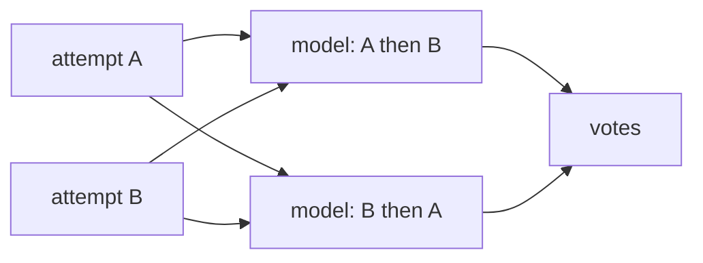

Checks say whether an attempt passed. `questions` ask a model what pass and fail can't: about each attempt on its own, or which of two attempts did the better job. Questions annotate the run: they never change pass, fail or the exit code.

```ts title="evals/greet.eval.ts"
evaluate('greets by name', {
  runs: 2,
  questions: [
    // asked of each attempt as it ends, with a pick from choices
    { question: 'Does greet.js handle a missing name?', choices: ['yes', 'no'] },
    // asked of each attempt, answered in words
    'How does greet.js treat a missing name?',
  ],
}, async (c) => { … })
```

A question without `across` is asked of each attempt. One with `across` is pairwise: after every attempt has ended, it asks which of two attempts did better, pairing them by the factor you vary. `questions` goes on an eval or a group, whether or not it has a `compare`; an eval's own list replaces its group's.

## Plan the questions

```text
eval                                  harnesses  variants  runs  attempts  notes
evals/greet.eval.ts › greets by name  2          —         2     4
  question 1/2  Does greet.js handle a missing name? · after each attempt · shows task, output, diff, transcript · each attempt · 4 attempts · yes / no · fake
  question 2/2  How does greet.js treat a missing name? · after each attempt · shows task, output, diff, transcript · each attempt · 4 attempts · fake
```

`reeval run --dry-run` lists each question, what it shows, the model that will answer it, and how many attempts or pairs it will ask.

| Field | What it does |
|---|---|
| `question` | The question. An entry can also be a plain string, asked of each attempt |
| `across` | Makes it pairwise: `'environment'` pairs two environments on one harness, `'harness'` two harnesses on one environment, or a list of both. Unset, it's asked of each attempt |
| `choices` | Two or more answers the model picks one of, with a short reason. Per-attempt questions only |
| `model` | The model that answers. Default the cascaded `question.model`, else `analysis.model`, else the run's judge model, a profile's included, when it's a language model; with none, `reeval run` exits 2 at plan time |
| `state` | What the model is shown: the judge's keys but `contents`. Default the task, final message, diff and transcript for an attempt; the task and the diff for a pair |
| `artifacts` | Captures to send as images: `true` for all, or their names. Default none |

`across` must name a factor the eval varies: `across: 'harness'` on one harness exits 2, and a profile that leaves one harness drops the question with a note.

## Ask each attempt

```text
pass             greets by name
  harness          pass
  terse            2 of 2
  chatty           2 of 2
  question  Does greet.js handle a missing name?
    yes 2 · no 2
  question  How does greet.js treat a missing name?
    terse/plain/fake#1   It greets the name it is given.
    terse/plain/fake#2   It greets the name it is given.
    chatty/plain/fake#1  It defaults the name to crew.
    1 more: reeval query attempt_answers
```

Each attempt that ends with a pass or a fail is asked as it ends, four calls at a time, while the run goes on; an attempt that hit an infrastructure error or was skipped isn't. A question with `choices` prints its tally, and a free-text one the first answers.

```text
$ reeval query "SELECT attempt_id, outcome, choice FROM attempt_answers WHERE choice IS NOT NULL"
attempt_id           outcome  choice
terse/plain/fake#1   pass     no
terse/plain/fake#2   pass     no
chatty/plain/fake#1  pass     yes
chatty/plain/fake#2  pass     yes
```

`reeval query attempt_answers` has every answer with its attempt's outcome, so you can ask how the answers split by harness, by environment or by pass and fail.

## Ask which of a pair did better

```ts title="evals/questions.eval.ts"
evaluate('greets by name', {
  harness: [composer, pim],
  runs: 1,
  compare: { baseline: plain, variants: [withHouseGreeting] },
  questions: [{
    question: 'Which greet.js handles a missing or empty name better?',
    across: 'environment',
  }],
}, async (c) => { … })
```

```text
  question 1/1  Which greet.js handles a missing or empty name better? · after the run · shows task, diff · environment · 2 pairs · google/gemini-3.8-flash
```

A pairwise question waits for every attempt of the eval, then pairs those that passed their checks, assuming in the plan that every attempt will.

```text
pass             greets by name
  …
  question  Which greet.js handles a missing or empty name better?
    plain                won 0 of 4
    with-house-greeting  won 4 of 4
```

This run is two fake agents and a fake analysis model that prefers the `greet.js` that falls back to `Ahoy, crew!`. Lift can't separate the arms, since every attempt passed, but the question can: the skill's arm won all four votes. `reeval query votes` has every vote, and `question_pairs` each pair's two orders.

<Warning>
  Attempts that failed their checks are left out of the pairs. A pairwise question on a compare whose baseline is expected to fail, like the house-greeting eval in [Compare and lift](/guide/compare), has no pairs to judge: ask it of each attempt instead.
</Warning>

## How pairs are judged



reeval pairs the attempts by varying the `across` factor and holding the others: two environments meet on the same harness and run, or two agents on the same environment and run. Each pair goes to the model twice, the order swapped and labelled only A and B, so neither position nor a name can win it.

A pair whose two orders pick opposite sides is a split: the position decided it, not the work, and it counts one win for each side. A side's rate is its wins over the decided votes it was in; a tie counts for neither side.

## Pick the model and what it sees

```ts title="evals/sign-in.eval.ts"
// reeval.config.ts: question: { model: 'anthropic/claude-sonnet-5' }
group('ui', { question: { model: 'openai/gpt-5.5', state: { checks: true } } }, () => {
  evaluate('sign-in', {
    compare: { baseline: plain, variants: [withDesignSystem] },
    questions: [
      { question: 'Which change is simpler?', across: 'environment' },
      {
        question: 'Which sign-in page follows the design system more closely?',
        across: 'environment',
        state: { diff: ['src/**/*.tsx'] },
        artifacts: ['sign-in'], // each side's own "sign-in" capture
      },
      { question: 'Did the agent run the tests?', model: 'google/gemini-3.8-flash' },
    ],
  }, async (c) => { … })
})
```

The [`question`](/reference/options#question) option sets `model`, `state` and `artifacts` for every question below it, from the config through profiles and groups to the entry, with `state` merged key by key. `reeval run` checks each model's key before the first attempt.

A pair's default leaves out the final message: side by side, the more confident summary wins on wording, not on the work. `transcript` names each agent's tools, so `reeval run` warns when a pairwise question that shows it pairs two harnesses.

## Where the answers go

| Where | What |
|---|---|
| The result block, `reeval show`, `summary.md` | A per-attempt question's tally or first answers; a pairwise one's wins (`won 4 of 4`) |
| The studio | Each attempt's answer, and each side's rate with a vote's short `reason` |
| The record | `evals[].attempts[].answers` per attempt, `evals[].answers` per pairwise question, with a failed call's `error` |
| `questions/<n>.json` | What the model was sent: under the attempt's directory, or the eval's for a pairwise question |
| `reeval query attempt_answers`, `question_pairs`, `votes` | Every attempt's answer, every pair's tally, every vote |
| `reeval analyze` | The tallies and a sample of answers, the rates, votes, splits and reasons |

A model error prints as a warning, and the outcomes stand.

## See what the model saw

```json title="<eval-slug>/<cell-slug>/2/questions/1.json (trimmed)"
{
  "question": "Does greet.js handle a missing name?",
  "model": "fake",
  "choices": ["yes", "no"],
  "system": "You answer one question about an attempt by a coding agent at a task. …",
  "prompt": "Question: Does greet.js handle a missing name?\n\nChoices:\n- yes\n- no\n\n<attempt>…"
}
```

Each answer points at its file (`input`). A pairwise question's file has one call per pair and order, with `labels` saying which side the model saw as A, and screenshots pointing at the attempts' own PNGs. `prompt` is the text the model was sent, secrets masked. `summary.md` and the studio link to the file, and `history.artifacts` keeps it or drops it with the eval's other files.

## Next

<CardGroup cols={2}>
  <Card title="Compare and lift" icon="chart-line" href="/guide/compare">
    Run with and without a skill and read the lift.
  </Card>
  <Card title="Analysis" icon="database" href="/guide/analysis">
    Ask questions across runs with SQL.
  </Card>
</CardGroup>
