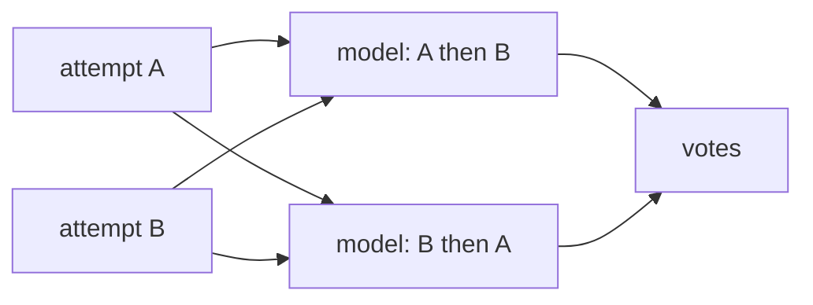

Lift says which arm passes more often. A compare's `questions` ask which attempt did the better job, pair by pair, once every attempt of the eval has finished. Questions annotate the compare: they never change pass, fail or the exit code.

```ts title="evals/questions.eval.ts"
evaluate('greets by name', {
  harness: [composer, pim],
  runs: 1,
  compare: {
    baseline: plain,
    variants: [withHouseGreeting],
    questions: [{
      question: 'Which greet.js handles a missing or empty name better?',
      across: 'environment',
    }],
  },
}, async (c) => { … })
```

## Plan the questions

```text
plan  profile questions (--profile) · 1 eval · 4 cells · 4 attempts · …
eval                                      harnesses  variants  runs  attempts  notes
evals/questions.eval.ts › greets by name  2          1         1     4
  question 1/1  Which greet.js handles a missing or empty name better? · after the run · shows task, diff · environment · 2 pairs · google/gemini-3.8-flash
```

`reeval run --dry-run` lists each question, what each side shows, the model that will answer it, and how many pairs it will ask, assuming every attempt passes its checks. A profile that leaves only the baseline drops them.

| Field | What it does |
|---|---|
| `question` | The question. An entry can also be a plain string |
| `model` | The model that answers. Default `analysis.model`, else the judge's model when it's a language model; with neither, `reeval run` exits 2 at plan time |
| `across` | The factor you vary when pairing: `'environment'` holds the harness (Auth vs Firebase UI), `'harness'` holds the environment (Cursor vs Antigravity). A list of both, or none, asks both pair kinds |
| `state` | What each side shows: the judge's keys but `contents`. Default the task and the diff |
| `artifacts` | Captures each side sends as images: `true` for all, or their names. Default none |

`compare.across: 'environment'` sets the default `across` for every question that doesn't name its own.

## Choose what each side shows

```ts title="evals/sign-in.eval.ts"
compare: {
  baseline: plain,
  variants: [withDesignSystem],
  questions: [
    'Which change is simpler?', // the task and the diff
    {
      question: 'Which sign-in page follows the design system more closely?',
      state: { diff: ['src/**/*.tsx'] },
      artifacts: ['sign-in'], // each side's own "sign-in" capture
    },
    {
      question: 'Which agent verified its work?',
      state: { transcript: 'tools', checks: ['npm test'] },
      across: 'environment',
    },
  ],
}
```

`state` takes the judge's keys (`task`, `output`, `files`, `diff`, `transcript`, `turns` and `checks`), and `artifacts` sends captures as images. A capture name picks each side's own capture of that name, labelled only by its position.

```text
  question 1/3  Which change is simpler? · after the run · shows task, diff · 1 pair · google/gemini-3.8-flash
  question 2/3  Which sign-in page follows … · after the run · shows task, diff, artifacts · 1 pair · …
  question 3/3  Which agent verified its work? · after the run · shows task, diff, transcript, checks · environment · 1 pair · …
```

The defaults leave out the final message: side by side, the more confident summary wins on wording, not on the work. `transcript` names each agent's tools, so `reeval run` warns when a question that shows it pairs two harnesses. The [`question`](/reference/options#question) option sets defaults for every question below it, merged key by key from the config to the entry.

## Read the answers

```text
Summary
 evals/questions.eval.ts
   ✓ greets by name      4/4 · pass@1 100% gated  4 attempts
       cursor:composer-2.5/plain/docker                control    1/1  pass@1 100%
       cursor:composer-2.5/with-house-greeting/docker  variant    1/1  pass@1 100%   lift +0 pts (95% −79…+79, 1/1 vs 1/1), within noise
       …
       pi:gemini-3.8-flash/plain/docker                control    1/1  pass@1 100%
       pi:gemini-3.8-flash/with-house-greeting/docker  variant    1/1  pass@1 100%   lift +0 pts (95% −79…+79, 1/1 vs 1/1), within noise
       …
       question  "Which greet.js handles a missing or empty name better?" within: plain 0/4 (0%), with-house-greeting 4/4 (100%) · across: cursor:composer-2.5 0/2 (0%), pi:gemini-3.8-flash 2/2 (100%) · 8 votes, 2 ties, 0/4 pairs split by order · gemini-3.8-flash
```

This is a real run on Cursor and pi. Lift can't separate the arms, since all four attempts passed, but the question can. With the skill, both agents' `greet.js` answered a missing name with `Ahoy, crew!`, and the model picked that arm in both orders on both harnesses.

<Warning>
  Attempts that failed their checks are left out of the pairs. A question on a compare whose baseline is expected to fail, like the house-greeting eval in [Compare and lift](/guide/compare), has no pairs to judge: ask it where both arms can pass.
</Warning>

## How pairs are judged



reeval pairs the attempts by varying one factor and holding the others, unless `across` keeps one. Vary the environment and two environments meet on the same harness and run; vary the harness and two agents meet on the same environment and run. Each pair goes to the model twice, the order swapped and labelled only A and B, so neither position nor a name can win it.

A pair whose two orders pick opposite sides is a split: the position decided it, not the work. The summary counts splits (`0/4 pairs split by order`). With three arms or more it prints each pair head to head, a split apart from a win: `within cursor:composer-2.5: no-skill 2–0 current-skill (1 split) · …`.

## Where the votes go

| Where | What |
|---|---|
| The summary, `reeval show`, the studio | Each side's rate, and a vote's short `reason` when it gave one |
| `evals[].answers` in the record | Every vote, with the rates per pair kind, and a failed call's `error` |
| `reeval query question_pairs`, `votes` | The pairs' tallies, and every vote as a row |
| `reeval analyze` | The rates, the vote and tie counts, a failed call and a sample of reasons |

A side's rate is its wins over the decided votes it was in. A tie counts for neither side, and a split counts one win for each. A model error prints as a warning, and the outcomes stand.

## Next

<CardGroup cols={2}>
  <Card title="Compare and lift" icon="chart-line" href="/guide/compare">
    Run with and without a skill and read the lift.
  </Card>
  <Card title="Analysis" icon="database" href="/guide/analysis">
    Ask questions across runs with SQL.
  </Card>
</CardGroup>
