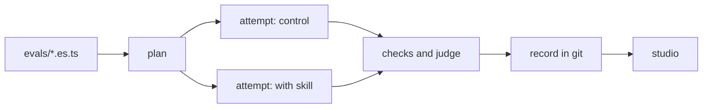

Does a coding agent actually use your SDK, your skills and your docs correctly? ES answers that with evals you write like tests.

```ts title="evals/skill.es.ts"
group('house greeting', { compare: [withHouseGreeting] }, () => {
  evaluate('greets in the house style', async (t) => {
    await t.send('Create greet.js exporting greet(name) that greets in our house style.')
    await expect(t.exec(greetAda)).toSucceed()
  })
})
```

A real agent does the task in a fresh Docker sandbox, once without the skill and once with it. ES checks the result and reports the difference as lift:

```text
✓ greets in the house style      2/4 · 100% gated  4 attempts
    cursor:composer-2.5/-/docker                    control    0/2    0%   not gated
    cursor:composer-2.5/with-house-greeting/docker  variant    2/2  100%   lift +100 pts (95% +7…+100, 2/2 vs 0/2)
      effort: tools 3 vs 8 (×0.38), agent 9s vs 18s (×0.50): too few attempts to test
```

With the skill the agent also needed fewer tool calls and half the time: ES reports that effort next to the lift.

## How it works



| Step | What ES does |
|---|---|
| Agent | Runs Cursor, Claude Code or Antigravity on your prompt, in its own sandbox |
| Checks | Runs your commands in the sandbox and asks an LLM judge yes/no questions |
| Compare | Runs the same eval with and without a skill, MCP server or docs, and reports lift and effort |
| History | Saves every run as a file you commit, diff and browse |

## See every attempt

The studio shows each run's cells, pass rates and lift, and each attempt's transcript, diff, checks and judge input.

<Image src="/assets/studio/run-cells-lift.png" alt="ES studio run page with a cells table showing 0% for the control and 100% with the skill" width={800} />

## Start here

<CardGroup cols={2}>
  <Card title="Quickstart" icon="rocket" href="/quickstart">
    A passing eval in two minutes, with no keys or Docker.
  </Card>
  <Card title="Compare and lift" icon="chart-line" href="/guide/compare">
    Prove a skill, MCP server or doc makes agents better.
  </Card>
</CardGroup>
