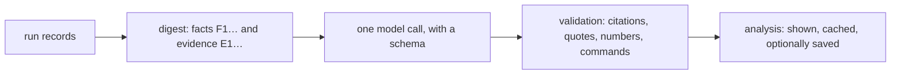

`es analyze` explains a run: what happened, what the numbers mean, why, and what to change. ES computes the facts; one structured LLM call explains and ranks them, and ES checks the answer before showing it.

```bash
npx es analyze                                  # latest vs its nearest recorded ancestor
npx es analyze latest --vs latest~2 --eval skill
npx es analyze --context                        # the digest for your own agent: no key, no call
```

## Help

{/* generated:cli-help:analyze */}
```text
es analyze [run]          Explain a run with one LLM call over a digest of its facts (vs its
                          nearest recorded ancestor), citations and commands checked; cached
                          in .es/analysis (model: config.analysis.model)
  --vs <run>              The run to compare with; --eval <filter> only matching evals
  --save                  Also write it into the run's history folder: <run>/analysis/
  --context               Print the digest and rules for your own coding agent (no key, no call)
  --dry-run               Print the digest's size and the cache key, without calling the model
  --json --md --no-cache  The analysis as JSON or Markdown; --no-cache calls the model again
```
{/* /generated:cli-help:analyze */}

## How it works



1. **Digest.** The runs, an attempts table with short ids (`r2/skill/control#1`), facts with ids (`F1…`: pass rate and lift, effort, factor effects by tier, skill reads, the judge's scores, failures, flaky cells, drift, the compare), and evidence chosen by rule (`E1…`: failing attempts' final messages, judge questions and check tails, and the first tool calls of contrasting attempts), with transcript lines as `L<n>`. It's capped at `analysis.maxInputTokens` by dropping the lowest-priority evidence first. The model is told the verdicts, not asked for them.
2. **Call.** One `generateText` call with a schema: TL;DR, what happened, results, why, anomalies, at most five actions (target, change, expected effect, verify command, impact, effort) and a confidence.
3. **Validation.** A claim, anomaly or action with no citation that names something in the digest is dropped, and so is one whose quote isn't in its cited evidence. Numbers no cited fact holds are flagged. Each verify command must parse as ES's own CLI, with only that command's flags. The counts are in the footer.
4. **Storage.** Every analysis is cached in `.es/analysis/<key>.json`, keyed by the scope, the digest's hash, the prompt version and the model, so the same inputs never call the model twice (`--no-cache` does). `--save` also writes `<run>/analysis/<stamp>_<author>_<hash8>.json` and a `.md` twin into the history folder, create-only and after the secret scan. Only recorded runs can be saved into.

## Configuration

```ts title="es.config.ts"
export default defineConfig({
  judge: { model: 'typesafe-ai/jev-1.13.0' },
  analysis: {
    model: 'google/gemini-3.8-flash', // default: the judge's, when it's a language model
    instructions: 'Fewer tool calls count as a win.',
    maxInputTokens: 20_000,           // the digest's cap (characters ÷ 4)
    maxOutputTokens: 8_000,           // the answer's cap
  },
})
```

<Property name="analysis.model" type="string" optional>
  A `provider/model` language model. `google/*` goes direct with `GOOGLE_GENERATIVE_AI_API_KEY`; anything else through the Vercel AI Gateway (`AI_GATEWAY_API_KEY` or `VERCEL_OIDC_TOKEN`). Defaults to the judge's model when that's a language model. Evaluation models such as `typesafe-ai/*` only score yes/no questions, so they exit 2 and point at `--context`.
</Property>

<Property name="analysis.instructions" type="string" optional>
  Your own guidance, added to the prompt: what counts as a win, which skill is under test.
</Property>

<Property name="analysis.maxInputTokens" type="number" optional>
  The digest's cap, at least 1000. Default 20000.
</Property>

<Property name="analysis.maxOutputTokens" type="number" optional>
  The answer's cap, at least 500. Default 8000.
</Property>

For tests, `fakeAnalysis({ output })` from `{{ pkg }}/judge` answers with canned output (or a function of the digest) through the same parsing and validation. ES has no prices, so the footer shows tokens used and no cost.

## Errors

| Message | Fix |
|---|---|
| `es analyze takes --json or --md, not both` | Pick one |
| `es analyze --context makes no analysis to save; drop --save` | `--context` only prints the digest |
| `es analyze --vs names the run itself` | Name an earlier run |
| `No eval in <run> matches "<filter>"` | Check `--eval` against `es show <run>` |
| A missing key, or an evaluation model | Set the key, set `analysis.model`, or use `--context` with your own agent |

## Related

- [Analysis](/guide/analysis)
- [es query](/reference/cli/query): the views the facts come from
- [Gates and lift](/concepts/lift)
