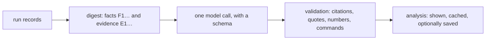

`reeval analyze` explains a run: what happened, what the numbers mean, why, and what to change. reeval computes the facts; one structured LLM call explains and ranks them, and reeval checks the answer before showing it.

```bash
npx reeval analyze                                  # latest vs its nearest recorded ancestor
npx reeval analyze latest --vs latest~2 --eval skill
npx reeval analyze --vs none                        # this run only: no ancestor
npx reeval analyze --context                        # the digest for your own agent: no key, no call
```

## Help

[//]: # (generated:cli-help:analyze)

```text
reeval analyze [run]          Explain a run with one LLM call over a digest of its facts (vs its
                              nearest recorded ancestor), citations and commands checked; cached
                              in .reeval/analysis (model: config.analysis.model)
  --vs <run>                  The run to compare with; none for this run only;
                              --eval <filter> only matching evals
  --save                      Also write it into the run's history folder: <run>/analysis/
  --context                   Print the digest and rules for your own coding agent (no key, no call)
  --dry-run                   Print the digest's size and the cache key, without calling the model
  --json --md --no-cache      The analysis as JSON or Markdown; --no-cache calls the model again
```

[//]: # (/generated:cli-help:analyze)

## A real run

`--dry-run` shows the digest's size and cache key without calling the model:

```text
digest 20260926T174444Z_b010670_ada-lovelace_7gmj vs 20260926T174239Z_b010670_ada-lovelace_yzmg: 24 facts, 5 evidence items, 18 attempts
size 26510 characters ≈ 6628 tokens (cap 20000 in, 8000 out)
model google/gemini-3.8-flash · analysis-v2 · cache miss (.reeval/analysis/cb4f1ade460a94fdd4e5a9ddef213bd995e81adbbf4f83d0c4a7fa93e0a69398.json)
```

Then the analysis, over a real Cursor and Antigravity run with the skill compare (trimmed):

```text
analysing 20260926T174444Z_b010670_ada-lovelace_7gmj vs 20260926T174239Z_b010670_ada-lovelace_yzmg with google/gemini-3.8-flash…
analysis 20260926T174444Z_b010670_ada-lovelace_7gmj vs 20260926T174239Z_b010670_ada-lovelace_yzmg

TL;DR  The house-greeting skill was introduced in run r2 and produced a statistically significant +100 percentage point pass-rate lift over control for both Cursor and Antigravity harnesses. Without the skill, agents in the control cells could not guess the proprietary greeting convention and failed assertion checks. Evaluated baseline tasks hello-1 and hello-2 remained saturated at 100% pass rate …

Results
  - In a pooled factor analysis across 2 runs for cursor:composer-2.5 on eval 'skill', environment:with-house-greeting achieved a pass-rate lift of +100 pts (95% CI +31…+100, verdict: effect) and reduced tool calls by ×0.38 (p = 0.0286, verdict: fewer). [F11]
…
Suggested actions
  1. Increase attempt count on skill eval to reach statistical power for effort (eval · impact medium · effort low) [F10] [F11]
     verify: reeval run --runs 6 --tag skill
…
gemini-3.8-flash · analysis-v2 · digest v1 · 10381 in / 3196 out tokens · 13s · 29 citations checked, 0 invalid, 0 dropped · 1 commands checked, 0 rejected
```

The studio pins that TL;DR and its capped confidence under the run header when an analysis exists. Without one, the header still leads with a deterministic sentence: counted pass and fail, which judge keys failed, and the infra count. Saved analyses (and, in `reeval studio`, cached ones) stay on the run's Analysis tab, with each citation linking to its attempt:

<Image src="/assets/studio/run-analysis.png" alt="reeval studio Analysis tab with the TL;DR, what happened and results, each claim followed by fact and evidence citations" width={800} />

## How it works



1. **Digest.** The runs, an attempts table with short ids (`r2/skill/control#1`), each eval's id and tags, facts with ids (`F1…`: pass rate and lift, effort, factor effects by tier, skill reads, the judge's scores, failures, flaky cells, drift, the compare, and each `compare.questions` answer: rates by cut, votes, ties, and a failed call's error), and evidence chosen by rule (`E1…`: failing attempts' final messages, judge questions and check tails, and the first tool calls of contrasting attempts), with transcript lines as `L<n>`. It's capped at `analysis.maxInputTokens` by dropping the lowest-priority evidence first. The model is told the verdicts, not asked for them, including `insufficient` (not measured) when lift has fewer than two counted attempts a side: `not enough attempts for lift (1 vs 1)`, never a results line. When sources or the eval fingerprint differ across the compared runs, the digest says `not comparable: the eval changed` and drops the mixed pass-rate (`6/10 vs 8/9` is not a results line); that difference is not an effect, and no pooled factor row straddles the pair. `--vs none` drops the ancestor: no drift, eval-changed or cross-run factor rows. Compare-question win rates annotate the run: they never change pass, fail or the exit code.
2. **Call.** One `generateText` call with a schema: a one-sentence TL;DR (what happened, how sure, why, next; no fact ids or intervals), what happened, results, why, anomalies, at most five actions (target, change, expected effect, verify command, impact, effort) and a confidence. Do not ask the model to self-rate the checks.
3. **Validation.** A claim, anomaly or action with no citation that names something in the digest is dropped, and so is one whose quote isn't in its cited evidence. Numbers no cited fact holds are flagged, including on anomalies. An anomaly (or claim) that quotes a judge score which is not the cited attempt's recorded score is dropped, so a wrong score cannot stay in the written explanation. Each verify command must parse as reeval's own CLI, with only that command's flags, and an `reeval run` or `reeval image build` must select an eval of the run. The digest lists each eval's tags. A `--tag` no eval has, or any other command the CLI rejects, drops the action. A rejected verify is not printed. After those checks, reeval caps `confidence.overall`: not `high` when `invalid`, `dropped` or `rejected` is above zero; `low` when a claim was dropped or a command was rejected. The capped value sits with the TL;DR; the counts stay in the footer.
4. **Storage.** Every analysis is cached in `.reeval/analysis/<key>.json`, keyed by the scope, the digest's hash, the prompt version and the model, so the same inputs never call the model twice (`--no-cache` does). `--save` also writes `<run>/analysis/<stamp>_<author>_<hash8>.json` and a `.md` twin into the history folder, create-only and after the secret scan. Only recorded runs can be saved into. With `analysis.agent`, `reeval run` also caches a note on each eval and harness in `.reeval/analysis/<runId>/notes/<eval slug>__<harness slug>.json`, and, once the run is written, the run's summary under the key `reeval analyze <run>` computes, so `reeval analyze` prints it from the cache (`--save` keeps it). Before that summary's call, the model may read evidence the cap dropped and open attempts (steps, checks and diff) with tools, and it can cite what it read. A summary whose call failed is cached with `error`: the studio shows it, and `reeval analyze` treats it as a miss.

## Configuration

```ts title="reeval.config.ts"
export default defineConfig({
  judge: { model: 'typesafe-ai/jev-1.13.0' },
  analysis: {
    model: 'google/gemini-3.8-flash', // default: the judge's, when it's a language model
    instructions: 'Fewer tool calls count as a win.',
    maxInputTokens: 20_000,           // the digest's cap (characters ÷ 4)
    maxOutputTokens: 8_000,           // the answer's cap
  },
})
```

<Property name="analysis.model" type="string" optional>
  A `provider/model` language model. `google/*` goes direct with `GOOGLE_GENERATIVE_AI_API_KEY`; anything else through the Vercel AI Gateway (`AI_GATEWAY_API_KEY` or `VERCEL_OIDC_TOKEN`). Defaults to the judge's model when that's a language model. Evaluation models such as `typesafe-ai/*` only score yes/no questions, so they exit 2 and point at `--context`.
</Property>

<Property name="analysis.agent" type="boolean" optional>
  Also write a note on each eval and harness during `reeval run`, and a summary of the run once it's written, with this model and these caps. Default false. See [Notes during a run](/guide/analysis#notes-during-a-run).
</Property>

<Property name="analysis.instructions" type="string" optional>
  Your own guidance, added to the prompt: what counts as a win, which skill is under test.
</Property>

<Property name="analysis.maxInputTokens" type="number" optional>
  The digest's cap, at least 1000. Default 20000.
</Property>

<Property name="analysis.maxOutputTokens" type="number" optional>
  The answer's cap, at least 500. Default 8000.
</Property>

For tests, `fakeAnalysis({ output })` from `{{ pkg }}/judge` answers with canned output (or a function of the digest) through the same parsing and validation. In `analysis.agent`'s summary, the fake first reads up to three dropped evidence items and three failing attempts with the tools, and the function gets the digest with the evidence it read; a function that throws is a failed call. reeval has no prices, so the footer shows tokens used and no cost.

## Errors

| Message | Fix |
|---|---|
| `reeval analyze takes --json or --md, not both` | Pick one |
| `reeval analyze --context makes no analysis to save; drop --save` | `--context` only prints the digest |
| `reeval analyze --vs names the run itself` | Name an earlier run, or `--vs none` |
| `No eval in <run> matches "<filter>"` | Check `--eval` against `reeval show <run>` |
| A missing key, or an evaluation model | Set the key, set `analysis.model`, or use `--context` with your own agent |

## Related

- [Analysis](/guide/analysis)
- [reeval query](/reference/cli/query): the views the facts come from
- [Gates and lift](/concepts/lift)
