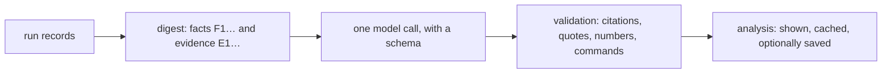

`reeval analyze` explains a run: what happened, what the numbers mean, why, and what to change. reeval computes the facts; one structured LLM call explains and ranks them, and reeval checks the answer before showing it.

```bash
# latest vs its nearest recorded ancestor
npx reeval analyze
npx reeval analyze latest --vs latest~2 --eval skill
# this run only: no ancestor
npx reeval analyze --vs none
# the digest for your own agent: no key, no call
npx reeval analyze --context
```

## Help

[//]: # (generated:cli-help:analyze)

```text
reeval analyze [run]          Explain a run with one LLM call over a digest of its facts (vs its
                              nearest recorded ancestor), citations and commands checked; cached
                              in .reeval/analysis (model: config.analysis.model)
  --vs <run>                  The run to compare with; none for this run only;
                              --eval <filter> only matching evals
  --save                      Also write it into the run's history folder: <run>/analysis/
  --context                   Print the digest and rules for your own coding agent (no key, no call)
  --dry-run                   Print the digest's size and the cache key, without calling the model
  --json --md --no-cache      The analysis as JSON or Markdown; --no-cache calls the model again
  --insights                  Write a run's insights instead: what each eval asks and its answer,
                              citing the facts, into <run>/insights.json, as reeval run does at its
                              end, or finish the evals one left unfinished; reeval show prints them.
                              Takes --json and -v
  -v, --verbose               With --insights, print each sentence the checks removed and why
```

[//]: # (/generated:cli-help:analyze)

## A real run

`--dry-run` shows the digest's size and cache key without calling the model:

```text
digest 20260926T174444Z_b010670_ada-lovelace_7gmj vs 20260926T174239Z_b010670_ada-lovelace_yzmg: 24 facts, 5 evidence items, 18 attempts
size 26510 characters ≈ 6628 tokens (cap 20000 in, 8000 out)
model google/gemini-3.8-flash · analysis-v2 · cache miss (.reeval/analysis/cb4f1ade460a94fdd4e5a9ddef213bd995e81adbbf4f83d0c4a7fa93e0a69398.json)
```

Then the analysis, over a real Cursor and Antigravity run with the skill compare (trimmed):

```text
analysing 20260926T174444Z_b010670_ada-lovelace_7gmj vs 20260926T174239Z_b010670_ada-lovelace_yzmg with google/gemini-3.8-flash…
analysis 20260926T174444Z_b010670_ada-lovelace_7gmj vs 20260926T174239Z_b010670_ada-lovelace_yzmg

TL;DR  The house-greeting skill was introduced in run r2 and produced a statistically significant +100 percentage point pass-rate lift over control for both Cursor and Antigravity harnesses. Without the skill, agents in the control cells could not guess the proprietary greeting convention and failed assertion checks. Evaluated baseline tasks hello-1 and hello-2 remained saturated at 100% pass rate …

Results
  - In a pooled factor analysis across 2 runs for cursor:composer-2.5 on eval 'skill', environment:with-house-greeting achieved a pass-rate lift of +100 pts (95% CI +31…+100, verdict: effect) and reduced tool calls by ×0.38 (p = 0.0286, verdict: fewer). [F11]
…
Suggested actions
  1. Increase attempt count on skill eval to reach statistical power for effort (eval · impact medium · effort low) [F10] [F11]
     verify: reeval run --runs 6 --tag skill
…
gemini-3.8-flash · analysis-v2 · digest v1 · 10381 in / 3196 out tokens · 13s · 29 citations checked, 0 invalid, 0 dropped · 1 commands checked, 0 rejected
```

The studio pins that TL;DR and its capped confidence under the run header when an analysis exists. Without one, the header still leads with a deterministic sentence: counted pass and fail, which judge keys failed, and the infra count. Saved analyses (and, in `reeval studio`, cached ones) stay on the run's Analysis tab, with each citation linking to its attempt:

<Image src="/assets/studio/run-analysis.png" alt="reeval studio Analysis tab with the TL;DR, what happened and results, each claim followed by fact and evidence citations" width={800} />

## How it works



1. **Digest.** The runs, an attempts table with short ids (`r2/skill/control#1`), each eval's id and tags, facts with ids (`F1…`: pass rate and lift, effort, factor effects by tier, skill reads, a `context-use` fact (each attempt's tool calls by class, from `context_use`, and which declared files each arm opened, from `skill_files`), the judge's scores, a `criteria` table of each check per cell, a `contrast` for each pair of arms when an eval has two variants or more (in place of the per-variant `checks` facts), failures, flaky cells, drift, the compare, and each `compare.questions` answer: rates by cut, votes, ties, the pairs whose two orders split, each pair head to head when more than two sides met, a failed call's error, and a sample of vote reasons), and evidence chosen by rule (`E1…`: failing attempts' final messages, judge questions and scores, failed checks and exec log tails, and the first tool calls of contrasting attempts), with transcript lines as `L<n>` and an attempt's n-th `c.exec` as `<attempt>:exec<n>`. Each attempt row lists its checks passed (`2/5`), the labels it failed and every judge's score by its `expect` label. The `criteria` fact gives each check (an assertion's label, or a judge's question) per cell as `passed/counted · mean score`, and names the checks no cell met (`neverMet`) and every cell met (`alwaysMet`): those can't tell the arms apart. Failures and evidence take one attempt from each cell in turn, so every arm is seen. When every cell in scope is ungated (`gate: 'none'`), the digest's `frame` is `study`: the run is a comparison of arms, not a pass/fail gate, and the TL;DR says how the arms differ. It's capped at `analysis.maxInputTokens` by dropping the lowest-priority evidence first. The model is told the verdicts, not asked for them, including `insufficient` (not measured) when lift has fewer than two counted attempts a side: `not enough attempts for lift (1 vs 1)`, never a results line. When sources or the eval fingerprint differ across the compared runs, the digest says `not comparable: the eval changed` and drops the mixed pass-rate (`6/10 vs 8/9` is not a results line); that difference is not an effect, and no pooled factor row straddles the pair. `--vs none` drops the ancestor: no drift, eval-changed or cross-run factor rows. Compare-question win rates annotate the run: they never change pass, fail or the exit code.
2. **Call.** One `generateText` call with a schema: a one-sentence TL;DR (what happened, how sure, why, next; no fact ids or intervals), what happened, results, why, anomalies, at most five actions (target, change, expected effect, verify command, impact, effort) and a confidence. Do not ask the model to self-rate the checks.
3. **Validation.** A claim, anomaly or action with no citation that names something in the digest is dropped, and so is one whose quote isn't in its cited evidence. Numbers no cited fact holds are flagged, including on anomalies. An anomaly (or claim) that quotes a judge score which is not the cited attempt's recorded score is dropped, so a wrong score cannot stay in the written explanation. Each verify command must parse as reeval's own CLI, with only that command's flags, and an `reeval run` or `reeval image build` must select an eval of the run (`reeval run` with filters or `--tag`; `reeval image build` with filters only). The digest lists each eval's tags. A `--tag` no eval has, or any other command the CLI rejects, drops the action. A rejected verify is not printed. After those checks, reeval caps `confidence.overall`: not `high` when `invalid`, `dropped` or `rejected` is above zero; `low` when a claim was dropped or a command was rejected. The capped value sits with the TL;DR; the counts stay in the footer.
4. **Storage.** Every analysis is cached in `.reeval/analysis/<key>.json`, keyed by the scope, the digest's hash, the prompt version and the model, so the same inputs never call the model twice (`--no-cache` does). `--save` also writes `<run>/analysis/<stamp>_<author>_<hash8>.json` and a `.md` twin into the history folder, create-only and after the secret scan. Only recorded runs can be saved into. Insights keep each eval's classification in `.reeval/analysis/classify/`.

## Insights

```bash
npx reeval analyze latest --insights
```

```text
writing insights for 20261020T231903Z_2e69951_cursor-agent_8s1m with fake…
wrote evals/.history/20261020T231903Z_2e69951_cursor-agent_8s1m/insights.json: 13 evals, 0 sentences removed by the checks. Commit it with git.
                 recommends Genkit for $task
  Not for a Python agent: 0 of 2 tries passed.
  case                        pass    Genkit
  pass  a chat app            2 of 2  2 of 2
  pass  a RAG pipeline        2 of 2  2 of 2
  fail  a Python agent        0 of 2  2 of 2
    It also names LangChain, so "names no other framework" fails.
…
```

`reeval run` writes a run's insights at its end when `analysis.model` is set (see [During a run](#during-a-run)); `--insights` writes them for a run that has none. Both use `analysis.model`, never the judge's model: what each eval asks and its answer, in sentences that cite the run's facts. They go into `<run>/insights.json` (in the history folder for a recorded run, `.reeval/runs/<run>/` otherwise), and `reeval show` prints them with the run from then on. A run's [remarks](/reference/cli/run#remarks) already there are kept in the new file. `--insights` takes a run, `--json` (the document instead of the blocks) and `-v`, and no other flag.

Per eval, one call classifies it from its name first, then its prompts, judge questions and check labels: its job (`choose` a tool, `finish` a task, or `other`), the question it asks and its subject. A low-confidence classification is `other`. A second call writes the answer and a sentence on each row the [layout](/concepts/output#insights) opens, from that eval's facts with each effect as a word. Then one call writes the run's headline.

The model sees each fact under a short id (`F1`, `F2`, … per call, `A1`, … for attempts, `A1#L12` for a transcript line) and cites those. reeval maps them back to the fact paths before it checks a sentence, so `insights.json` stores the paths, and a cite to an id the call never had is dropped like a missing one.

Every sentence is checked before it's kept, and one that fails a check is dropped, counted in `validation.dropped` and listed with its reason in `validation.drops`. `-v` prints each one:

```text
removed  greets in French › answer: "It never greets in French."
         cites F999, which isn't a fact it was shown
```


| Check | Drops |
|---|---|
| Citations | A sentence with no cite, or one naming a fact the eval wasn't shown; an id in the text, asked for once more (a trailing `(F2, F7)` is cut instead) |
| Numbers and quotes | An `N of M` that isn't a cited fact's own count (the facts count passes, so after `failed` it counts failures: over `0 of 4 passed`, `failed 4 of 4` is kept and `failed 0 of 4` dropped; a transcript line's text isn't a count; on a choose eval, a count whose clause names a tool after its last outcome verb, as in `recommended Genkit in 1 of 1 tries`, must be the tries that named that tool, as its row reads), another number the cited facts don't hold, or a span in double, single, curly or backtick quotes they don't hold |
| Effect words | `helped`, `made it worse`, `no difference` or `can't tell yet`, or a plain word for one (`helps`, `improved`, `worse`, `hurt`), that isn't the cited effect; `didn't help` claims none, and what the run's interrupt cancelled has no effect to cite. One in a clause the cited `can't tell yet` governs (`can't tell yet if it helped`) isn't a claim; the clause ends at a comma, colon, semicolon, dash, bracket or conjunction |
| Length | A sentence over 25 words, or an answer over two sentences |
| Plain words | Statistics jargon (`within noise`, `interval`, `variant`, `lift`, …), asked for once more (`validation.regenerated`) |
| Slots | A row sentence on a row the layout keeps closed, such as a passing or cancelled case, or a finding past an eval's three. A cancelled eval opens no findings and no row for an arm that moved |
| Repeats | A finding that repeats the answer, a row sentence or another finding in the same eval |
| Named tools | On a choose eval, a tool that isn't verbatim in that attempt's final message, as a whole word (`Gen` isn't in `Genkit`) |
| Headline counts | A headline that calls a tally number a count of evals (`22 evals` on a run of 13): the tally counts results, each case of a family one |

What the model writes never changes a verdict or the exit code. A reply that isn't the schema's JSON is asked for once more; a model call that still fails writes nothing, so the command can run again.

A complete file is never rewritten: delete it to write new insights. A file with unfinished evals, after Ctrl-C, calls that failed twice or a spent budget, is finished instead (below). When the run's facts no longer hash to its `factsHash`, `reeval show` leaves the insights out with a note. See [the insights file](/reference/record#insights) for its fields.

### During a run

```text
insights: 11 evals with google/gemini-3.8-flash (Ctrl-C skips the rest; --no-insights skips them all)
insights 3/11…
```

With `analysis.model` set, `reeval run` asks for insights once its last attempt finishes and its exit code is fixed, eight evals at a time, and prints each block with its sentences. They run to the end, with no overall time limit. On a terminal, the status line counts the evals settled, in place; piped or in CI, the heartbeat says so after a quiet minute (`… insights 8/11 after 13s`), and the agent output prints nothing until the result. `--no-insights`, or `analysis.insights: false`, skips them.

```text
pass             greet module › creates a tested greet module
  Yes, the agent created a tested greet module in 1 of 1 tries.
…
pass             recommends Genkit over the Vercel AI SDK
pass             recommends Genkit over Semantic Kernel
pass             recommends Genkit when choosing against LangChain
…
insights stopped: 7 evals skipped (Ctrl-C): reeval analyze 20261021T150812Z_bb8d414_cursor-agent_2k2d --insights to finish
2s · results .reeval/runs/20261021T150812Z_bb8d414_cursor-agent_2k2d/summary.md
16 pass
```

Ctrl-C (or SIGTERM) while insights run stops the calls in flight and starts no more. The sentences already written stay, `insights.json` keeps them and lists the rest in `stopped`, and the exit code is the run's own, not 130. A second Ctrl-C leaves at once, with the same code. Ctrl-C during the attempts cancels the run as before, and asks for no insights.

`analysis.maxTokens` (default 250000) caps the tokens of one run's insight calls. It goes to failing evals first, then to changes that made something worse, then to compares, then to infrastructure errors, then to the rest. Each eval reserves an estimate before it starts (6,000 tokens, then the mean of the evals that finished), and starts only when that fits what's left. Once the next one can't fit, no eval's calls start (those in flight finish), the evals it didn't reach print their facts, and the summary names how many. A budget under 6,000 tokens starts none. The run can still pass the budget by what the evals in flight spend over their estimates. The default covers about 45 evals on `google/gemini-3.8-flash`, whose thinking is most of each answer.

| Outcome | What prints |
|---|---|
| Ctrl-C or SIGTERM while they run | `insights stopped: N evals skipped (Ctrl-C): reeval analyze <run> --insights to finish` |
| The budget runs out | `insights skipped for N evals: analysis.maxTokens (250k) reached — raise it in reeval.config.ts, or reeval analyze <run> --insights to finish` |
| Some evals' calls fail twice | `insights failed for N evals (<reason>), so they print their facts: reeval analyze <run> --insights to finish` |
| Every eval's calls fail twice | `insights failed (<reason>): reeval analyze <run> --insights to retry` |
| The model's key isn't set | `insights skipped: <why>` |

### The caps

| Cap | Value | Measured on 104 evals, `google/gemini-3.8-flash` |
|---|---|---|
| Each eval's input | 24,000 characters of JSON (about 6k tokens) | largest 8,291, median 2,656 |
| Each call's output, thinking included | 20,000 tokens | largest 9,801 (9,468 thinking) |
| Each call's time | 3 minutes | slowest 68s, 95th percentile 46s |

The caps are fixed, not options. An eval over its input cap is cut the same way every time, and the model is told so: passing tries' messages go first, then older transcript lines, passing checks and effort, then the rest. Its verdict, cells and failing checks with their messages always stay. A reply cut off at the output cap, or a call past its time, counts as a failed call: the eval is tried once more, then prints its facts alone, and the other evals and the exit code are untouched.

### Finishing a run's insights

```text
$ reeval analyze 20261021T150812Z_bb8d414_cursor-agent_2k2d --insights
finishing insights for 20261021T150812Z_bb8d414_cursor-agent_2k2d with google/gemini-3.8-flash: 7 evals left…
wrote .reeval/runs/20261021T150812Z_bb8d414_cursor-agent_2k2d/insights.json: 11 evals, 0 sentences removed by the checks. Commit it with git.
…
All 16 results passed across greeting styles, module creation, and framework recommendations.
16 pass
```

When `insights.json` lists evals in `stopped`, `failed` or `budget.skipped`, `reeval analyze <run> --insights` asks about only those. It keeps every sentence already written as it was, asks for the headline if there's none, adds the new calls to `usage` and clears the lists it filled. It replaces the file whole, through a temporary file and a rename.

It needs the same facts, model and prompt version the file was written with, and refuses otherwise: delete the file to write new insights. A file with none of those lists is complete and refused as before.

Each eval's classification is cached in `.reeval/analysis/classify/<key>.json`, keyed by what it's read from, so an unchanged eval isn't classified again. Without the cache, reeval reads it from the last recorded run's `insights.json`.

## Configuration

```ts title="reeval.config.ts"
export default defineConfig({
  judge: { model: 'typesafe-ai/jev-1.14.0' },
  analysis: {
    // default: the judge's, when it's a language model
    model: 'google/gemini-3.8-flash',
    maxTokens: 250_000, // one run's insights, in and out
    instructions: 'Fewer tool calls count as a win.',
    maxInputTokens: 20_000, // the digest's cap (characters ÷ 4)
    maxOutputTokens: 8_000, // the answer's cap (not insights')
  },
})
```

<Property name="analysis.model" type="string" optional>
  A `provider/model` language model. `google/*` goes direct with `GOOGLE_GENERATIVE_AI_API_KEY`; anything else through the Vercel AI Gateway (`AI_GATEWAY_API_KEY` or `VERCEL_OIDC_TOKEN`). Defaults to the judge's model when that's a language model, except for `--insights`, which takes `analysis.model` only. Evaluation models such as `typesafe-ai/*` only score yes/no questions, so they exit 2 and point at `--context`.
</Property>

<Property name="analysis.insights" type="boolean" optional>
  Whether `reeval run` writes insights when `analysis.model` is set. Default true; `--no-insights` turns them off for one run.
</Property>

<Property name="analysis.maxTokens" type="number" optional>
  The tokens, in and out, one run's insight calls may use, at least 1. Default 250000. Going over it never fails the run.
</Property>

<Property name="analysis.instructions" type="string" optional>
  Your own guidance: what counts as a win, which skill is under test. It opens the prompt, before the digest and the rules, as the question the analysis answers.
</Property>

<Property name="analysis.maxInputTokens" type="number" optional>
  The digest's cap, at least 1000. Default 20000. Insights have [their own caps](#the-caps).
</Property>

<Property name="analysis.maxOutputTokens" type="number" optional>
  The answer's cap, at least 500. Default 8000. Insights have [their own caps](#the-caps).
</Property>

For tests, `fakeAnalysis({ output })` from `{{ pkg }}/judge` answers with canned output (or a function of the digest) through the same parsing and validation. A function that throws is a failed call. `fakeAnalysis({ insights })` answers `--insights` the same way; see [fakeAnalysis](/reference/judges#fakeanalysis).

reeval has no prices, so the footer shows tokens used and no cost.

## Errors

| Message | Fix |
|---|---|
| `reeval analyze takes --json or --md, not both` | Pick one |
| `reeval analyze --context makes no analysis to save; drop --save` | `--context` only prints the digest |
| `reeval analyze --vs names the run itself` | Name an earlier run, or `--vs none` |
| `reeval analyze --insights takes a run, --json and -v only, not --save` | Drop the other flags |
| `reeval analyze --insights needs analysis.model, and never uses the judge's model` | Set `analysis: { model: 'google/gemini-3.8-flash' }` in `reeval.config.ts` |
| `reeval analyze takes -v only with --insights` | Add `--insights`, or drop `-v` |
| `<run>/insights.json already exists, and insights are never rewritten` | It has no unfinished evals: delete the file to write new ones |
| `<run>/insights.json has unfinished evals, but it was written for other facts than this run's` (or `by <model> (<prompt version>)`) | Finishing keeps the earlier sentences, so it needs the same facts, model and prompts: delete the file to write new ones |
| `No eval in <run> matches "<filter>"` | Check `--eval` against `reeval show <run>` |
| A missing key, or an evaluation model | Set the key, set `analysis.model`, or use `--context` with your own agent |

## Related

- [Analysis](/guide/analysis)
- [reeval query](/reference/cli/query): the views the facts come from
- [Gates and lift](/concepts/lift)
